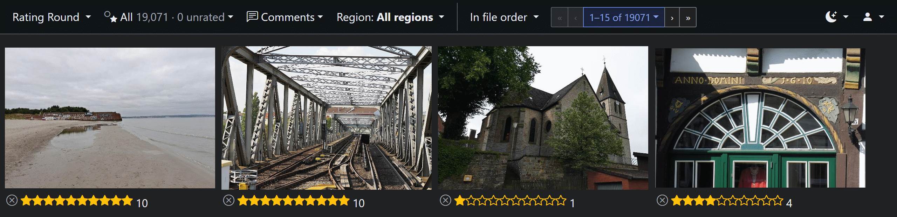
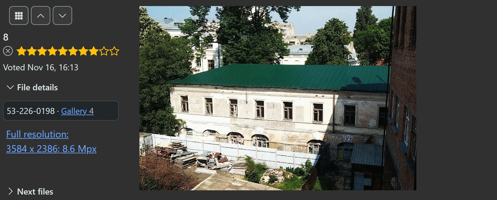

# WLX Jury Tool

A web tool for judging photos in the Wiki Loves Monuments and Wiki Loves Earth contests (and
similar ones). The photos are files on Wikimedia Commons; jurors select or rate them in rounds,
and organizers follow the results. More about the tool and its use in the contests:
[Commons:WLX Jury Tool](https://commons.wikimedia.org/wiki/Commons:WLX_Jury_Tool).

## Who uses it

- **Jurors** vote on the files of their rounds, in a gallery or one by one in the large view,
  from the keyboard or the mouse. They see only their own votes.
  Guide: [juror guide](docs/user/juror-guide.md).
- **Organizers** read the statistics, the results of all jurors, the file lists and comments of
  a contest. Guide: [organizer guide](docs/user/organizer-guide.md).
- **Admins** set up a contest: import its files from Commons, invite people, and create and run
  rounds. Guide: [admin guide](docs/user/admin-guide.md).
- **Root** accounts manage the contests of the installation.

One account can be a member of many contests, with a role in each. The pages are in English,
Ukrainian, Russian and French.

## What it does

- Contests are built from Commons categories, templates or lists of files.
- A round is **yes/no** (select or reject) or **rated** (1 to N stars, also by several
  criteria). A round can be limited by region, category operations (in A, not in A, both, either,
  A but not B), monument, size, media type or special nomination, and can leave out files by the
  contest's own members (conflicts of interest).
- Rounds are prepared in the background, with progress, Cancel and Retry; **Distribute new
  files** adds files that arrived later. A round stays hidden from jurors until it is ready.
- Galleries, a large view with keyboard voting, comments, round statistics and results.

What changed and when: [CHANGELOG.md](CHANGELOG.md), and
[what's new](docs/user/whats-new-26.11.md) for users.

## Develop and run

- Run it locally: [DEV.md](DEV.md).
- Make a change: [CONTRIBUTING.md](CONTRIBUTING.md) (branches, PRs, tests, UI, translations).
- Deploy and recover: [docs/deployment.md](docs/deployment.md).
- The practices and the rest of the documentation: [docs index](docs/README.md); open work:
  [roadmap](docs/plans/2026-11-02-roadmap.md).
- Reports of the latest master build: [Allure report](https://ukrainianwiki.github.io/wlxjury/allure/)
  and [test coverage](https://ukrainianwiki.github.io/wlxjury/coverage/).

## Security

See [docs/security/](docs/security/secure-coding.md): the rules, the review checklist, the register
and past reviews.

## License

GPL-3.0-or-later: see [LICENSE](LICENSE); third-party components and the options chosen for
dual-licensed ones are in [NOTICE](NOTICE). GPL-3.0 has its own patent licence (section 11).
Versions before the relicensing (2026-11) were released under Apache-2.0 and remain available
under it from their tags.
