# WLX Jury: a guide for administrators

This guide is for the admins of a contest in WLX Jury, and for root, the tool's own
administrators. A contest's admins are the people of its organizing team who set WLX Jury up for
it, usually one or two. The guide explains accounts and roles, how people are invited and sign in, the
settings of a contest, and how to run the judging: rounds, their files and jurors, and conflicts
of interest. The other members of the team, who help follow the voting, are **Organizers**: the
statistics, results and other pages they read are in the [organizer guide](organizer-guide.md),
and admins see all of them too. The people you add as jurors use the [juror
guide](juror-guide.md).

Labels in **bold** are the ones the tool shows in English. Terms: a **contest** is one
competition, a **file** is one photo or video, a **yes/no round** is a round with the rating type
**Yes/No**, and the roles are **Juror**, **Organizer** and **Admin**. Whoever installs and runs the tool
(servers, mail, sign-in providers, backups) finds that in the operators' [deployment
guide](../deployment.md); this guide doesn't repeat it.

Contents: [Accounts and roles](#a-accounts), [People](#a-users), [Invitations](#a-invitations),
[Signing in](#a-sign-in), [The contest](#a-contest), [Running the judging](#a-running) and [What
only root can do](#a-root).

<a id="a-accounts"></a>
## Accounts and roles

<a id="a-one-account"></a>
### One account per person

A person has one account, found by its email address, whatever the number of contests. The
account can be a member of many contests, with a role in each. A person who is a juror in one
contest and an organizer in another signs in once, and switches contest with the contest menu at
the top of the page.

Accounts are made by invitation only. The tool has no sign-up page: the sign-in page says that
accounts are created by contest admins.

<a id="a-roles"></a>
### Roles

A role belongs to a membership: one account, one contest.

| Role | What it can do |
|---|---|
| **Juror** | Votes in the rounds it is a juror of, and sees only its own files there (a monument's files too, from a [monument's page](organizer-guide.md#o-monuments)). Doesn't open the contest's files page. |
| **Organizer** | Reads the statistics, the results of all jurors, the contest's files and the conflicts page, and may comment on the files of an open round. Changes nothing else. |
| **Admin** | Everything an organizer does, and manages the contest: its people, rounds and files. |
| **Board**, **Audit committee**, **Staff** | No access to the contest's pages. These roles record that a person belongs to the contest, so that their own photos count as [conflicts of interest](organizer-guide.md#o-conflicts). |
| **No** | A member with no role: no access. |
| **Root** | Not a role of a contest: a property of the account (see [What only root can do](#a-root)). Root works in every contest without being a member. |

A person with no access role who opens a page gets the **Access denied** page, as the juror guide
describes.

<a id="a-current-contest"></a>
### The current contest

Each request runs in one contest, the **current contest**. It comes from the contest menu, and
when someone follows a link to a page of another contest they belong to, the tool switches to
that contest. Admins manage only the contests in which they are admins.

The contest menu groups a person's contests by **series** (see [Series](#a-series)): under
"Series: Wiki Loves Monuments in Nepal" this year's and last year's contest of that series, the
newest first; the older contests of series under **Earlier years**; the contests in no series
under **Other contests**. Someone with only one contest has no menu. A **retired** contest isn't
in the menu, and its members can't open it.

<a id="a-users"></a>
## People

<a id="a-users-page"></a>
### The users page

Open **Users** at the start of the top bar (in a gallery, on the Rounds and Statistics pages, or in a window narrower than 1280 pixels, in the pages menu there). The page lists the members of the current contest: **Full name**,
**Wiki account**, **Email**, **Role**, and a pencil to edit. Next to a wiki account there may be
two buttons that write to the person on Commons, a message on their talk page and an email.

A badge **unverified** after a wiki account says that nobody has proved that the account
belongs to this person: anyone could have typed it. A badge **unverified** after an email says
that the person hasn't accepted an invitation yet. A badge **password expired** says that the
person's password was set before version 26.11 and has stopped working: they need a link to set a
new one. The envelope button next to the badge sends it again.

A member without a wiki account whose files could be conflicts of interest shows **no wiki
account, can't be checked for conflicts of interest**. Add their wiki account in their edit
page.

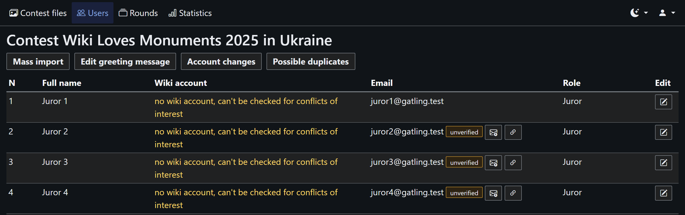

<a id="a-add-person"></a>
### Adding a person

At the bottom of the table, fill in the row: **Full name**, **Wiki account**, **Email**, the
**Role**, and press the button with the plus. A person needs an email or a wiki account. The text
under the table recalls which roles make the person's own photos conflicts of interest, and that
**Board**, **Audit committee** and **Staff** give no access (see [Roles](#a-roles)).

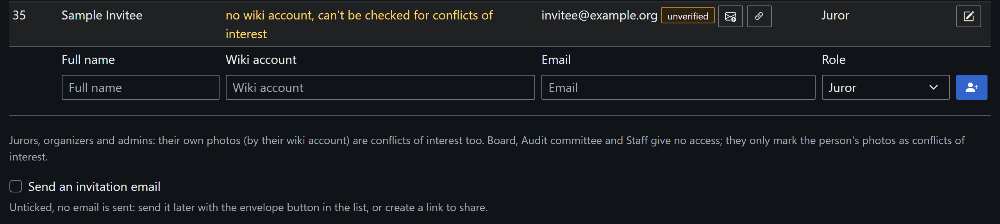

- **Send an invitation email**, under the table, is unticked by default: nothing is mailed. The
  person then gets in with a [link to share](#a-share-link) that you pass on, or a password you
  [set for them](#a-passwords); the envelope button next to them sends the invitation later. Tick
  it to mail the invitation (and, to someone who already has an account, the contest's greeting).
- A **new** email gets a new account, and an invitation by email if you ticked the box, see
  [Invitations](#a-invitations).
- An email whose account **exists** and whose owner has proved it (they accepted an invitation
  or a mailed link) joins your contest with the role at once. Nothing is changed in the account
  itself.
- An account that hasn't proved its email, for example one made unverified by a shared link,
  gets an invitation instead, and the role applies when they accept it. Unticked, the invitation
  waits in the invitations list as **Not sent**, for you to send or share.
- A **wiki account** (with no email) that an account already has, but that nobody has verified,
  adds nothing at first: the page asks you to pick the account you mean and confirm it, see
  [A wiki account nobody verified](#a-wiki-confirm). A role without access (**Board**, **Audit
  committee**, **Staff**, **No role**) is added at once, as before.
- A person added with a wiki account only has no email. They can't sign in with a password
  until you share a link or set one for them (only while Wikimedia sign-in is not set up, see
  [Sharing a link](#a-share-link) and [Passwords](#a-passwords)), or add the person by email to
  invite them.

The page tells you how many accounts were created, how many people joined and how many were
members already, how many invitations were not emailed because the box was unticked, and any that
could not be sent.

<a id="a-wiki-confirm"></a>
### A wiki account nobody verified

A wiki account stored in the tool says who holds the account only once its owner has signed in
with it through Wikimedia: until then anyone could have typed it into their own account, or an
admin of another contest could have mistyped it. So when you type, in the add row, a wiki account
(and no email) that such accounts have, nothing is added yet. The page **Confirm the account with
the wiki account** … lists those accounts **by name only**, none of them chosen; old contests
sometimes left several accounts with one wiki account, and one person may have several on purpose.

- Pick the account of the person you mean. The page shows the name you typed in the add row
  beside them, to compare. To see more about one first (its email, masked, and
  the contests of yours it is in), search for it under [Find an existing
  account](#a-find-account) on the users page.
- Tick **This is the person I mean** and press **Add to this contest**. Without a pick or the tick,
  nothing is added and the page says so.
- **Send an invitation email** and **Tell its owner by email** are both unticked, whatever you
  chose in the add row: tick them here for the account you picked. **Cancel** goes back to the
  users page.

The account is then added as if you had found it with the search (see [Finding an existing
account](#a-find-account)): an account whose owner proved its email joins at once; an account
with no password and no email joins at once too (see below); one with an email but no password
joins at once and needs an invitation to set its password; another gets an invitation, and the role
applies when they accept it. An invitation is mailed only if you ticked **Send an invitation
email**; unticked, the one that gives the role waits in the invitations list as **Not sent**, for
you to send or share, and none is made for the account that only needs a password: send it with
the envelope button, or create a link to share, from the users page. The message after the add names the account you confirmed with its email,
masked there if the account wasn't in your contests before; once it is in your contest (or
invited), the users page and the search show its email in full, as for anyone you add. Its owner
sees a notice in the tool when they next sign in.

**Be sure before you confirm:** the role goes to whoever signs in to that account, with its
password or its email, and that may not be the person you mean. If you are not sure, add the
person by email instead. Each confirmation is recorded in the account changes as **wiki account
unverified, confirmed by the admin**, and logged with your account.

An account with no password and no email (made with a wiki account only) is confirmed the same
way. Nobody can sign in to it until someone shares a link to set its password: if you can't (the
account is also in a contest you don't administer), the page says that the person signs in with a
link from root.

<a id="a-find-account"></a>
### Finding an existing account

Someone may already have an account from another contest, or from an earlier year, under an
email you don't know. **Find an existing account**, under the add row, searches every account in
the tool:

- by **any part of a name or wiki account**, at least 3 characters, in any letter case;
- by a **whole email address**. A part of an address finds only accounts that are in your
  contests (members, or invited and not yet accepted).

At most 20 accounts are shown; if more match, type more to narrow the search. Each shows its
**Full name** (a link to its edit page if it is a member of this contest), its **Email**, its
**Wiki account** (with **verified** if its owner proved it), the contests of yours it is in with
its role there, and whether it is in this contest already. The email is shown in full only for
accounts in your contests; for others it is masked, as `a***@example.org`, or **no email** (an
address typed into a name or wiki account is masked too, and such a name finds the account only by
its whole email). You never see an account's other contests. Root accounts are not shown.

Several accounts with the same name, or one person with several juror accounts, are normal (a
screening round may give one person several shares on purpose): the search shows them side by
side and doesn't suggest joining them.

To add one, pick its **Role** and press **Add to this contest**. It is added as if you had typed
its email in the add row (see [Adding a person](#a-add-person)): an account whose owner proved the
email joins at once; another gets an invitation, and the role applies when they accept it. An
account with a password but no email can't be invited and isn't added: ask root.
**Send an invitation email**, next to the button, is unticked by default; ticked, the mail goes
from the tool's own address, not yours. Whether you can then [share a link](#a-share-link) or
[set a password](#a-passwords) for the account follows the usual rule: not for an account that
is also in a contest you don't administer.

The account's owner always sees a notice in the tool when they next sign in: that you added them
to your contest, with the role. **Tell its owner by email**, also unticked by default, mails them
the same from the tool's own address; nothing is mailed unless you tick one of the two boxes. The
page says what happened: that the owner will see the notice, and whether the email went out (or
couldn't, for an account without an email). Once the account is in your contest (or invited to
it), you see its full email address on the users page and in the search, as for anyone you add by
email.

A person you added this way sees **An admin added you to a contest** under the top bar after
signing in; **See the details** opens their profile, which lists each add (the contest, who added
them, the role and what it lets them do), with **Dismiss**.

Each search is logged with your account and the number of results, never the text you typed.

<a id="a-mass-import"></a>
### Adding many people

**Mass import** takes a list: entries separated by commas or new lines, each a Wikimedia
account, an email, or a name with an email in angle brackets:

```
Wiki Account 1, Wiki Account 2
mail1@example.org, mail2@example.org
Name1 Surname1 <mail1@example.org>
```

Choose the role for all of them; the text under it says the same about the roles as the users
page. **Send an invitation email** works as on the users page (unticked: nothing is mailed). They
are added as in [Adding a person](#a-add-person), except that an import never asks you to confirm
an account: a wiki account nobody verified is counted as **Not added yet**, with a link to the
users page, where you type each such wiki account in the add row and
[confirm the account](#a-wiki-confirm).

To bring the people of another contest you administer, last year's jurors say, you don't need to
copy their emails into an import: see [Adding people from another of your
contests](#a-add-from-contest).

<a id="a-add-from-contest"></a>
### Adding people from another of your contests

**Add people from another of your contests**, on the users page, adds people who are members of
another contest of yours, for example last year's jurors. The button is there when you are an
admin of another contest (root sees it always). Pick the contest under **Contest to add people
from**: the contests where you are an admin, the newest first (root: every contest), and press
**Show its people**.

The list shows that contest's members: **Full name**, **Role there**, **Wiki account** (with
**verified** if its owner proved it), **Email** (in full: they are in a contest of yours) and
**Role in this contest**, which starts as their role there; a row whose role here is **Admin** is
bold. Root accounts are not listed for admins, nor retired accounts. **All**, **Jurors**, **Organizers** and
**Admins** show only the people with that role there.

- Nobody is ticked. Tick the people to add, or **Tick all shown**, and change a role where you
  need another.
- A person already in this contest can't be ticked: the row says **Already in this contest**, with
  their role here. Nor can a person already invited into it (**Invited already**): adding them
  again would cancel that invitation and make a new one.
- A person known only by a wiki account nobody verified (no email) can be ticked too: you pick the
  account itself, a member of your other contest, so there is nothing to
  [confirm](#a-wiki-confirm) as in the add row.
- **Send an invitation email** is unticked: nothing is mailed. Tick it to mail the invitations, as
  on the users page; ticked, the people who join at once also get the contest's
  [greeting](#a-greeting) by email.
- At most 200 people are added at a time.

Press **Add the ticked people**. Each person is added as **Add to this contest** in the search
adds an account (see [Finding an existing account](#a-find-account)): one whose owner proved the
email joins at once; so does one with an email but no password, which only needs the invitation
to set a password; another gets an invitation, and the role applies when they accept it
(unticked, it waits in the invitations list as **Not sent**). A person with neither an email nor
a password joins at once, and no invitation can reach them: the result says so, and they sign in
once you [share a link](#a-share-link) with them (or with a link from root, where you may not
create one). A person with a password but no email can't be invited and is skipped: ask root.
The role counts for [conflicts of
interest](organizer-guide.md#o-conflicts) as any role does. Each person added sees a notice in
the tool when they next sign in, which names the contest they were added from. Each add is listed
under [Account changes](#a-account-changes) with that contest, as "from Wiki Loves Earth 2020 in
Nepal (#20)", a link to its users page: this contest's admins see where the people came from
(the link opens only for that contest's admins and root). The users page then says how many
joined, how many were invited, how many were given the Admin role, and how many were skipped and
why.

<a id="a-edit-person"></a>
### Changing a person

The pencil opens the page **Edit user**. An admin can change, for members of the current contest:

- the **Role** in this contest (the text under it says which roles make the person's own photos
  conflicts of interest);
- the **Full name** and the **Wiki account** (a valid wiki name that no other account has; it
  is marked unverified);
- the **Email**, at once, also of a person who has a password: they keep the password and sign
  in with the new address, which is unverified until they use an invitation or a password link
  sent to it. They are signed out everywhere. If the old address was verified, it gets a short
  email saying that you changed it (the new address partly hidden). The email can't be changed
  to another account's address, nor removed from an account that has a password;
- **Send an invitation email**, unticked by default: ticked, the person gets an invitation at the
  (new) address; unticked, nothing is mailed to it. An account that can sign in (with a password,
  or with Google or Wikimedia) and whose address an admin set gets an invitation (also **Send the
  invitation again**, or an add to another contest) only from someone who may set its password, as
  for a [link to share](#a-share-link): not, for example, a fellow admin; ask root then. Once the
  person uses a link sent to the address, or root sets it, this no longer applies;
- if someone else changed the email after you opened the page, your save keeps their address
  when you left the field as it was, and refuses an edit of it: reload the page;
- the **Password**, with **Set password**, where you may: see [Passwords](#a-passwords). Set it
  and change the email in separate saves;
- a **Comment for the log**, optional: it is shown with this save's changes under
  [Account changes](#a-account-changes).

An account that also works in other contests can't be changed by an admin of one of them: the
admin may change the person's role in their own contest only, unless they administer all of its
contests.

<a id="a-wiki-account-taken"></a>
#### A wiki account another account has

If you type a wiki account that another account already has, nothing is saved, and the page shows
**Other accounts with the wiki account** … above the form: often the same person, who already has
an account from another contest or an earlier year. Some wiki accounts are on several old
accounts; up to 10 are shown, none chosen for you. Each shows what the search shows (see [Finding
an existing account](#a-find-account)): its name, its email (in full only if it is in your
contests, otherwise masked), its wiki account, the contests of yours it is in with its role, and
its **votes, comments and rounds in your contests** (root: in all contests), so you can tell an
account in use from an empty one. Root accounts are not shown to admins; the panel says when some
accounts are not shown.

- **Add that account to this contest instead** adds the other account, with the role you pick (the
  form's role is chosen), exactly as **Add to this contest** in the search: an account whose owner
  proved the email joins at once, another gets an invitation. **Send an invitation email** and
  **Tell its owner by email** are unticked by default; nothing is mailed unless you tick one. Its
  owner sees a notice in the tool either way. An account already in this contest shows its role
  instead.
- **Retire the account being edited** (unticked; next to each **Add that account to this contest
  instead**) also retires the account you were editing, once the other account is added: for one
  person who ended up with two accounts. It is offered only for an **empty** account: no votes, no
  rounds, no comments, no linked Google or Wikimedia sign-in, no API token. Retiring removes it
  from its contests, revokes its invitations and links, frees its email address (so the person's
  other account can take it), ends its sessions, and nobody can sign in to it again; it can't be
  undone here, and no mail is sent. Admins may retire an account only if it is a member of (or invited to)
  this contest and they are an admin of every contest it is in; an account that is an admin is retired by root only; never your own
  account. While a round of its contests is getting its files or a new juror (a job on its
  page), wait until that is done; a round held in review doesn't stop it. If the account you were editing has another wiki account, the panel says that the
  conflict-of-interest filter will check the added account's wiki account instead. If the account
  can't be retired, the panel says why instead of offering the checkbox. The account change log
  shows **Account retired** on both accounts, each naming the other.
- **Keep them separate** puts the account's wiki account back as it was and hides the panel; your
  other changes in the form stay, and nothing is saved until you press **Save**. Nothing is
  recorded: the next time someone types that wiki account, the panel shows again.

Unless you tick **Retire the account being edited**, the account you were editing stays as it was.
Each time the panel is shown, the log records your account and the number of accounts shown, as for
a search.

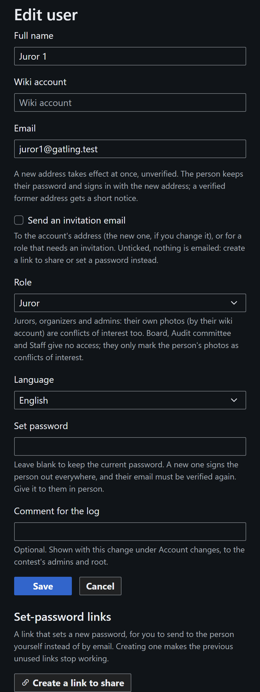

Root sees more on this page, such as the checkbox **Root (every contest)**: see [What only root
can do](#a-root).

A person's own email change, on their profile, still takes effect only once they follow the link
mailed to the new address.

<a id="a-account-changes"></a>
### Account changes

Every change an admin or root makes to someone else's account is logged: the email (old and new),
a password set, a role change, the name and wiki account, accounts created, invitations and links
to share, and whether an email went out, with who made it, when, and the optional comment. The
button **Account changes** on the users page lists the contest's changes, the newest first; a
person's **Edit user** page lists theirs. Only the contest's admins and root see them: they show
email addresses. Root sees every change of an account on its edit page, also those made in other
contests.

<a id="a-duplicates"></a>
### Possible duplicate accounts

The same person may have several accounts: one from an earlier year or another contest, created
under another email. **Possible duplicates**, on the users page, lists the groups of accounts that
look like one person's by one of two signs only:

- the **same wiki account**, written in any letter case, with or without `User:` and with
  underscores or spaces (`Anna K`, `anna_k`);
- the **same verified email**: one account's proven address is the address of another account's
  Google or Wikimedia sign-in. Root's report only, for now.

Nothing else pairs accounts: not the same name, and not working in the same round. A group is
listed in your contest's report if one of its accounts is a member of the contest or worked in it;
the report shows every account of the group, as the search shows it (see [Finding an existing
account](#finding-an-existing-account)): the email in full only for accounts in your contests,
masked otherwise, only the contests of yours each is in with its role there, and a link to the
edit page of the contest's members. Root accounts are not shown. Root sees every group, across
the contests and outside them, from the **Users** page of all contests. The report changes no
account and mails no one.

**Keep separate** records that the accounts are different people, or that one person keeps
several accounts on purpose (a screening round may give one person several juror accounts, each
with its own share of the files): the pair is then never listed again, for you or anyone else, and
there is no undo in the tool. In a group of three or more, **Keep separate from the others** on an
account's row keeps that account apart from the rest of the group (a screening portion), and
**Keep all separate** keeps every pair apart; the others stay listed while any pair of them is not
kept apart. Two accounts kept apart can stay in a group while a third account links them; the
report then says so. Only root, or an admin of every contest the group's accounts are in or worked
in, can keep them separate: an account that is also in a contest you don't administer shows the
group without the buttons. If the group changed since you opened the page (someone kept a pair
apart meanwhile), nothing is recorded and the page says so. Each Keep separate is logged with
your account and the accounts' ids.

<a id="a-join"></a>
### Joining two accounts

When the accounts of a group are one person's, **Join…** on the group (in the report, next to
**Keep separate**) opens the join's page; **Join the two accounts…** in the Edit user panel (when
another account has the wiki account you typed) opens it for those two accounts. Only root, or an
admin of every contest each account is in or worked in, sees these links and the page; an account
in no contest is joined by root only.

1. **Choose the account to keep.** Nothing is chosen for you. If only some of the accounts have an
   email their owner proved (verified, not set by an admin), only those can be kept. Press **Show
   what joining would do**.
2. **Check the preview** of each other account joining into the one kept:
   - **Contests:** each account's role in each contest and the role after; where both have one, the
     role with more access is kept (admin, then organizer, then juror, then the roles without
     access; *no role* loses to any other).
   - **Rounds:** each round of the account retired, both accounts' files, votes and votes set aside
     there, and the round's juror after (active if either was; a row where one of the two was
     stopped is marked). Where both accounts have the same file unrated, it is one assignment: one
     stays (**Assignments merged**).
   - **Collisions:** a file both accounts voted on in the same round (or one's vote and the other's
     set aside). **Any collision stops the join**: a join never drops a vote. A file only one of
     them rated, the other having it unrated, is not a collision: the vote is kept. Fix them
     by hand first (it happens mostly where one person was given two shares on purpose; then keep
     the accounts separate).
   - **What else changes:** the conflict-of-interest filter (the account kept keeps its wiki
     account, or takes the other's if it has none; a name stays verified only if the account that
     proved it is the one it came from), comments moved, the account's Google or Wikimedia sign-ins
     unlinked (their holder links them again from the account kept, after signing in to it), both
     accounts' API tokens and unused links revoked and their sessions ended.
   - Why the join can't start, if it can't: a collision; an account in another join; a juror being
     added to a round of theirs, a round of theirs being distributed or held in review (finish or
     cancel the review first), or a round job in a contest of the account retired; the account
     retired being an admin (root only), your own, or not a member of this contest (start from the
     report of a contest it is in).
3. **Tell both owners by email** is unticked: no mail is sent unless you tick it (the addresses
   masked, no link). Press **Join #… into #…**. In a group of three or more, join one account at a
   time into the one kept.

The join runs in the background, round by round; its page shows the progress and, when done, what
moved. From its start the account retired can't sign in, and neither account can be added to a
round. Until its first round has moved, **Cancel** stops it with nothing moved; after that it can't
be cancelled: if it fails (a round getting its files or a new juror, say), fix the cause and press
**Retry** (if whoever started it is no longer an admin of every contest of both accounts, it
finishes for you, if you are). Root can **Abandon** a failed join instead: what moved stays with
the account kept, the other account is not retired, and both can be used again. While a join
runs, neither account can be added to a contest, accept an invitation, or have its role or
password changed. When it is done the other account is retired (as **Retire the account being edited**
does: its email freed, nobody signs in to it again), its votes outside every round's results stay
with it, and the account change log shows **Account joined** and **Account retired** on both
accounts. It can't be undone.

<a id="a-invitations"></a>
## Invitations

If the email doesn't arrive, create a [link to share](#a-share-link) and pass it on yourself.

<a id="a-invitation-email"></a>
### The invitation email

A new member gets an email, **Invitation to the … jury**, with a link that is valid for a few
days. When the contest uses its own **greeting message**, the email is **Welcome to … jury**
instead, with the greeting's text and the link, see [The greeting](#a-greeting). The person opens the link, chooses a password on the page **Set your
password**, and is signed in. The email address is their login. The role applies once the
invitation is accepted. See [Accepting your invitation](juror-guide.md#accepting-your-invitation)
in the juror guide.

<a id="a-pending"></a>
### The invitations list

Under the users table, **Invitations** lists each person's latest invitation into the contest,
if it is still live or is from the last 30 days: the **Email**, the **Role**, how it was **Sent**
(**By email** or **Link to share**) and its **Status** (**active**, **used**, **expired** or
**revoked**, with the time). So you can see whether the person got it. For a live one:

- **Send the invitation again** mails a new link;
- **Create a link to share** makes a link to pass on yourself, see [Sharing a
  link](#a-share-link), where you may;
- **Cancel** cancels it: the link stops working.

A person whose link expired asks you to send it again.

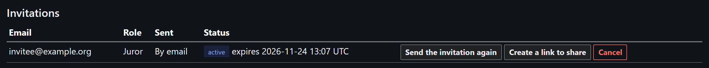

<a id="a-share-link"></a>
### Sharing a link instead of mailing it

When an email doesn't arrive, or you prefer to pass the link on yourself, you can create a link
to set a password and give it to the person directly, for example in a message.

**Where.** For an invitation not yet accepted, press **Create a link to share** on the users page
(in the list **Invitations**, or next to the person). For a reset of a password,
open the person's edit page and press **Create a link to share**.

**Who can create one.**

- **Root**, for any account.
- **A contest admin**, in their contest: for a member or a person invited into it, and for a
  reset only for an active member. The account must not be root or the admin themselves, must
  have only the roles **Juror** or **Organizer**, and every contest it belongs to, has worked in
  or is invited into must be a contest the admin administers.
- For a person who has no email, only if they have a wiki account of their own (one no other
  account has): it is then their login. Once Wikimedia sign-in is set up for the tool, not even
  then: such a person signs in with Wikimedia, with their wiki account, and the page says so.
  A link already shared with such a person then stops working too.
  A person with neither an email nor a wiki account of their own can't get a link.

**How it works.**

- The link is **single-use**: it works once, for the account it was made for. It expires like a
  mailed one, and the page shows **Expires**.
- It is **shown once**, on the page **A link to set the password**, with a **Copy** button.
  Reloading or resubmitting that page creates a new link and the one you copied stops working. If
  you lose a link, create another.
- Creating a link makes the account's earlier unused links of the same kind stop working, the
  mailed ones too. So an account has one active link at a time.
- The status of each link is shown as **active**, **used**, **expired** or **revoked**, with
  whether it was sent **By email** or is a **Link to share**: in the invitations list, and on
  the person's edit page.
- Mailing the invitation or the reset stays available.

**What using the link does.** The person chooses a password and is signed in. For a reset, it
signs out every other session of the account, and the old password works until the link is used.
A shared link doesn't prove that the person owns the email, because anyone who has it could use
it. So using it **marks the email and the wiki account unverified**: if another contest then adds
the person, they get an invitation by email first. Accepting a mailed link verifies the address
again.

Treat the link like a password: anyone who has it can set the account's password until it is
used. Pass it on to the person only, and not in a public place.

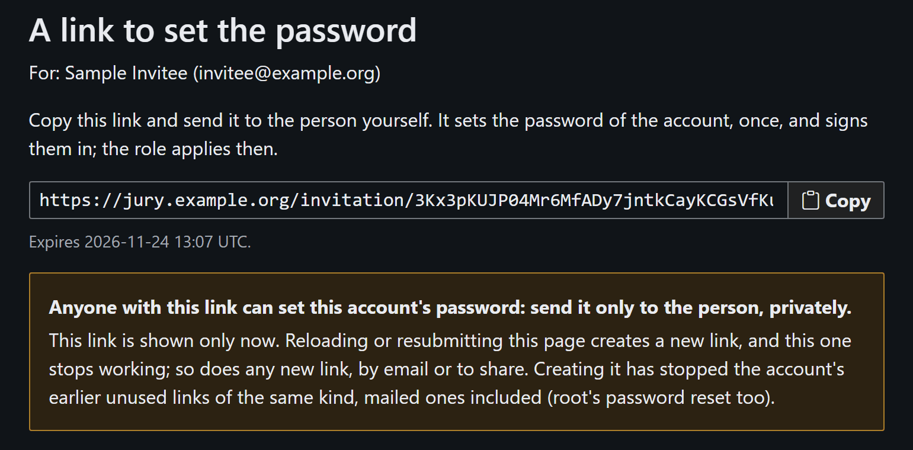

<a id="a-greeting"></a>
### The greeting

**Edit greeting message** on the users page opens the contest's greeting: the text a new member
receives. Tick **Send greeting to new users** to use it for new members, except that board,
audit committee and staff members don't get it. The page lists the variables you can put in the
text, and shows a preview for each member. Without a greeting the tool sends its standard
invitation.

The email never contains a password. Where your text has `{{Password}}`, the email says "the one
you choose with the link below"; the tool adds the link itself, after your text.

<a id="a-sign-in"></a>
## Signing in

<a id="a-password"></a>
### Password

A person signs in with their email address (or, if you set one, their wiki user name) and their
password. **Keep me signed in** is ticked by default. Passwords set before version 26.11 stop
working about three months after the update: the person then needs a link to set a new one,
which you can send from the users page. Their
[juror guide](juror-guide.md#signing-in-with-your-password) describes the page.

<a id="a-passwords"></a>
### Passwords: setting another person's

Nobody can see a password. There are three ways to give a person a new one:

- **Set password** on the person's edit page: you type the password and give it to the person
  yourself, in person if you can.
- A link to share: you pass it on and the person chooses the password
  ([Sharing a link](#a-share-link)).
- A mailed link: root mails one from the person's edit page (**Reset password**), and an admin
  invites an unverified member again, which does the same.

**Who can set a password.** The field **Set password** is shown, and accepted, only where you
may create a link to share for a reset, under the conditions in [Sharing a link](#a-share-link):
root for any account; a contest admin only for an active **Juror** or **Organizer** of their
contest whose every contest is one they administer, never root, another admin or themselves.
Anyone else's attempt is refused. Nobody, root included, can set a password for a person who has no
email where Wikimedia sign-in is set up (they sign in with their wiki account, and the page says
so), or who has no email and no wiki account of their own to sign in with (none, or one that
several accounts share). Your own password is changed on your
profile, with your current password.

**What setting it does.** It is the same as the person using a link to share:

- the new password works at once, and the old one stops working;
- the person is **signed out everywhere**, and their API tokens stop working;
- their **email and wiki account are marked unverified**: if another contest then adds the
  person, they get an invitation by email first, and accepting a mailed link verifies the
  address again;
- their linked Google and Wikimedia accounts are unlinked;
- their unused links (invitations, password and email-change links) stop working. An invitation
  that was waiting to give a role in a contest you administer gives it.

Leave the field blank to keep the current password. A password can be at most 72 bytes. Change the
email or the role and set the password in separate saves. The password is set after the rest of
the form is saved: if the person's account changed meanwhile so that you may no longer set it, the
page says that your other changes were saved and the password was not. Each password set is recorded in the security log, with the accounts' ids. The
person can then change the password on their own profile.

<a id="a-wikimedia-google"></a>
<!-- not offered yet (built, providers not set up): the section "Wikimedia and Google".

### Wikimedia and Google

If the tool's operators set them up, the sign-in page has **Sign in with Wikimedia** and **Sign
in with Google**. They sign a person in to the account they already have, and never create one.
The tool finds the account by the email address the provider confirms: for Wikimedia, the
person's confirmed email there; for Google, only a Gmail or Google Workspace address. The
account's email must be verified (an accepted invitation or link), or the account has no
password and a live invitation or password link to that address, which the sign-in then
accepts. Wikimedia also finds an account by its wiki account, but only one with no email and no
password that no Wikimedia account was ever linked to. A person can also **Link** the provider on
their own profile under **Linked accounts**, and **Unlink** it, which signs out the account's
other sessions.

When the same wiki account is on several jury accounts, the person chooses their account on the
page **Choose your jury account**, with its password or a link mailed to it. See [the juror
guide](juror-guide.md#when-one-wiki-name-has-several-jury-accounts).

Some changes unlink accounts, as the account may be changing hands:

- changing a person's wiki account unlinks their Wikimedia account (the name may now be
  someone else's), but not Google;
- changing the email of an invitee who has not set a password yet unlinks both, and sends a new
  invitation;
- **Reset password** (root), setting a person's password, and the person accepting an
  invitation or a password link unlink both.

Changing the email of a person who has a password unlinks nothing: the new address takes effect
when they follow the link sent to it.

Operators set the providers up in the [OAuth reference](../oauth.md).
-->

<a id="a-sessions"></a>
### Sessions

A signed-in session ends after a period without use, and at the latest a fixed time after
sign-in; the operators set both (30 days idle and 365 days at most, unless changed). A person can
end all their sessions on their profile: **Sign out everywhere** under **Sessions**. Changing a
password does the same, except in the browser it was changed in. Root can end the sessions of any
account with **End sessions** on its edit page.

<a id="a-api-tokens"></a>
### API tokens

Only root sees the API tokens section on their profile, for command-line tools: almost nothing
can be done through the API yet, and only by root, so nobody else can create a token for now. A
token acts with its owner's roles, so it must be kept secret. Ending sessions doesn't revoke
tokens: the owner revokes them on the profile, and root on any account's tokens page.

A token's **Access** is chosen when it is created: **Full** (the default) reads and writes from
anywhere; **Read-only, from the server only** is for the diagnostics tool run on the server over
ssh (`wlxjury-diag`): it only reads, and is refused on anything sent through the website. Both
token lists show each token's access. The contest's health report (**Contest health**) can also
be read through the API, by root and the contest's admins, as the page.

<a id="a-contest"></a>
## The contest

<a id="a-contest-settings"></a>
### Contest settings

A contest has a name, a country, a year, the Commons category or page its files come from (**Files source**),
a **monument id template** for monuments contests, a greeting, and its rounds. Root creates and
changes the contests on the **Contests** page. Its **Type**, **Country** and **Year** menus at the
top pick which contests are listed (by default those of the latest contest year; **All years**
lists every year), and **Order** lists the oldest or the newest first, or **By country**: by the
country's name in the page's language, International last, each country's contests by year.
**Country** goes by the contest's campaign if the tool knows it, else by its country text. A known country is one entry
under its name, however it is written ("UA" or "Ukraine"). **International** has the contests of
an international campaign and those whose country is empty or "International". Any other text
("Ukraine, Animals", a misspelling) is an entry of its own. After **Add** the list shows
the new contest's year, and after **Import** the imported contests' year (all years if they are
of several). Admins of a contest set up its
people ([People](#a-users)), its [greeting](#a-greeting), its [files](#a-import-files) and its
[rounds](#a-running).

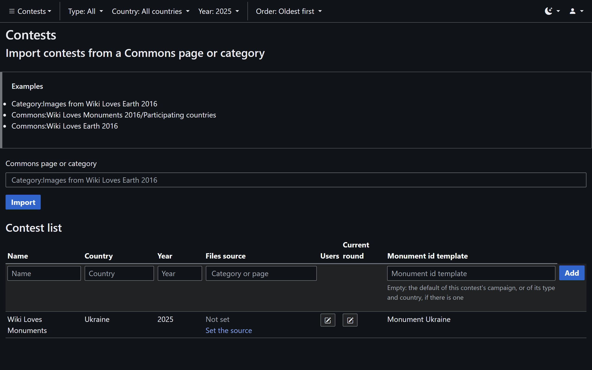

<a id="a-series"></a>
### Series

A **series** ties one contest per year across the years: "Wiki Loves Monuments in Nepal" holds
the 2024, 2025 and 2026 contests of WLM in Nepal. Each year stays its own contest, with its own
people, files and rounds. The **previous year's contest** is the series' contest with the next
lower year. A series is not a Montage series, which covers a whole competition.

Today only root creates series and puts contests into them (see [What only root can
do](#a-root)). Contests of a series show under its name in the contest menu. Contests in no
series work as before.

<a id="a-series-admins"></a>
#### Series admins

A **series admin** looks after a whole series, not one contest. Root makes someone a series admin
of a series; a series admin may add more series admins of their own series, but only root
removes them. Each grant has a **start year**:

- in the series' contests of the start year and later, a series admin is an **Admin**, whether the
  contest existed before the grant or not: rounds, settings, files, people, invitations and links,
  as a contest Admin can;
- in older contests of the series, a series admin is an **Organizer**: they see everything there
  but change nothing;
- where a series admin is a **Juror**, the series doesn't apply: they stay a Juror there;
- a series admin can't act on root accounts, other series admins, or people who also belong to a
  contest the series admin doesn't administer; only root changes a series admin's roles or
  account, in any contest.

A series admin's contest menu has one entry per series, **Series: Wiki Loves Monuments in Nepal
(Series admin)**, leading to the **series page**: its contests by year, with your role in each and
an **Open** button that makes it your current contest, and its series admins with who added each,
when and their start year. A series admin with no contest role of their own lands there when
signing in.

**Add a series admin** on the series page: pick a member of the contests where you are an Admin as
series admin (root: of any of the series' contests), then check the
start year and the list of contests showing what the grant gives in each (**Show for this year**
shows it for another year). The start year is filled in from the person's own history: the
earliest year they were an Admin of a contest of the series, but at most last year; with none,
last year. A series admin may choose from their own start year up to next year; root may choose
any year. Only root changes a start year later. Root sees each addition on its **Series** page.

On a contest's **Users** page, **Series admins:** names the series admins of its series; only
root manages them. The contest's **Account changes** list each grant, revocation and start-year
change of its series. Creating a contest from the series page comes with a later update.

<a id="a-more-than-one-admin"></a>
### Several admins

Make each person who runs the contest with you an **Admin** in the users page, and the team
members who only follow the voting **Organizers**. An admin of the contest can do all that this
guide says for it. It can't change contests it isn't an admin of, nor root accounts.

<a id="a-running"></a>
## Running the judging

This part is for the admins: the rounds, their files and jurors, starting and stopping them, and
conflicts of interest. Following the voting and reading the results, which admins and organizers
both do, are in the [organizer guide](organizer-guide.md): the
[statistics](organizer-guide.md#o-statistics), the [results](organizer-guide.md#o-results), the
[CSV](organizer-guide.md#o-csv), the [contest's files](organizer-guide.md#o-contest-files) and
the [conflicts page](organizer-guide.md#o-conflicts-page).

<a id="a-contest-and-rounds"></a>
### A contest and its rounds

A **contest** has **files**, the images and videos taken from Commons, and **rounds**. A round is
one stage of judging: its own files, its own jurors and its own votes. A typical contest has a
first round that every file goes through, and later rounds that take only the best files of the
earlier ones.

<a id="a-round-kinds"></a>
### Kinds of rounds

The **Rating type** of a round is one of:

- **Yes/No** (a yes/no round): jurors select or reject each file.
- **1-N rating**, a rated round: jurors give each file from one star up to N stars, with N from
  3 to 20. A rated round can also use criteria and the worst mark, described below.
- **Comments only**: jurors take no votes, only write comments.

The rating type is chosen when the round is created and can't be changed afterwards.

A **rated round with criteria** (for example Aesthetics, Technical quality, Usefulness for
Wikipedia) asks for stars on each criterion; a file's rate is the sum. You choose 1 to 10
criteria for the round from the shared **Criteria catalogue**, which has a link on the round
form: **Add criteria** shows a criterion's list, **Add another criterion** one more, and × beside
a criterion removes it. With one criterion the round is rated as usual (the file's rate is that
criterion's stars, and the digit keys rate it), and the large view shows the criterion's name.
If the contest's latest round has criteria, a new round starts with them and with that round's
rating type; otherwise it starts as Yes/No without criteria. Choose another rating type, or remove
the criteria with ×, to drop them. Once a round is started (running, or with a vote), its criteria can't be
changed: the form lists them, and a round started without criteria can't get any. A round
stopped before its first vote keeps the full form.

<a id="a-stages"></a>
### The life of a round

1. You create the round on the round form. The tool then gives its files to its jurors in the
   background. While it does, the round is hidden from jurors.
2. When all files are given, the round starts: jurors see it and vote.
3. You follow the voting on the [statistics page](organizer-guide.md#o-statistics), as the
   contest's organizers do.
4. You stop the round when the voting ends. Votes are kept.
5. You read the results and, if there is a next round, create it from these results.

<a id="a-rounds-list"></a>
### The rounds list

Open **Rounds** at the start of the top bar (or in the pages menu there). The list shows, for each round: its **Number** (a link to the
round form), its **Name** (a link to the round's statistics), the **File distribution**, the **Rating type**, whether it is
**Active** (started), the number of **Images** and the state of its distribution. The
**Contest health** link under the contest's name opens the contest's health report (see
[Importing the contest's files](#a-import-files)).

Before each name, an icon shows the round's type: a tick and a cross for **Yes/No**, a star for
**Rated** (a criteria round is rated too; a comments-only round has no icon). The icons are in
colour for a started round and in grey for a stopped one; pointing at them shows the type and the
state. The **Type** menu shows the same icons as a legend. A stopped round's row is in grey; its
links still work.

With many rounds, the menus in the top bar narrow and order the list:

- **Status:** **All**, **Active** or **Not active** rounds.
- **Type:** **All**, **Yes/No** or **Rated** rounds (a comments-only round shows under **All** only).
- **Order:** **Oldest first** (the order in which the rounds were created), **Newest first**, or
  **Active first** (the started rounds, then the others, each group oldest first).

Each item shows in grey how many rounds it would list. The choices stay in the page's address, so
a reload or a link keeps them, and the round's statistics (the round's name, **Statistics** in the
pages menu) open with the same choices, which narrow the row of rounds there; **Rounds** from there
comes back to the same list. Starting or stopping a round, and the round form's **Save** and
**Cancel**, come back to it too. With no choice made the list is all rounds, oldest first.

**Add round** creates a new round.

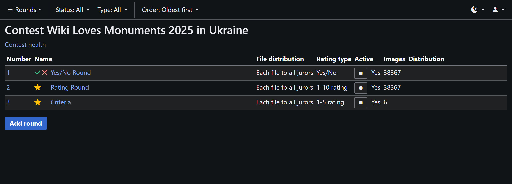

<a id="a-create-round"></a>
### Creating a round

Press **Add round**. The page **Create round** has these parts, from the top:

- **Round name (optional)**: a name for the round next to its number.
- **Media filtering**: which files the round takes. [Choosing files](#a-choose-files) describes it.
- **Leave out conflicts of interest**: see [Leaving them out of a round](#a-leave-out-conflicts).
- **Add files**: a list of files to add, see [Adding files by name](#a-add-files).
- **Rating type**: see [Kinds of rounds](#a-round-kinds).
- **File score**: see [The file score](#a-score-rule).
- **Worst mark**: see [The worst mark](#a-worst-mark).
- **Criteria**: see [Kinds of rounds](#a-round-kinds).

The form has no jurors: the round's images are selected first, and nothing goes to the jurors
until you choose them on the round's **jurors form** and distribute it
([Choosing the jurors](#a-round-jurors)). The form ends with two buttons:

- **Review images first**: you go to the rounds list, where the round shows the selection of its
  images. The round then waits for you on its review page, hidden from the jurors: see
  [Reviewing a round's images](#a-review).
- **Choose jurors next**: you go to the round's jurors form, which shows the selection's progress
  and then the jurors and the file distribution.

**Cancel** leaves the form without saving anything.

If you press Save twice, or send the form again from the browser's Back button, the tool makes
one round, not two, and tells you.

The jurors are chosen on the jurors form when the round is distributed, and can't be changed on
the form of a distributed round. To work with other jurors, create another round. Later you can pause and resume
a juror, see [Pausing a juror](#a-pause-juror).

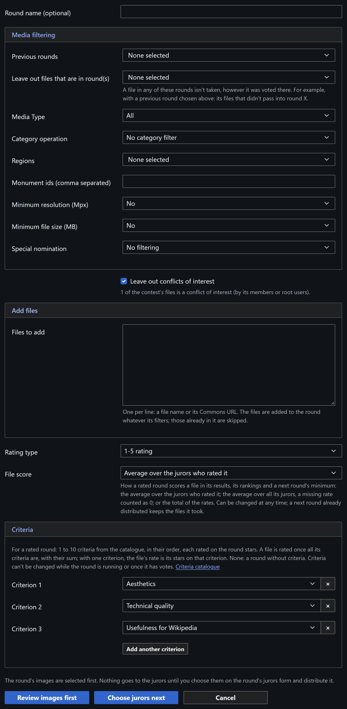

Here the contest's latest round has criteria, so the form starts with them and its 1–5 rating;
with criteria the form has no worst mark.

<a id="a-choose-files"></a>
### Choosing the round's files

The **Media filtering** section of the form decides which of the contest's files go into the
round. Leave a filter at its default to not use it. Filters add up: a file must pass all of them.
A round for all the files takes no filters at all.

**From earlier rounds**

- **Previous rounds**: take the files of one or more earlier rounds, which must all be rated the
  same way (all yes/no, all comments only, or all rated on the same scale with the same number
  of criteria). With none chosen, the files come from the whole contest, and the filters below
  that name earlier rounds don't apply. With several, each earlier round a file was in is
  checked on its own, with its own jurors, votes and file score: a file is taken if it passes
  the filters in at least one of them.
- **Selected by at least X jurors**: for earlier yes/no rounds. A file is taken when at least X
  jurors selected it (X from 1 to 6). **No filter** takes all the files of the earlier round.
- **Average file rating is at least**: for earlier rated rounds. A file is taken when its score
  in the earlier round is at least this number. The score follows that round's
  [file score](#a-score-rule): with the total of the rates it is a total, and for a round with
  criteria it is the sum of the criteria's rates, averaged over the jurors. The hint under the
  field says which applies.
- The **rejection filter**: take or drop files by how many jurors rejected them in the earlier
  rounds. See the next section.
- **Leave out files that are in round(s)**: choose one or more other rounds of the contest. A file
  that is in any of them isn't taken, whatever the votes it got there. It works with or without
  previous rounds, and with every other filter. See the [example](#a-leave-out-rounds) below.

**By the file itself**

- **Media Type**: **All**, **Video** or **Image**.
- **Category operation**, **Category A** and **Category B**: the Commons categories the file
  must be in. The operations are **No category filter**, **In category A**, **Not in category A**,
  **In both A and B**, **In A or B (or both)** and **In A but not B**. Typing in a category
  field suggests Commons categories.
- **Regions** and **Monument ids (comma separated)**: for contests where the tool knows the
  regions (at present Ukraine's, Wiki Loves Monuments and Wiki Loves Earth alike). Choose one or more
  regions, or list monument ids. A file's region is the first part of its monument id (`07` of
  `07-101-0001`). The list has only the real regions, so a file of a special nomination (its own
  monument id prefix) or a file without a monument id is left out by any choice of regions. To
  leave out just these files, tick **Select all** at the top of the regions list.
- **Minimum resolution (Mpx)** and **Minimum file size (MB)**: leave out small files.
- **Special nomination**: only the files of one special nomination, for contests that have them.

Most of these filters can only be set when the round is created. On an existing round the form
shows them, but they can't be changed.

<a id="a-leave-out-rounds"></a>
**Example: the files of the previous round that didn't pass into round X.** Round Q-00 still has
files nobody voted for, and round Q-01 took its selected files. A round Q-00-1 for the rest of
Q-00 (its rejected and unvoted files), of 4 Mpx and up, without the special nominations, with one
of four jurors per file, yes/no:

- **Previous rounds**: Q-00. **Selected by at least X jurors**: **No filter** (all of Q-00's files).
- **Leave out files that are in round(s)**: Q-01.
- **Minimum resolution (Mpx)**: 4.
- **Regions**: **Select all** (the special nominations' files have no region of the list).
- **Jurors**: the four jurors; **File distribution**: each file to 1 juror; **Rating type**: Yes/No.

The round keeps the setting: "Distribute new files" later leaves out the files that are in Q-01
then. The files of the rounds to leave out are read while the round's distribution runs, so a file
that reaches Q-01 after that stays in Q-00-1 too. The form therefore refuses a round to leave out
that is still being distributed, or whose creation's distribution failed ("The round to leave out,
Q-01, is still being distributed, or its distribution failed…"): let it finish, or retry it, then
save again. In the same way "Distribute new files" on Q-01 (or resuming its failed distribution) is
refused while Q-00-1 is being filled ("A round that leaves out this round's files, Q-00-1, is still
being filled…"), and a Retry of Q-01's distribution on its job page fails with that message:
distribute again when Q-00-1's distribution has finished. The form also refuses the round itself, rounds of another contest ("The
rounds to leave out must be other rounds of this contest") and a round that is also a previous
round of the new round, which would leave it with no files ("A round to leave out can't also be a
previous round of this round…").

<a id="a-rejection-filter"></a>
### The rejection filter

The rejection filter uses how many jurors rejected each file in an earlier round, each earlier
round on its own. It works with earlier yes/no rounds, and with earlier rated
rounds without criteria, where a worst mark counts as a rejection. It shows once you choose
such a previous round.

It has two fields. **Rejected files** is the mode:

- **No filter (keep rejected files)**: rejections don't matter.
- **Exclude files rejected by at least X jurors**: a file is left out when X or more jurors
  rejected it. This drops the files that jurors agreed were bad, for example after a screening
  round where jurors rejected only the few worst files. With several earlier rounds, a file is
  left out only if X or more jurors rejected it in each of the earlier rounds it was in.
- **Only files rejected by at least X jurors**: a file is taken only when X or more jurors
  rejected it. This is for a round that looks again at the files that were doubted.

The second field, **X: rejected by at least X jurors**, is the number, from 1 to 6. The filter
combines with the other filters of the round.

The form refuses these choices: a mode with no X ("Choose X, the number of jurors…"), an X with
**No filter** ("Choose whether to exclude the rejected files or take only them, or clear X"), and
the filter with no previous round that has rejections ("The rejected files filter needs a previous
round with rejections: a yes/no round, or a rated round without criteria").

<a id="a-add-files"></a>
### Adding files by name

In **Add files**, type or paste file names or Commons addresses, one per line, in **Files to
add**. The tool adds these files to the round whatever its filters say. Files already in the
round are skipped. If a line doesn't name a file, nothing is added and the page lists the lines.
You can add files this way both when you create a round and later.

<a id="a-distribution"></a>
### The distribution of files

After you save a new round, the tool gives its files to its jurors as a **background job**. The
rounds list, and the top of the round form, show the job under **Distribution**: its state,
for example queued or running, and its progress as a number of files done out of the total.

While the job runs the round is hidden from jurors, and you can't start it: the tool says
that its images are still being distributed. The round starts by itself when the distribution
has finished. You can leave the page and come back.

- **Cancel** stops the job. It shows while the job runs and after it fails.
- **Retry** runs a failed job again, from where it stopped. It shows only for a failed job.

If a job fails, the state shows why. A message with a **reference** is for the contest's tool
administrators: send them the reference. If the tool stopped for a while while a job was running,
it takes the job up again by itself.

A round has one distribution job at a time. Starting a second one for the same round, for
example from another browser tab, tells you that its images are already being distributed.

<a id="a-review"></a>
### Reviewing a round's images

A new round's images are selected first and wait on the round's **review page**, so a wrong filter
is caught before any juror gets a file. When they are ready, the rounds list shows **Images ready:
N** with **Review** and **Distribute to jurors** (which opens the jurors form); the round form and
the round's statistics link the page too.

The review page shows the round's files as the contest's files page does (tiles, pages, the place
menu, the large view), with tabs for the files **In the round**, **Deleted on Commons** and
**Disqualified**, each with its number of files after its name. Above them: how the files were added (by the round's filters, from a pasted
list, ...), the round's conflicts of interest, if it has any, and its jurors.

- The **place menu** in the bar lists the contest's places with the files of the tab shown in each:
  the countries of an international contest (by the contest's country categories), the regions of
  a national one. Open it to check that each country (region) has the number of files it should;
  choosing a place shows only its files.
- In a file's large view you and the contest's organizers can write **comments**. They are the
  round's ordinary comments: jurors see them once the round is distributed, not before (also
  the jurors of other rounds with the same file).
- **Distribute to jurors** opens the round's jurors form ([Choosing the jurors](#a-round-jurors)).
  Until the round is distributed it is hidden from the jurors: they don't see it in their menus,
  its gallery or its large view.
- To change the files, open **Edit the round**. While the round waits for review and has no votes,
  its filters (previous rounds, categories, regions, sizes, ...) can be changed and the main button
  is **Re-apply filters**: the images are selected again. Files the filters chose before (also those
  **Distribute new files** added) that no longer pass are taken out, new matches are added, a top-N is chosen again from scratch (files you
  disqualified don't take a place in it). Files added from a list and disqualified files stay as
  they are. The review page then shows how many files were added and removed, and the first
  removed files by name. Check the files again, and re-apply again if needed. If a re-apply fails or
  is cancelled, the review page says so and **Distribute to jurors** waits until you re-apply the
  filters again or retry its job. The other settings of the form (its name, ...) are saved only with a
  re-apply that starts.
- If votes in the previous round(s) change after the images were selected, the review page and the
  jurors form warn you. Re-apply the filters to select by the current votes, or tick **Distribute
  anyway** on the jurors form to give out the images as they are.
- A file deleted on Commons while the round waits is never given to a juror.
- If you cancel a round's creation on its job, the round is cancelled. **Distribute new files** on
  its form reinstates it: its images are selected again and it waits for review again. The tool
  records who did it.

The contest's organizers see the review page too, without the Distribute button; they can't
open the jurors form or re-apply the filters.

<a id="a-round-jurors"></a>
### Choosing the jurors

A round's **jurors form** is where its jurors are chosen and its files given out. It opens from
**Choose jurors next** on the new-round form, and from **Distribute to jurors** on the review page
or the rounds list. While the round's images are being selected it shows the progress, and the
form when that is done.

The form shows the number of images that passed the round's filters and, for a contest with
places, the number in each country (region). Then:

- **Jurors**: the people who vote in this round. They show the round's jurors, or, for a round
  without jurors yet, all the contest's jurors; change them as you need. If the contest has no
  jurors yet, the form links the contest's users: add them first.
- **File distribution**: **Each file to all jurors**, or **Each file to N juror(s)**, for contests
  with so many files that each juror takes a part. The files are shared out so that each file goes
  to the number of jurors you chose.
- **Distribute to jurors** gives each juror their share and opens the round to them when it has
  finished. You go to the review page, which shows the progress.

Nothing is distributed before you press the button. The tool refuses, and says why on the form,
when no juror is chosen, when a file would go to more jurors than are chosen, when the round's
jurors changed since you opened the form (open it again), when the last re-apply of its filters
didn't finish, or, without **Distribute anyway**, when the previous rounds' votes changed. Once a
distribution has started (the round has votes), its jurors can't change any more.

<a id="a-distribute-new-files"></a>
### Distributing new files

When files are added to the contest after a round was created, or a file list is added to it,
the round can take them. Open the round form: the box **Distribute N new files** is there, and
**Count** shows how many files the round would take. Tick the box and press **Save** to start the
distribution of these files to the round's jurors, by the same filters as before.

The round keeps its own settings. For example, a next round whose files were taken from this
round by its score keeps the rule it started with.

<a id="a-edit-round"></a>
### Changing a round

Open the round from the rounds list: its number is a link. On an existing round you can change:

- the round's name;
- the [file score](#a-score-rule) and, in a rated round, the [worst mark](#a-worst-mark), at any time;
- in a rated round, the criteria, only before the round is started (not running and no vote
  yet; a yes/no or comments-only round's form has neither);
- **Leave out conflicts of interest**, see [Leaving them out of a round](#a-leave-out-conflicts);
- **Add files** and **Distribute N new files**.

The rest of the form is shown but can't be changed: the files' filters, the rating type and the
file distribution. To start over, create another round. The panel **Jurors** shows each
juror's counts, as the [statistics page](organizer-guide.md#o-statistics) does.

**Cancel** leaves without saving anything.

At the bottom of the form of an existing round there are also the button **Conflicts of
interest of this round**, and, where the tool's operators have set up a local image cache,
**Download images locally**, which fills it for this round's files.

<a id="a-score-rule"></a>
### The file score

The **File score** option decides how a rated round gives a file its score. The score is shown
in the results and ranks the files, and a next round's minimum score uses it. The three rules
are:

- **Average over the jurors who rated it**, the default: the file's rates added up and divided
  by the number of jurors who rated it.
- **Average over its assigned jurors (unrated counts as 0)**: the rates divided by the number of
  jurors the file was given to, a juror who didn't rate it counting as 0.
- **Total of the rates (a file a juror skipped adds nothing)**: the rates added up, not
  divided.

The results show what the score is divided by, for example "14.50 (29 / 2 of 3 jurors)" or "29
(sum of 3 jurors)".

You can change the rule at any time. It changes the scores and the order of the round's results
on every page at once, and nothing is recomputed in the background. **The page warns you** when
the round has votes and you pick another rule. The warning says that:

- the results are re-scored and re-ordered everywhere, at once;
- a distribution that is already queued or running keeps the rule it started with;
- the later rounds that took their minimum score from this round are named. Their
  files don't change, but a later **Distribute new files** there uses the new rule.

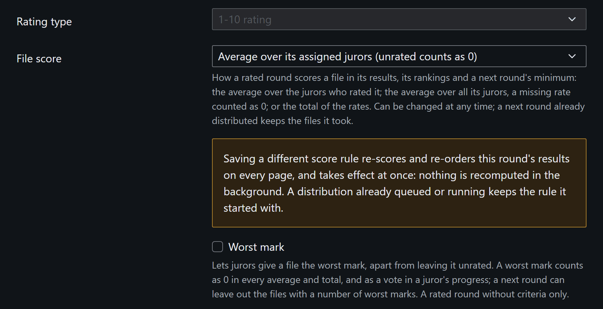

<a id="a-worst-mark"></a>
### The worst mark

The **Worst mark** option is for rated rounds without criteria. It is off by default. When it is
on, a juror can give a file the worst mark, shown as an X icon, for a file worth fewer than one
star, which is different from leaving it unrated:

- a worst mark counts as 0 in every average and total;
- a worst mark is a vote: the file counts as rated in the juror's progress and in the round's
  count of jurors who rated it;
- the results show the number of worst marks ("n worst marks") beside the file's score, for a
  file that has them: the file list, the by-rate gallery, the large view of all jurors and the
  CSV;
- a next round can use the worst marks in the [rejection filter](#a-rejection-filter).

Jurors give a worst mark with a button and clear a vote with another, see the [juror
guide](juror-guide.md#rated-rounds-stars). The form hides the option for a yes/no round, a
comments-only round and a round with criteria (and refuses it there if it is sent anyway). You can turn it on or off on an existing round.

<a id="a-import-files"></a>
### Importing the contest's files

Admins bring files into the contest with **Import and cache** on the [contest files
page](organizer-guide.md#o-contest-files); root also from the **Files source** link of the
contest (**Set the source**, if it has none) on the contests page. The page's **Files source**
takes a Commons category or a page, or a pasted list of files in **Or image list**, and **Import
files** adds them.
Imports only add: no file is removed, and all the contest's rounds choose from these files.

**A name without `Category:`.** A source that starts with `Category:` or `Template:` (or another
namespace, such as `Commons:`) is read as it is, and so is a pasted list. A name without any such
prefix, for example `Images from Wiki Loves Monuments 2026 in Nepal`, is checked on Commons first,
for **Import files** and **Update monuments** alike, before anything starts:

- if Commons has only a page of that name, or only the category `Category:<name>`, the import
  uses that one (a category is saved as the contest's source with its `Category:` prefix);
- if it has both, the page asks which one you mean and shows each one's file count, with a link
  to look at it on Commons. The category is chosen, as it usually is the one meant; check that
  the names and counts are what you expected (a page of the same name may exist by chance, or the
  name may have been copied from the wrong place), change the choice if needed, and press the
  button again;
- if it has neither, nothing starts, and the page says so: check the name, or add `Category:` in
  front of a category's name;
- if Commons can't be reached to check it (within a few seconds), nothing starts and the page
  says so, keeping the name: the import needs Commons anyway. Try again later, or add
  `Category:` in front of a category's name yourself.

**An import that found nothing.** When a finished import added no file (its source gave none, or
only files that are missing on Commons or in none of the contest's country categories), the page
says so under the import, so that you can check the name. When an import from a page left files
out as in no country category of this contest, it says how many: the page is likely another
contest's or another year's.

For monuments contests **Update monuments** refreshes the files' monument ids, and for Ukrainian
contests reads the monument lists on Wikipedia: each monument's name, place, Commons category
and Wikidata item, which the [monument's page](organizer-guide.md#o-monuments) shows. Monuments
read before the Wikidata items were stored get theirs the next time it runs. Where the tool's
operators have set up a local image cache, **Download images locally** fills it. These run as
background jobs, with their progress. When the download has nothing to fetch, it says whether all
the files were already cached or there were none, with the time it checked.

**Contest health**, under the contest's name, opens a read-only report on the contest: its
files and import sources, and checks of its rounds (for example empty, frozen or being
created, and which are open to jurors). Only the contest's admins and root see the link and the
page.

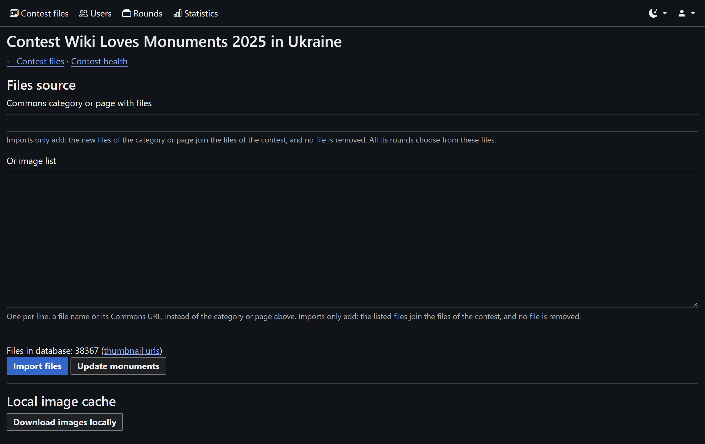

<a id="a-start-stop"></a>
### Starting and stopping a round

In the rounds list, the **Active** column shows **Yes** or **No**. The button in it, a play or a
stop icon, starts the round (**Start the round**) or stops it (**Stop the round**). The
conflicts page of a round has a **Stop the round** button too.

A round whose files are still being distributed can't be started; it starts by itself when the
distribution is done.

<a id="a-pause-juror"></a>
### Pausing a juror

In the **Start/Stop** column of the [statistics page](organizer-guide.md#o-statistics), the
button next to a juror's name pauses their voting in that round (**Pause the juror's voting**),
and the same button resumes it (**Resume the juror's voting**). The round disappears from that
juror's view while they are paused; their votes are kept, and the juror's files stay assigned to
them. Organizers don't have the buttons: their column, **Voting**, shows each juror as
**Active** or **Paused**.

While a background job holds the round (its distribution, a juror being added, or a juror's
files being reassigned), these buttons are refused with a message: try again when the job has finished.

<a id="a-add-juror"></a>
### Adding a juror to a running round

Under the jurors' table of the [statistics page](organizer-guide.md#o-statistics) (and of the
round form's jurors panel), **Add juror…** opens a page listing the round's jurors (stopped ones
marked **stopped**). Its list of people to add has only the contest's jurors who aren't in the
round. Choose one and **Show what this does**: the page says how many files they get, or why they
can't be added now. **Add** queues the work; the rounds list's job column shows it, and the number
of files given when it is done. The person must first be a juror of the contest (**Users**).

The round's own jurors aren't in that list. A stopped juror is brought back from their row in the
table (**Start and give a fair share…**, below). An active juror can't be added again: to give them
more files, **Stop** them, then use **Start and give a fair share…**.

- Only a running round takes a juror: started, its distribution done, and not held by another
  round's distribution. Start the round first.
- In a round where every file goes to every juror, the new juror gets every file of the round
  they don't have yet, unrated, except files deleted on Commons.
- In a round where each file goes to a set number of jurors, the new juror takes unrated files
  from the jurors ticked on the page, so that they all end with about as many unrated files; the
  page shows how many from each ("Y gets about 1,520: from A 410, B 390 …"). The round's active
  jurors are ticked; stopped ones are listed unticked and marked: a ticked stopped juror gives
  their unrated files and stays stopped. Each juror gives the files assigned to them last first.
  Choose the jurors and **Show what this does** again to see the new figures: until then the
  confirm button is greyed out, with a note to show the figures first.
- In such a round, files **waiting for a juror** (with fewer jurors than the round gives each file,
  for example after a juror's files were reassigned) go to the new juror first, automatically:
  each counts toward the new juror's fair share, and the rest of the share comes from the ticked
  jurors as above. The page shows the split ("Y gets about 81 files: 12 waiting + 69 from
  others"). If more files are waiting than the share, the share is filled from them only and the
  others keep waiting (the page says how many); a file the new juror already has, or has set
  aside, isn't given to them. If no ticked juror has more unrated files than the new juror (their
  share of the others' files is nothing), the new juror still gets every waiting file they may
  take, and nothing from the others ("Y gets the 12 files waiting for a juror that they may
  take").
- Votes already given never move: only unrated files do (in a round with criteria, a file with
  any criterion rated counts as rated).
- A stopped juror's row in the table has **Start and give a fair share…**: the same page with
  that juror as its subject instead of the list. **Start … again** starts them again with a share
  of the others' unrated files (their own unrated files counted). They can then change their
  earlier votes in the round, as after a plain Start.
- The round pauses for a few seconds while the files are given: its jurors see a page saying so
  ("Reload shortly") and their votes are refused meanwhile; then the round is open again.
- If the job fails, the round is open again and **Retry** resumes it. **Cancel** also opens the
  round. A juror the job added stays in the round with the files given so far; only if it gave
  them nothing yet are they stopped again (if they weren't active before).
- Choosing a juror who is already in the round tops them up: they get only what they are short
  of. That is also how to finish an add that was cancelled.
- Rounds from before the rounds' jurors were stored (old rounds) can't take a juror.

<a id="a-reassign-juror"></a>
### Reassigning a juror's unrated files

When a juror can't go on, their unrated files can go to the round's other jurors. In the
**Start/Stop** column of the [statistics page](organizer-guide.md#o-statistics), the button with
two arrows next to a juror's name (**Reassign files…**) opens a page with the juror's files: how
many they have, how many are rated (a ✗ and, in a round with criteria, a file with any criterion
rated count as rated), how many unrated, and how many set aside (files deleted on Commons or
disqualified). The button is there only while the round is running, for a juror with unrated
files to move, and only if enough other jurors of the round could take them, each with an active
jury membership of the contest: in a round where each file goes to N jurors, at least N others
(stopped ones count: they are started again); in a round where every file goes to every juror, at
least one other active juror. Otherwise add a juror first (**Add juror…**), or resume a stopped
one. Opened directly, the page says why there is nothing to do.

- Only unrated files move. The juror's votes stay as they are, in every view and in the results.
  Afterwards the juror is stopped in the round.
- In a round where each file goes to a set number of jurors, the page lists the round's other
  jurors: the active ones ticked, the stopped ones unticked and marked **stopped**. Ticking a
  stopped juror starts them again, and they can then change their earlier votes in the round, as
  after a plain Start. **Show what this does** shows, for the jurors ticked, how many files each
  gets ("340 unrated files → 4 jurors: A +85, B +85, C +85, D +85"): they end with about as many
  unrated files each. A file goes only to a juror who doesn't have it yet. Until you show the
  figures for the jurors ticked, the confirm button is greyed out, with a note to show them first.
  A juror whose jury membership of the contest isn't active is listed unticked and marked **no
  active membership**: they can't receive files.
- Files that every ticked juror already has can't move: the page says how many. They stay in the
  round **waiting for a juror**, counted under the statistics table while the round is running.
  Adding a juror (see above) gives them to the new juror first. Or tick **Also give out the N
  files waiting for a juror** on the round form (it is off by default) to give each its missing
  jurors from the round's active jurors who don't have it, the least loaded first. Ticked alone,
  it gives out only those files; with **Distribute new files** or a pasted **Add files** list it
  does that too. If the round's last distribution had failed, saving resumes it instead and says
  so: tick the box again once it has finished.
- The juror's unrated files set aside go to ticked jurors too, so that a file restored on Commons
  or requalified comes back to an active juror, not to the stopped one.
- In a round where every file goes to every juror, nothing is given: the other jurors have the
  files already. The juror's unrated files are only taken from them.
- Fewer ticked jurors than the files' number of jurors is refused: add a juror first. So are a
  juror without an active jury membership of the contest, a round that isn't running (start it
  first), and rounds from before the rounds' jurors were stored.
- **Reassign** queues the work; the rounds list's job column shows it. The round pauses for a few
  seconds meanwhile, as when a juror is added. If the job fails, the round is open again and
  **Retry** resumes it. **Cancel** also opens the round; if no file had moved yet, the juror and
  any stopped juror it started are as they were before. If some files had moved already, the
  juror stays stopped with the unrated files not yet moved, and the jurors it started stay started
  (the message after Cancel says so): **run Reassign files… again to move the rest**.
- In a round where every file goes to every juror, the message afterwards says how many unrated
  files were taken from the juror.
- To bring the juror back, use **Start and give a fair share…** (see above).

<a id="a-what-jurors-see"></a>
### What jurors see

A juror sees a round only when it is started, the juror is in it and not paused, and its
distribution is done. When a round is stopped it disappears from the jurors' view, and votes in
it are refused ("This round is closed for voting"). Votes are kept, and the round comes back
when you start it again. A juror with no round open sees **No round configured yet**.

Jurors see their own votes only, and never the files' authors: the author's name and links, the
contest files page's author filter and the authors list are for admins, organizers and root
(the organizer guide explains [them](organizer-guide.md#o-authors)). In the large view of a file
they see comments of other jurors, with names. Their **Comments** menu and the comment counts on their tiles cover
their own files only; the organizer guide explains [both](organizer-guide.md#o-comments-filter).
A stopped round takes no comments, also from admins and organizers. Admins and organizers also
have the round's [comments report](organizer-guide.md#o-comments-report), with its CSV: every
file with comments of the round (or of the whole contest) and its comments on one page. Jurors
open it for their own files only (**Recent comments list** in their **Comments** menu, with the comments their large view shows),
without the CSV, the round names or the filter by person.

<a id="a-leave-out-conflicts"></a>
### Leaving conflicts of interest out of a round

The organizer guide explains [what a conflict of interest is](organizer-guide.md#o-conflicts).
Tick **Leave out conflicts of interest** on the round form. The form shows how many of the
contest's files, and of the round's files, are conflicts.

- On a new round, these files are left out when its files are given to jurors.
- On an existing round, saving the form with the box ticked disqualifies the round's conflicts,
  keeping their votes aside. It works only while the round is stopped. On an open round the
  tick makes only the later distributions leave them out; the tool then shows a link to the
  conflicts page.

<a id="a-disqualify"></a>
### Disqualifying and requalifying

Admins do these on the [conflicts page](organizer-guide.md#o-conflicts-page) of the round, which
the button **Conflicts of interest of this round** at the bottom of the round form opens, **only
while the round is stopped**. On an open round the page offers **Stop the round**, with a
confirmation.

- Select files and press **Disqualify the selected files**. They leave every juror's list and
  the results. Their votes are kept aside. **Distribute new files** never adds them again.
- Select files in **Disqualified files**, choose **Why** (**A mistaken match** or **The conflict
  has ended**) and press **Requalify the selected files**. The files come back with their votes.
  A file that was deleted on Commons while the round was open stays out.

Jurors don't need to do anything. Their round may disappear for a while, as long as it is
stopped.

<a id="a-root"></a>
## What only root can do

- Create contests, and import them from a Commons list, on **Contests**, and change a contest's
  settings there. A contest added there records who added it and when (the **Created** column).
  Adding a contest with the name, year and country of an existing one is allowed, with a warning.
- Manage **series admins** ([Series admins](#a-series-admins)): on a series' page under **Series**,
  its series admins as a tree of who added whom, each with **Revoke** (tick **Also revoke the grants
  this admin added** to remove the whole branch) and its **start year** (change it; the default as
  it would be computed now is shown under it, useful after joining accounts); add a series admin on
  the series page (**Add series admins on the series page**). **Series** lists, per series, the
  series admins added in the last 24 hours, and on top those that series admins added in the last
  30 days. A grant root revoked can be given again by root only. When root un-retires a series,
  its series admins come back marked **to confirm**: they have no access until root presses
  **Confirm** beside each (one added by a series admin who is still to confirm waits for them).
- Manage **series** on **Series** (the **Manage series** link beside the **Series** menu on **Contests**):
  - **create** a series with its name, type (`wlm`, `wle`, or the word after "Wiki Loves" in
    lower case, such as `folklore`; empty for any type), country and campaign; **rename** it
    (two live series can't share a name); **retire** it
    (its contests stay live and show under **Other contests**; nothing new goes into it) and
    un-retire it;
  - **assign contests in bulk:** **Assignment proposals** groups the live contests in no series
    by type and country across years, and offers an existing series of that type and country
    first; a type the tool doesn't know otherwise ("Wiki Loves Folklore") groups by the word after
    "Wiki Loves". Tick the proposals to assign and untick contests to leave out; one confirmation
    is one **batch**, all or nothing: if the proposals changed since the page was shown (a contest
    assigned, retired or flagged meanwhile), nothing is assigned and the page says to look again.
    **Undo batch** on the Series page takes the batch's contests out of their series again, except
    those changed since (they are listed); a series the batch created stays, empty (retire it if
    it isn't wanted). The proposals leave out, with why: a name of no contest type, an unusual
    country, two live contests of one type, country and year, a year the series already has, and a
    contest the **reuse check** flags (with the kinds of signs it found). The page reads every
    unassigned contest's rounds and files, so it takes a few seconds;
  - **one contest at a time:** the contest's **Series and status** page (the **Series** column on
    **Contests**) assigns it, moves it to another series or takes it out. A series holds one live
    contest per year, and a contest the tool reads as of another type or country than the series is
    refused. A contest whose type or country it can't read ("USA", a name in another language) may
    be assigned, and its change log says so. The page shows the reuse check and the change log;
  - the **reuse check** looks for signs that a contest was reused for another year or country: an
    import source or files source naming another contest, a round filtered by another contest's
    category, a round with at least 5 files, and at least 2 % of its files, in another contest's or
    country's categories, and rounds of several countries in a national contest. Rounds created
    far apart are shown beside these, never a sign alone. Such a contest is never proposed for a
    series. On **Contests** the **Reused** badge reads the sources and rounds only, not the rounds'
    files: the contest's **Series and status** page shows every sign.
- **Retire a contest**, and un-retire it, on its **Series and status** page: its members can't
  open it any more and menus and lists leave it out (**Status** on **Contests** shows the retired
  ones); its data stays; root still opens and can change it. A contest with a round open or
  paused can't be retired (stop the round first), nor one with a round being created or reviewed,
  or whose creation failed (finish or cancel it on the Rounds page). Its admins no longer reach
  accounts through it, and it is no source for adding people from another contest. A retired contest doesn't count as its series' contest of that year, and
  can't be un-retired while another live contest of the series has that year.
- On **Contests**, the **Series** menu lists the contests of one series or of none, and **Status**
  the live (the default), retired or all contests.
- See **Users** across all contests, every account by default. The **Type**, **Country**, **Year**
  and **Role** menus in the top bar narrow the list to the accounts that are an **Admin**, an
  **Organizer** or a **Juror** (or any of these, with **All**) of a contest of that type, country
  and year: the role must be in that same contest, so an admin of a 2024 contest who is a juror in
  2025 isn't listed for Admin in 2025. A membership with **No role**, or with Board, Audit committee
  or Staff, doesn't count for these menus. Each item shows how many accounts it lists,
  given the other menus' choices; the menus are links, so a filtered list can be bookmarked or
  shared with another root. With every menu on **All** the page also lists the accounts in no
  contest. Root accounts are listed only under **All**, unless they are also a member of a
  contest with a role there: root is not a role of a contest.
- Make an account root: tick **Root (every contest)** on its **Edit user** page. An account that
  has a password but no verified email can't be made root; an invitee who hasn't set a password
  yet can. A new account can't be made root when it is added: add the person, and tick it once
  they have accepted the invitation. Root can't change their own root, and the last root can't
  be taken away. Root and the email can't be changed in one save: save one, then the other.
  Changing the person's role in a contest leaves root as it is.

  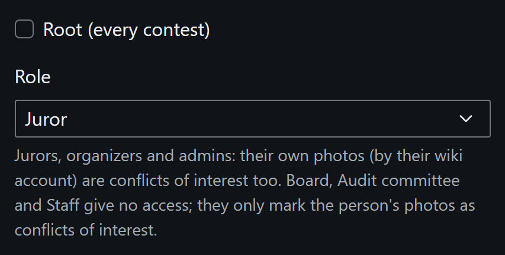

- Edit an account that is in contests the admin doesn't administer, its email included (at
  once, as an admin does, see [Changing a person](#a-edit-person)).
- Send **Reset password** links and use **End sessions** on any account, and see and revoke
  any account's API tokens.
- See the [possible duplicate accounts](#a-duplicates) of every contest and outside them, keep
  any of them separate, and [join](#a-join) any two accounts (also an admin account, or one in no
  contest).
- Run **Check every round's images**, on the rounds list: it checks that every round's list of
  files matches its votes, and repairs any drift.
- Run **Normalize stored authors**, on the rounds list, see [below](#a-normalize-authors).
- **Release** a round that the rounds list flags as held inactive with no job holding it: a job
  that paused it (a distribution, or a juror being added) ended without its cleanup. Release
  makes it active again if it was before. **Check every round's images** lists such rounds too.
- Work in any contest without being a member of it.

The first root account is made when the tool is first set up; that is in the [deployment
guide](../deployment.md).

<a id="a-normalize-authors"></a>
### Normalizing stored authors

Files imported by older versions of the tool may keep their author as wiki markup, such as
`[[User:Petro_Hrushko|Petro]]` or a photographer's credit template like `{{SergiyBobokPhotos}}`.
Files imported now keep the author's Commons account. The tool shows these old authors as their
account. But conflicts of interest are found by the stored account, so such files aren't found
as conflicts until their authors are normalized. A file deleted on Commons can't be imported
again, so only this button can fix its author.

**Normalize stored authors**, on the rounds list (root only), does it for the files of every
contest, as a background job:

- A link to a user page gives that account: `[[User:Petro_Hrushko|Petro]]` becomes
  `Petro Hrushko`.
- A credit template gives the account its page links to. A template that links to nobody gives
  the file's original uploader, as an import does. A file deleted on Commons, or uploaded by a
  bot, then has no author.
- An unknown author (`{{Unknown|author}}`) becomes no author.
- An account that an old import stored as question marks (`[[User:???????? ????????|…]]`, its
  letters lost) is read again from the file's page on Commons. If Commons names no author for it
  (a file deleted there), it is left as it is.

The job shows its progress under the buttons, with **Cancel**, and **Retry** if it fails. When
it is done, the line shows how many authors it changed, how many got the uploader, how many were
left without an author, how many question-mark accounts it restored from Commons or left, and
how many were skipped because an import changed them meanwhile. It can be run again: a second
run changes nothing, apart from reading again any question-mark accounts Commons could not
restore (it reports them as left again).

After it, files whose author is a contest member are found as conflicts of interest on the
round form and the conflicts pages. Rounds already distributed keep their files: to leave the
new conflicts out of a round, stop it and disqualify them on its [conflicts
page](organizer-guide.md#o-conflicts-page).
