# WLX Jury: a guide for administrators

This guide is for the admins of a contest in WLX Jury, and for root, the tool's own
administrators. A contest's admins are the people of its organizing team who set WLX Jury up for
it, usually one or two. The guide explains accounts and roles, how people are invited and sign in, the
settings of a contest, and how to run the judging: rounds, their files and jurors, and conflicts
of interest. The other members of the team, who help follow the voting, are **Organizers**: the
statistics, results and other pages they read are in the [organizer guide](organizer-guide.md),
and admins see all of them too. The people you add as jurors use the [juror
guide](juror-guide.md).

Labels in **bold** are the ones the tool shows in English. Terms: a **contest** is one
competition, a **file** is one photo or video, a **yes/no round** is a round with the rating type
**Yes/No**, and the roles are **Juror**, **Organizer** and **Admin**. Whoever installs and runs the tool
(servers, mail, sign-in providers, backups) finds that in the operators' [deployment
guide](../deployment.md); this guide doesn't repeat it.

Contents: [Accounts and roles](#a-accounts), [People](#a-users), [Invitations](#a-invitations),
[Signing in](#a-sign-in), [The contest](#a-contest), [Running the judging](#a-running) and [What
only root can do](#a-root).

<a id="a-accounts"></a>
## Accounts and roles

<a id="a-one-account"></a>
### One account per person

A person has one account, found by its email address, whatever the number of contests. The
account can be a member of many contests, with a role in each. A person who is a juror in one
contest and an organizer in another signs in once, and switches contest with the contest menu at
the top of the page.

Accounts are made by invitation only. The tool has no sign-up page: the sign-in page says that
accounts are created by contest admins.

<a id="a-roles"></a>
### Roles

A role belongs to a membership: one account, one contest.

| Role | What it can do |
|---|---|
| **Juror** | Votes in the rounds it is a juror of. |
| **Organizer** | Reads the statistics, the results of all jurors, the contest's files and the conflicts page, and may comment on the files of an open round. Changes nothing else. |
| **Admin** | Everything an organizer does, and manages the contest: its people, rounds and files. |
| **Board**, **Audit committee**, **Staff** | No access to the contest's pages. These roles record that a person belongs to the contest, so that their own photos count as [conflicts of interest](organizer-guide.md#o-conflicts). |
| **No** | A member with no role: no access. |
| **Root** | Not a role of a contest: a property of the account (see [What only root can do](#a-root)). Root works in every contest without being a member. |

A person with no access role who opens a page gets the **Access denied** page, as the juror guide
describes.

<a id="a-current-contest"></a>
### The current contest

Each request runs in one contest, the **current contest**. It comes from the contest menu, and
when someone follows a link to a page of another contest they belong to, the tool switches to
that contest. Admins manage only the contests in which they are admins.

<a id="a-users"></a>
## People

<a id="a-users-page"></a>
### The users page

Open **Users** in the top bar. The page lists the members of the current contest: **Full name**,
**Wiki account**, **Email**, **Role**, and a pencil to edit. Next to a wiki account there may be
two buttons that write to the person on Commons, a message on their talk page and an email.

A badge **unverified** after a wiki account says that nobody has proved that the account
belongs to this person: anyone could have typed it. A badge **unverified** after an email says
that the person hasn't accepted an invitation yet. A badge **password expired** says that the
person's password was set before version 26.11 and has stopped working: they need a link to set a
new one. The envelope button next to the badge sends it again.

A member without a wiki account whose files could be conflicts of interest shows **no wiki
account, can't be checked for conflicts of interest**. Add their wiki account in their edit
page.

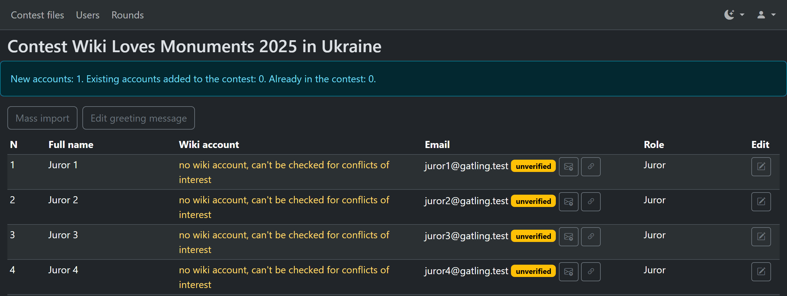

<a id="a-add-person"></a>
### Adding a person

At the bottom of the table, fill in the row: **Full name**, **Wiki account**, **Email**, the
**Role**, and press the button with the plus. A person needs an email or a wiki account. The text
under the table recalls which roles make the person's own photos conflicts of interest, and that
**Board**, **Audit committee** and **Staff** give no access (see [Roles](#a-roles)).

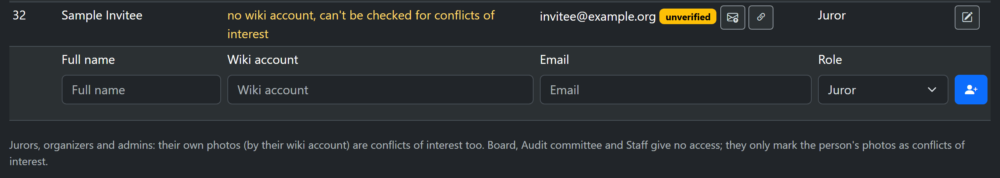

- **Send an invitation email**, under the table, is unticked by default: nothing is mailed. The
  person then gets in with a [link to share](#a-share-link) that you pass on, or a password you
  [set for them](#a-passwords); the envelope button next to them sends the invitation later. Tick
  it to mail the invitation (and, to someone who already has an account, the contest's greeting).
- A **new** email gets a new account, and an invitation by email if you ticked the box, see
  [Invitations](#a-invitations).
- An email whose account **exists** and whose owner has proved it (they accepted an invitation
  or a mailed link) joins your contest with the role at once. Nothing is changed in the account
  itself.
- An account that hasn't proved its email, for example one made unverified by a shared link,
  gets an invitation instead, and the role applies when they accept it. Unticked, the invitation
  waits in the invitations list as **Not sent**, for you to send or share. A wiki account that
  belongs to such an account is not added: add the person by email.
- A person added with a wiki account only has no email. They can't sign in with a password
  until you share a link or set one for them (only while Wikimedia sign-in is not set up, see
  [Sharing a link](#a-share-link) and [Passwords](#a-passwords)), or add the person by email to
  invite them.

The page tells you how many accounts were created, how many people joined and how many were
members already, how many invitations were not emailed because the box was unticked, and any that
could not be sent.

<a id="a-mass-import"></a>
### Adding many people

**Mass import** takes a list: entries separated by commas or new lines, each a Wikimedia
account, an email, or a name with an email in angle brackets:

```
Wiki Account 1, Wiki Account 2
mail1@example.org, mail2@example.org
Name1 Surname1 <mail1@example.org>
```

Choose the role for all of them; the text under it says the same about the roles as the users
page. **Send an invitation email** works as on the users page (unticked: nothing is mailed). They
are added as in [Adding a person](#a-add-person).

<a id="a-edit-person"></a>
### Changing a person

The pencil opens the page **Edit user**. An admin can change, for members of the current contest:

- the **Role** in this contest (the text under it says which roles make the person's own photos
  conflicts of interest);
- the **Full name** and the **Wiki account** (a valid wiki name that no other account has; it
  is marked unverified);
- the **Email**, at once, also of a person who has a password: they keep the password and sign
  in with the new address, which is unverified until they use an invitation or a password link
  sent to it. They are signed out everywhere. If the old address was verified, it gets a short
  email saying that you changed it (the new address partly hidden). The email can't be changed
  to another account's address, nor removed from an account that has a password;
- **Send an invitation email**, unticked by default: ticked, the person gets an invitation at the
  (new) address; unticked, nothing is mailed to it. An account that can sign in (with a password,
  or with Google or Wikimedia) and whose address an admin set gets an invitation (also **Send the
  invitation again**, or an add to another contest) only from someone who may set its password, as
  for a [link to share](#a-share-link): not, for example, a fellow admin; ask root then. Once the
  person uses a link sent to the address, or root sets it, this no longer applies;
- if someone else changed the email after you opened the page, your save keeps their address
  when you left the field as it was, and refuses an edit of it: reload the page;
- the **Password**, with **Set password**, where you may: see [Passwords](#a-passwords). Set it
  and change the email in separate saves;
- a **Comment for the log**, optional: it is shown with this save's changes under
  [Account changes](#a-account-changes).

An account that also works in other contests can't be changed by an admin of one of them: the
admin may change the person's role in their own contest only, unless they administer all of its
contests.

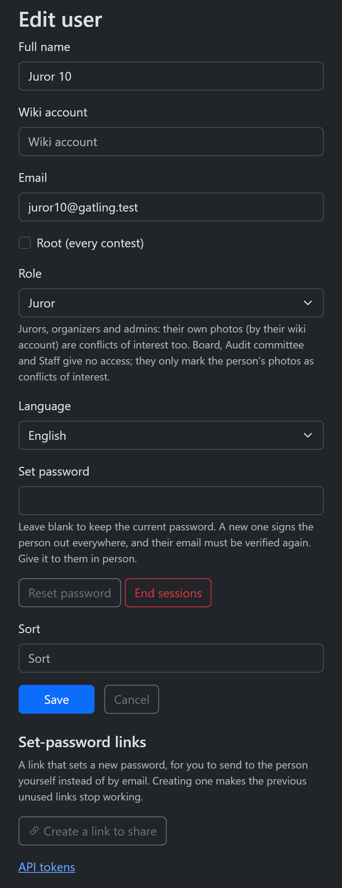

Root sees more on this page, such as the checkbox **Root (every contest)**: see [What only root
can do](#a-root).

A person's own email change, on their profile, still takes effect only once they follow the link
mailed to the new address.

<a id="a-account-changes"></a>
### Account changes

Every change an admin or root makes to someone else's account is logged: the email (old and new),
a password set, a role change, the name and wiki account, accounts created, invitations and links
to share, and whether an email went out, with who made it, when, and the optional comment. The
button **Account changes** on the users page lists the contest's changes, the newest first; a
person's **Edit user** page lists theirs. Only the contest's admins and root see them: they show
email addresses. Root sees every change of an account on its edit page, also those made in other
contests.

<a id="a-invitations"></a>
## Invitations

If the email doesn't arrive, create a [link to share](#a-share-link) and pass it on yourself.

<a id="a-invitation-email"></a>
### The invitation email

A new member gets an email, **Invitation to the … jury**, with a link that is valid for a few
days. When the contest uses its own **greeting message**, the email is **Welcome to … jury**
instead, with the greeting's text and the link, see [The greeting](#a-greeting). The person opens the link, chooses a password on the page **Set your
password**, and is signed in. The email address is their login. The role applies once the
invitation is accepted. See [Accepting your invitation](juror-guide.md#accepting-your-invitation)
in the juror guide.

<a id="a-pending"></a>
### The invitations list

Under the users table, **Invitations** lists each person's latest invitation into the contest,
if it is still live or is from the last 30 days: the **Email**, the **Role**, how it was **Sent**
(**By email** or **Link to share**) and its **Status** (**active**, **used**, **expired** or
**revoked**, with the time). So you can see whether the person got it. For a live one:

- **Send the invitation again** mails a new link;
- **Create a link to share** makes a link to pass on yourself, see [Sharing a
  link](#a-share-link), where you may;
- **Cancel** cancels it: the link stops working.

A person whose link expired asks you to send it again.

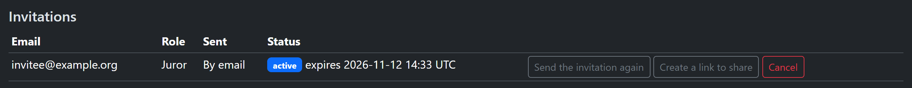

<a id="a-share-link"></a>
### Sharing a link instead of mailing it

When an email doesn't arrive, or you prefer to pass the link on yourself, you can create a link
to set a password and give it to the person directly, for example in a message.

**Where.** For an invitation not yet accepted, press **Create a link to share** on the users page
(in the list **Invitations**, or next to the person). For a reset of a password,
open the person's edit page and press **Create a link to share**.

**Who can create one.**

- **Root**, for any account.
- **A contest admin**, in their contest: for a member or a person invited into it, and for a
  reset only for an active member. The account must not be root or the admin themselves, must
  have only the roles **Juror** or **Organizer**, and every contest it belongs to, has worked in
  or is invited into must be a contest the admin administers.
- For a person who has no email, only if they have a wiki account of their own (one no other
  account has): it is then their login. Once Wikimedia sign-in is set up for the tool, not even
  then: such a person signs in with Wikimedia, with their wiki account, and the page says so.
  A link already shared with such a person then stops working too.
  A person with neither an email nor a wiki account of their own can't get a link.

**How it works.**

- The link is **single-use**: it works once, for the account it was made for. It expires like a
  mailed one, and the page shows **Expires**.
- It is **shown once**, on the page **A link to set the password**, with a **Copy** button.
  Reloading or resubmitting that page creates a new link and the one you copied stops working. If
  you lose a link, create another.
- Creating a link makes the account's earlier unused links of the same kind stop working, the
  mailed ones too. So an account has one active link at a time.
- The status of each link is shown as **active**, **used**, **expired** or **revoked**, with
  whether it was sent **By email** or is a **Link to share**: in the invitations list, and on
  the person's edit page.
- Mailing the invitation or the reset stays available.

**What using the link does.** The person chooses a password and is signed in. For a reset, it
signs out every other session of the account, and the old password works until the link is used.
A shared link doesn't prove that the person owns the email, because anyone who has it could use
it. So using it **marks the email and the wiki account unverified**: if another contest then adds
the person, they get an invitation by email first. Accepting a mailed link verifies the address
again.

Treat the link like a password: anyone who has it can set the account's password until it is
used. Pass it on to the person only, and not in a public place.

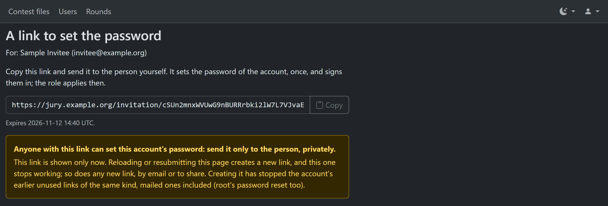

<a id="a-greeting"></a>
### The greeting

**Edit greeting message** on the users page opens the contest's greeting: the text a new member
receives. Tick **Send greeting to new users** to use it for new members, except that board,
audit committee and staff members don't get it. The page lists the variables you can put in the
text, and shows a preview for each member. Without a greeting the tool sends its standard
invitation.

The email never contains a password. Where your text has `{{Password}}`, the email says "the one
you choose with the link below"; the tool adds the link itself, after your text.

<a id="a-sign-in"></a>
## Signing in

<a id="a-password"></a>
### Password

A person signs in with their email address (or, if you set one, their wiki user name) and their
password. **Keep me signed in** is ticked by default. Passwords set before version 26.11 stop
working about three months after the update: the person then needs a link to set a new one,
which you can send from the users page. Their
[juror guide](juror-guide.md#signing-in-with-your-password) describes the page.

<a id="a-passwords"></a>
### Passwords: setting another person's

Nobody can see a password. There are three ways to give a person a new one:

- **Set password** on the person's edit page: you type the password and give it to the person
  yourself, in person if you can.
- A link to share: you pass it on and the person chooses the password
  ([Sharing a link](#a-share-link)).
- A mailed link: root mails one from the person's edit page (**Reset password**), and an admin
  invites an unverified member again, which does the same.

**Who can set a password.** The field **Set password** is shown, and accepted, only where you
may create a link to share for a reset, under the conditions in [Sharing a link](#a-share-link):
root for any account; a contest admin only for an active **Juror** or **Organizer** of their
contest whose every contest is one they administer, never root, another admin or themselves.
Anyone else's attempt is refused. Nobody, root included, can set a password for a person who has no
email where Wikimedia sign-in is set up (they sign in with their wiki account, and the page says
so), or who has no email and no wiki account of their own to sign in with (none, or one that
several accounts share). Your own password is changed on your
profile, with your current password.

**What setting it does.** It is the same as the person using a link to share:

- the new password works at once, and the old one stops working;
- the person is **signed out everywhere**, and their API tokens stop working;
- their **email and wiki account are marked unverified**: if another contest then adds the
  person, they get an invitation by email first, and accepting a mailed link verifies the
  address again;
- their linked Google and Wikimedia accounts are unlinked;
- their unused links (invitations, password and email-change links) stop working. An invitation
  that was waiting to give a role in a contest you administer gives it.

Leave the field blank to keep the current password. A password can be at most 72 bytes. Change the
email or the role and set the password in separate saves. The password is set after the rest of
the form is saved: if the person's account changed meanwhile so that you may no longer set it, the
page says that your other changes were saved and the password was not. Each password set is recorded in the security log, with the accounts' ids. The
person can then change the password on their own profile.

<a id="a-wikimedia-google"></a>
<!-- not offered yet (built, providers not set up): the section "Wikimedia and Google".

### Wikimedia and Google

If the tool's operators set them up, the sign-in page has **Sign in with Wikimedia** and **Sign
in with Google**. They sign a person in to the account they already have, and never create one.
The tool finds the account by the email address the provider confirms: for Wikimedia, the
person's confirmed email there; for Google, only a Gmail or Google Workspace address. The
account's email must be verified (an accepted invitation or link), or the account has no
password and a live invitation or password link to that address, which the sign-in then
accepts. Wikimedia also finds an account by its wiki account, but only one with no email and no
password that no Wikimedia account was ever linked to. A person can also **Link** the provider on
their own profile under **Linked accounts**, and **Unlink** it, which signs out the account's
other sessions.

When the same wiki account is on several jury accounts, the person chooses their account on the
page **Choose your jury account**, with its password or a link mailed to it. See [the juror
guide](juror-guide.md#when-one-wiki-name-has-several-jury-accounts).

Some changes unlink accounts, as the account may be changing hands:

- changing a person's wiki account unlinks their Wikimedia account (the name may now be
  someone else's), but not Google;
- changing the email of an invitee who has not set a password yet unlinks both, and sends a new
  invitation;
- **Reset password** (root), setting a person's password, and the person accepting an
  invitation or a password link unlink both.

Changing the email of a person who has a password unlinks nothing: the new address takes effect
when they follow the link sent to it.

Operators set the providers up in the [OAuth reference](../oauth.md).
-->

<a id="a-sessions"></a>
### Sessions

A signed-in session ends after a period without use, and at the latest a fixed time after
sign-in; the operators set both (30 days idle and 365 days at most, unless changed). A person can
end all their sessions on their profile: **Sign out everywhere** under **Sessions**. Changing a
password does the same, except in the browser it was changed in. Root can end the sessions of any
account with **End sessions** on its edit page.

<a id="a-api-tokens"></a>
### API tokens

Only root sees the API tokens section on their profile, for command-line tools: almost nothing
can be done through the API yet, and only by root, so nobody else can create a token for now. A
token acts with its owner's roles, so it must be kept secret. Ending sessions doesn't revoke
tokens: the owner revokes them on the profile, and root on any account's tokens page.

<a id="a-contest"></a>
## The contest

<a id="a-contest-settings"></a>
### Contest settings

A contest has a name, a country, a year, the Commons category or page its files come from (**Files source**),
a **monument id template** for monuments contests, a greeting, and its rounds. Root creates and
changes the contests on the **Contests** page. Admins of a contest set up its
people ([People](#a-users)), its [greeting](#a-greeting), its [files](#a-import-files) and its
[rounds](#a-running).

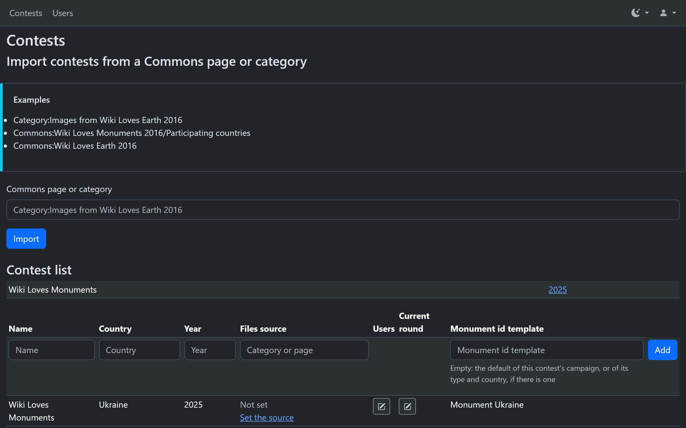

<a id="a-more-than-one-admin"></a>
### Several admins

Make each person who runs the contest with you an **Admin** in the users page, and the team
members who only follow the voting **Organizers**. An admin of the contest can do all that this
guide says for it. It can't change contests it isn't an admin of, nor root accounts.

<a id="a-running"></a>
## Running the judging

This part is for the admins: the rounds, their files and jurors, starting and stopping them, and
conflicts of interest. Following the voting and reading the results, which admins and organizers
both do, are in the [organizer guide](organizer-guide.md): the
[statistics](organizer-guide.md#o-statistics), the [results](organizer-guide.md#o-results), the
[CSV](organizer-guide.md#o-csv), the [contest's files](organizer-guide.md#o-contest-files) and
the [conflicts page](organizer-guide.md#o-conflicts-page).

<a id="a-contest-and-rounds"></a>
### A contest and its rounds

A **contest** has **files**, the images and videos taken from Commons, and **rounds**. A round is
one stage of judging: its own files, its own jurors and its own votes. A typical contest has a
first round that every file goes through, and later rounds that take only the best files of the
earlier ones.

<a id="a-round-kinds"></a>
### Kinds of rounds

The **Rating type** of a round is one of:

- **Yes/No** (a yes/no round): jurors select or reject each file.
- **1-N rating**, a rated round: jurors give each file from one star up to N stars, with N from
  3 to 20. A rated round can also use criteria and the worst mark, described below.
- **Comments only**: jurors take no votes, only write comments.

The rating type is chosen when the round is created and can't be changed afterwards.

A **rated round with criteria** (for example Aesthetics, Technical quality, Usefulness for
Wikipedia) asks for stars on each criterion; a file's rate is the sum. You choose 2 to 10
criteria for the round from the shared **Criteria catalogue**, which has a link on the round
form. After the round's first vote you can only replace a criterion by another in its place.

<a id="a-stages"></a>
### The life of a round

1. You create the round on the round form. The tool then gives its files to its jurors in the
   background. While it does, the round is hidden from jurors.
2. When all files are given, the round starts: jurors see it and vote.
3. You follow the voting on the [statistics page](organizer-guide.md#o-statistics), as the
   contest's organizers do.
4. You stop the round when the voting ends. Votes are kept.
5. You read the results and, if there is a next round, create it from these results.

<a id="a-rounds-list"></a>
### The rounds list

Open **Rounds** in the top bar. The list shows, for each round: its **Number** (a link to the
round form), its **Name**, the **File distribution**, the **Rating type**, whether it is
**Active** (started), the number of **Images** and the state of its distribution.

**Add round** creates a new round.

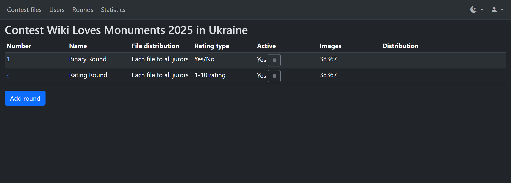

<a id="a-create-round"></a>
### Creating a round

Press **Add round**. The page **Create round** has these parts, from the top:

- **Round name (optional)**: a name for the round next to its number.
- **Media filtering**: which files the round takes. [Choosing files](#a-choose-files) describes it.
- **Leave out conflicts of interest**: see [Leaving them out of a round](#a-leave-out-conflicts).
- **Add files**: a list of files to add, see [Adding files by name](#a-add-files).
- **Jurors**: the people who vote in this round. Choose them in the list, which shows the
  contest's jurors.
- **File distribution**: **Each file to all jurors**, or **Each file to N juror(s)**, for
  contests with so many files that each juror takes a part. The files are shared out so that
  each file goes to the number of jurors you chose.
- **Rating type**: see [Kinds of rounds](#a-round-kinds).
- **File score**: see [The file score](#a-score-rule).
- **Worst mark**: see [The worst mark](#a-worst-mark).
- **Criteria**: see [Kinds of rounds](#a-round-kinds).

Press **Save**. You go to the rounds list, where the round shows its distribution.
**Cancel** leaves the form without saving anything.

If you press Save twice, or send the form again from the browser's Back button, the tool makes
one round, not two, and tells you.

The jurors are chosen when the round is created, and the **Jurors** list can't be changed on an
existing round. To work with other jurors, create another round. Later you can pause and resume
a juror, see [Pausing a juror](#a-pause-juror).

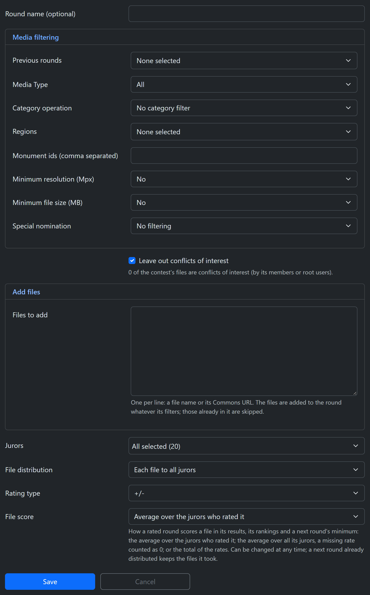

<a id="a-choose-files"></a>
### Choosing the round's files

The **Media filtering** section of the form decides which of the contest's files go into the
round. Leave a filter at its default to not use it. Filters add up: a file must pass all of them.
A round for all the files takes no filters at all.

**From earlier rounds**

- **Previous rounds**: take the files of one or more earlier rounds, which must all be rated the
  same way (all yes/no, all comments only, or all rated on the same scale with the same number
  of criteria). With none chosen, the files come from the whole contest, and the filters below
  that name earlier rounds don't apply. With several, each earlier round a file was in is
  checked on its own, with its own jurors, votes and file score: a file is taken if it passes
  the filters in at least one of them.
- **Selected by at least X jurors**: for earlier yes/no rounds. A file is taken when at least X
  jurors selected it (X from 1 to 6). **No filter** takes all the files of the earlier round.
- **Average file rating is at least**: for earlier rated rounds. A file is taken when its score
  in the earlier round is at least this number. The score follows that round's
  [file score](#a-score-rule): with the total of the rates it is a total, and for a round with
  criteria it is the sum of the criteria's rates, averaged over the jurors. The hint under the
  field says which applies.
- The **rejection filter**: take or drop files by how many jurors rejected them in the earlier
  rounds. See the next section.
- **Leave out files that are in round(s)**: choose one or more other rounds of the contest. A file
  that is in any of them isn't taken, whatever the votes it got there. It works with or without
  previous rounds, and with every other filter. See the [example](#a-leave-out-rounds) below.

**By the file itself**

- **Media Type**: **All**, **Video** or **Image**.
- **Category operation**, **Category A** and **Category B**: the Commons categories the file
  must be in. The operations are **No category filter**, **In category A**, **Not in category A**,
  **In both A and B**, **In A or B (or both)** and **In A but not B**. Typing in a category
  field suggests Commons categories.
- **Regions** and **Monument ids (comma separated)**: for contests where the tool knows the
  regions (at present Ukraine's, Wiki Loves Monuments and Wiki Loves Earth alike). Choose one or more
  regions, or list monument ids. A file's region is the first part of its monument id (`07` of
  `07-101-0001`). The list has only the real regions, so a file of a special nomination (its own
  monument id prefix) or a file without a monument id is left out by any choice of regions. To
  leave out just these files, tick **Select all** at the top of the regions list.
- **Minimum resolution (Mpx)** and **Minimum file size (MB)**: leave out small files.
- **Special nomination**: only the files of one special nomination, for contests that have them.

Most of these filters can only be set when the round is created. On an existing round the form
shows them, but they can't be changed.

<a id="a-leave-out-rounds"></a>
**Example: the files of the previous round that didn't pass into round X.** Round Q-00 still has
files nobody voted for, and round Q-01 took its selected files. A round Q-00-1 for the rest of
Q-00 (its rejected and unvoted files), of 4 Mpx and up, without the special nominations, with one
of four jurors per file, yes/no:

- **Previous rounds**: Q-00. **Selected by at least X jurors**: **No filter** (all of Q-00's files).
- **Leave out files that are in round(s)**: Q-01.
- **Minimum resolution (Mpx)**: 4.
- **Regions**: **Select all** (the special nominations' files have no region of the list).
- **Jurors**: the four jurors; **File distribution**: each file to 1 juror; **Rating type**: Yes/No.

The round keeps the setting: "Distribute new files" later leaves out the files that are in Q-01
then. The files of the rounds to leave out are read while the round's distribution runs, so a file
that reaches Q-01 after that stays in Q-00-1 too. The form therefore refuses a round to leave out
that is still being distributed, or whose creation's distribution failed ("The round to leave out,
Q-01, is still being distributed, or its distribution failed…"): let it finish, or retry it, then
save again. In the same way "Distribute new files" on Q-01 (or resuming its failed distribution) is
refused while Q-00-1 is being filled ("A round that leaves out this round's files, Q-00-1, is still
being filled…"), and a Retry of Q-01's distribution on its job page fails with that message:
distribute again when Q-00-1's distribution has finished. The form also refuses the round itself, rounds of another contest ("The
rounds to leave out must be other rounds of this contest") and a round that is also a previous
round of the new round, which would leave it with no files ("A round to leave out can't also be a
previous round of this round…").

<a id="a-rejection-filter"></a>
### The rejection filter

The rejection filter uses how many jurors rejected each file in an earlier round, each earlier
round on its own. It works with earlier yes/no rounds, and with earlier rated
rounds without criteria, where a worst mark counts as a rejection. It shows once you choose
such a previous round.

It has two fields. **Rejected files** is the mode:

- **No filter (keep rejected files)**: rejections don't matter.
- **Exclude files rejected by at least X jurors**: a file is left out when X or more jurors
  rejected it. This drops the files that jurors agreed were bad, for example after a screening
  round where jurors rejected only the few worst files. With several earlier rounds, a file is
  left out only if X or more jurors rejected it in each of the earlier rounds it was in.
- **Only files rejected by at least X jurors**: a file is taken only when X or more jurors
  rejected it. This is for a round that looks again at the files that were doubted.

The second field, **X: rejected by at least X jurors**, is the number, from 1 to 6. The filter
combines with the other filters of the round.

The form refuses these choices: a mode with no X ("Choose X, the number of jurors…"), an X with
**No filter** ("Choose whether to exclude the rejected files or take only them, or clear X"), and
the filter with no previous round that has rejections ("The rejected files filter needs a previous
round with rejections: a yes/no round, or a rated round without criteria").

<a id="a-add-files"></a>
### Adding files by name

In **Add files**, type or paste file names or Commons addresses, one per line, in **Files to
add**. The tool adds these files to the round whatever its filters say. Files already in the
round are skipped. If a line doesn't name a file, nothing is added and the page lists the lines.
You can add files this way both when you create a round and later.

<a id="a-distribution"></a>
### The distribution of files

After you save a new round, the tool gives its files to its jurors as a **background job**. The
rounds list, and the top of the round form, show the job under **Distribution**: its state,
for example queued or running, and its progress as a number of files done out of the total.

While the job runs the round is hidden from jurors, and you can't start it: the tool says
that its images are still being distributed. The round starts by itself when the distribution
has finished. You can leave the page and come back.

- **Cancel** stops the job. It shows while the job runs and after it fails.
- **Retry** runs a failed job again, from where it stopped. It shows only for a failed job.

If a job fails, the state shows why. A message with a **reference** is for the contest's tool
administrators: send them the reference. If the tool stopped for a while while a job was running,
it takes the job up again by itself.

A round has one distribution job at a time. Starting a second one for the same round, for
example from another browser tab, tells you that its images are already being distributed.

<a id="a-distribute-new-files"></a>
### Distributing new files

When files are added to the contest after a round was created, or a file list is added to it,
the round can take them. Open the round form: the box **Distribute N new files** is there, and
**Count** shows how many files the round would take. Tick the box and press **Save** to start the
distribution of these files to the round's jurors, by the same filters as before.

The round keeps its own settings. For example, a next round whose files were taken from this
round by its score keeps the rule it started with.

<a id="a-edit-round"></a>
### Changing a round

Open the round from the rounds list: its number is a link. On an existing round you can change:

- the round's name;
- the [file score](#a-score-rule) and the [worst mark](#a-worst-mark), at any time;
- the criteria, only by replacing one in its place once the round has votes;
- **Leave out conflicts of interest**, see [Leaving them out of a round](#a-leave-out-conflicts);
- **Add files** and **Distribute N new files**.

The rest of the form is shown but can't be changed: the files' filters, the rating type and the
file distribution. To start over, create another round. The panel **Jurors** shows each
juror's counts, as the [statistics page](organizer-guide.md#o-statistics) does.

**Cancel** leaves without saving anything.

At the bottom of the form of an existing round there are also the button **Conflicts of
interest of this round**, and, where the tool's operators have set up a local image cache,
**Download images locally**, which fills it for this round's files.

<a id="a-score-rule"></a>
### The file score

The **File score** option decides how a rated round gives a file its score. The score is shown
in the results and ranks the files, and a next round's minimum score uses it. The three rules
are:

- **Average over the jurors who rated it**, the default: the file's rates added up and divided
  by the number of jurors who rated it.
- **Average over its assigned jurors (unrated counts as 0)**: the rates divided by the number of
  jurors the file was given to, a juror who didn't rate it counting as 0.
- **Total of the rates (a file a juror skipped adds nothing)**: the rates added up, not
  divided.

The results show what the score is divided by, for example "14.50 (29 / 2 of 3 jurors)" or "29
(sum of 3 jurors)".

You can change the rule at any time. It changes the scores and the order of the round's results
on every page at once, and nothing is recomputed in the background. **The page warns you** when
the round has votes and you pick another rule. The warning says that:

- the results are re-scored and re-ordered everywhere, at once;
- a distribution that is already queued or running keeps the rule it started with;
- the later rounds that took their minimum score from this round are named. Their
  files don't change, but a later **Distribute new files** there uses the new rule.

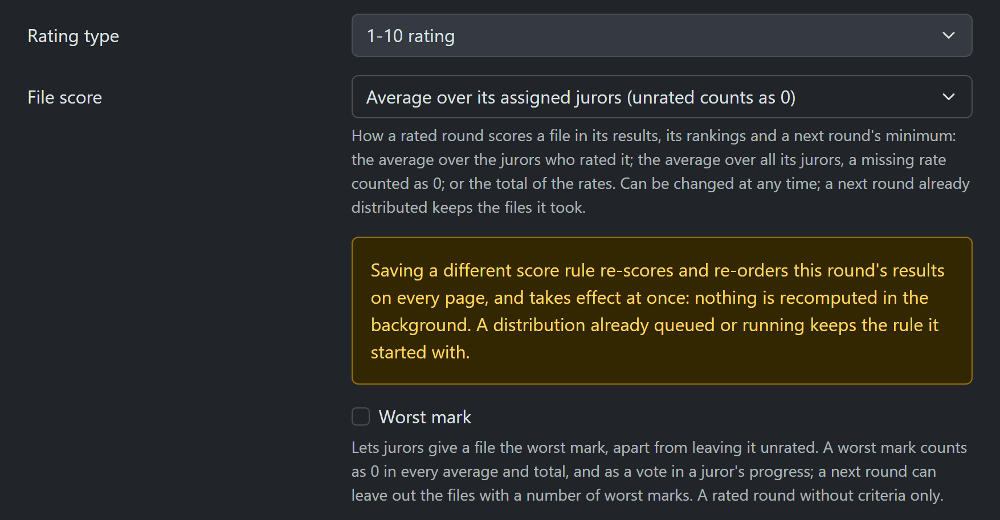

<a id="a-worst-mark"></a>
### The worst mark

The **Worst mark** option is for rated rounds without criteria. It is off by default. When it is
on, a juror can give a file the worst mark, shown as an X icon, for a file worth fewer than one
star, which is different from leaving it unrated:

- a worst mark counts as 0 in every average and total;
- a worst mark is a vote: the file counts as rated in the juror's progress and in the round's
  count of jurors who rated it;
- the results show the number of worst marks ("n worst marks") beside the file's score, for a
  file that has them: the file list, the by-rate gallery, the large view of all jurors and the
  CSV;
- a next round can use the worst marks in the [rejection filter](#a-rejection-filter).

Jurors give a worst mark with a button and clear a vote with another, see the [juror
guide](juror-guide.md#rated-rounds-stars). The form hides the option for a yes/no round, a
comments-only round and a round with criteria (and refuses it there if it is sent anyway). You can turn it on or off on an existing round.

<a id="a-import-files"></a>
### Importing the contest's files

Admins bring files into the contest with **Import and cache** on the [contest files
page](organizer-guide.md#o-contest-files); root also from the **Files source** link of the
contest (**Set the source**, if it has none) on the contests page. The page's **Files source**
takes a Commons category or a page, or a pasted list of files in **Or image list**, and **Import
files** adds them.
Imports only add: no file is removed, and all the contest's rounds choose from these files.

For monuments contests **Update monuments** refreshes the files' monument ids. Where the tool's
operators have set up a local image cache, **Download images locally** fills it. These run as
background jobs, with their progress.

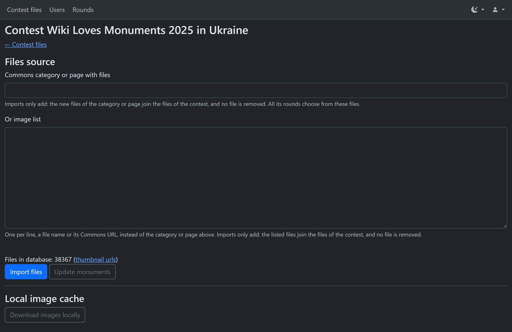

<a id="a-start-stop"></a>
### Starting and stopping a round

In the rounds list, the **Active** column shows **Yes** or **No**. The button in it, a play or a
stop icon, starts the round (**Start the round**) or stops it (**Stop the round**). The
conflicts page of a round has a **Stop the round** button too.

A round whose files are still being distributed can't be started; it starts by itself when the
distribution is done.

<a id="a-pause-juror"></a>
### Pausing a juror

In the **Start/Stop** column of the [statistics page](organizer-guide.md#o-statistics), the
button next to a juror's name pauses their voting in that round (**Pause the juror's voting**),
and the same button resumes it (**Resume the juror's voting**). The round disappears from that
juror's view while they are paused; their votes are kept, and the juror's files stay assigned to
them. Organizers don't have the buttons: their column, **Voting**, shows each juror as
**Active** or **Paused**.

<a id="a-what-jurors-see"></a>
### What jurors see

A juror sees a round only when it is started, the juror is in it and not paused, and its
distribution is done. When a round is stopped it disappears from the jurors' view, and votes in
it are refused ("This round is closed for voting"). Votes are kept, and the round comes back
when you start it again. A juror with no round open sees **No round configured yet**.

Jurors see their own votes only. In the large view of a file they see comments of other jurors,
with names. Their **Only with comments** toggle and the comment counts on their tiles cover
their own files only; the organizer guide explains [both](organizer-guide.md#o-comments-filter).
A stopped round takes no comments, also from admins and organizers. Admins and organizers also
have the round's [comments report](organizer-guide.md#o-comments-report), with its CSV: every
file with comments of the round (or of the whole contest) and its comments on one page. Jurors
cannot open it.

<a id="a-leave-out-conflicts"></a>
### Leaving conflicts of interest out of a round

The organizer guide explains [what a conflict of interest is](organizer-guide.md#o-conflicts).
Tick **Leave out conflicts of interest** on the round form. The form shows how many of the
contest's files, and of the round's files, are conflicts.

- On a new round, these files are left out when its files are given to jurors.
- On an existing round, saving the form with the box ticked disqualifies the round's conflicts,
  keeping their votes aside. It works only while the round is stopped. On an open round the
  tick makes only the later distributions leave them out; the tool then shows a link to the
  conflicts page.

<a id="a-disqualify"></a>
### Disqualifying and requalifying

Admins do these on the [conflicts page](organizer-guide.md#o-conflicts-page) of the round, which
the button **Conflicts of interest of this round** at the bottom of the round form opens, **only
while the round is stopped**. On an open round the page offers **Stop the round**, with a
confirmation.

- Select files and press **Disqualify the selected files**. They leave every juror's list and
  the results. Their votes are kept aside. **Distribute new files** never adds them again.
- Select files in **Disqualified files**, choose **Why** (**A mistaken match** or **The conflict
  has ended**) and press **Requalify the selected files**. The files come back with their votes.
  A file that was deleted on Commons while the round was open stays out.

Jurors don't need to do anything. Their round may disappear for a while, as long as it is
stopped.

<a id="a-root"></a>
## What only root can do

- Create contests, and import them from a Commons list, on **Contests**, and change a contest's
  settings there.
- See **Users** across all contests, and make an account root: tick **Root (every contest)** on
  its **Edit user** page. An account that has a password but no verified email can't be made
  root; an invitee who hasn't set a password yet can. A new account can't be made root when it
  is added: add the person, and tick it once they have accepted the invitation. Root can't
  change their own root, and the last root can't be taken away. Root and the email can't be
  changed in one save: save one, then the other. Changing the person's role in a contest leaves
  root as it is.

  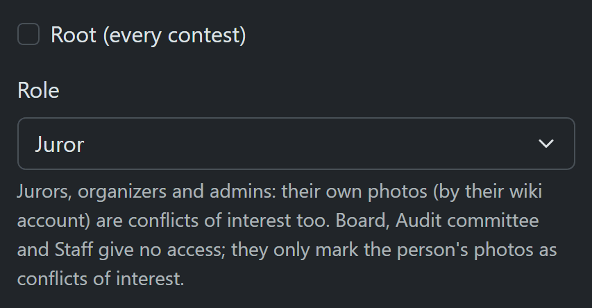

- Edit an account that is in contests the admin doesn't administer, its email included (at
  once, as an admin does, see [Changing a person](#a-edit-person)).
- Send **Reset password** links and use **End sessions** on any account, and see and revoke
  any account's API tokens.
- Run **Check every round's images**, on the rounds list: it checks that every round's list of
  files matches its votes, and repairs any drift.
- Work in any contest without being a member of it.

The first root account is made when the tool is first set up; that is in the [deployment
guide](../deployment.md).
