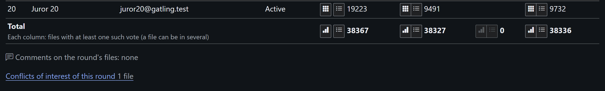
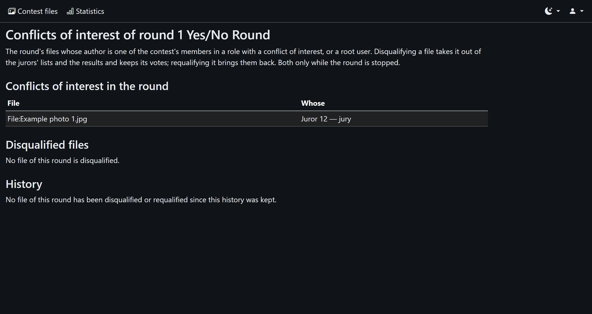

# Conflicts of interest

## What a conflict of interest is

A file is a conflict of interest when its author is a member of the contest in a role that
gives a conflict of interest (Juror, Organizer, Admin, and the Board, Audit committee and Staff
roles), or a root user. The tool recognises the files by the members' **Wiki account**. A
member without one can't be checked. An admin sets the wiki account, see [People](people.md#a-users).

The admins can leave these files out of a round, and disqualify them from a stopped round,
keeping their votes aside, see [Leaving conflicts of interest out of a
round](#a-leave-out-conflicts).

## The conflicts page

The link **Conflicts of interest of this round**, under the table on the round's
**Statistics** page, opens the page **Conflicts of interest of round …**. (Admins also find a
button on the round form.)

The page has:

- **Conflicts of interest in the round**: the files whose author is a conflicted member now,
  each with its author and reason.
- **Disqualified files**: the files taken out of the round.
- **History**: every disqualification and requalification, newest first: when, which file, the
  reason, the status before and after, and who did it.

In the picture, one of the round's files is a juror's own photo; no file is disqualified yet
and there is no history. A part with nothing in it says so. Admins also have the
controls to disqualify and requalify files there, see [Disqualifying and
requalifying](#a-disqualify); for organizers the page is read only.

## Leaving conflicts of interest out of a round

> **For admins.**

Tick **Leave out conflicts of interest** on the round form. The form shows how many of the
contest's files, and of the round's files, are conflicts.

- On a new round, these files are left out when its files are given to jurors.
- On an existing round, saving the form with the box ticked disqualifies the round's conflicts,
  keeping their votes aside. It works only while the round is stopped. On an open round the
  tick makes only the later distributions leave them out; the tool then shows a link to the
  conflicts page.

## Disqualifying and requalifying

> **For admins.**

Admins do these on the [conflicts page](#o-conflicts-page) of the round, which
the button **Conflicts of interest of this round** at the bottom of the round form opens, **only
while the round is stopped**. On an open round the page offers **Stop the round**, with a
confirmation.

- Select files and press **Disqualify the selected files**. They leave every juror's list and
  the results. Their votes are kept aside. **Distribute new files** never adds them again.
- Select files in **Disqualified files**, choose **Why** (**A mistaken match** or **The conflict
  has ended**) and press **Requalify the selected files**. The files come back with their votes.
  A file that was deleted on Commons while the round was open stays out.

Jurors don't need to do anything. Their round may disappear for a while, as long as it is
stopped.
