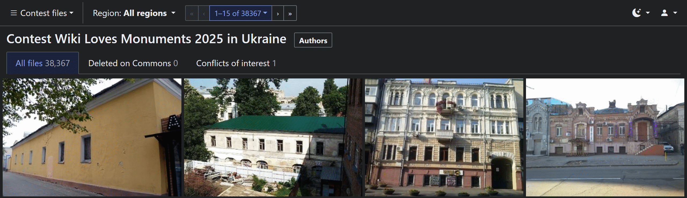
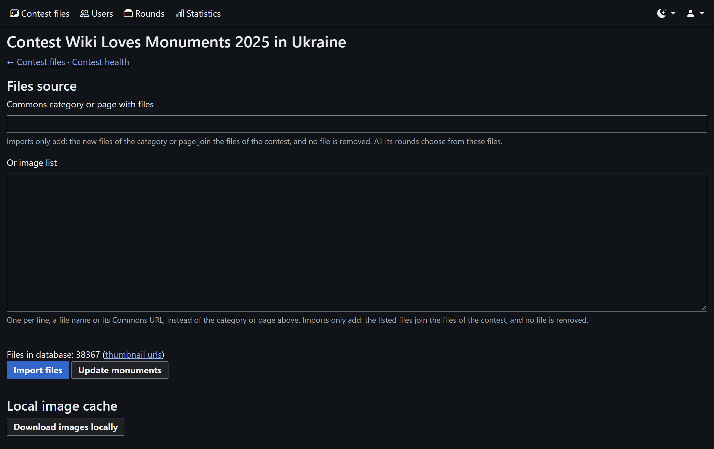

# The contest's files

**Contest files**, in the pages menu at the start of the top bar (on the statistics, where you start, and on a gallery) or a link there on a page without filters, shows all the files of the contest in a gallery, with the region
menu of a monuments contest, and a large view of each file. It has three tabs, each with its
number of files after its name (the conflicts of interest's for those who may see authors):

- **All files**;
- **Deleted on Commons**: the files that were deleted on Commons;
- **Conflicts of interest**: the contest's files that are conflicts of interest, each with
  whose it is, see [What a conflict of interest is](conflicts.md#o-conflicts); above them the people whose
  files they are, each with their role and number of files.

The **Import and cache** button next to the contest's name is only for admins, who bring the
files in with it, see [Importing the contest's files](#a-import-files).

Jurors don't open this page: it is for the contest's admins and organizers. A juror who follows
an old link to it gets the "no access" page, which suggests their round's gallery. Jurors reach
a monument's files in their own round instead (see [Monuments](monuments-authors.md#o-monuments)).

## Importing the contest's files

> **For admins and root.**

Admins bring files into the contest with **Import and cache** on the [contest files
page](#o-contest-files); root also from the **Files source** link of the
contest (**Set the source**, if it has none) on the contests page. The page's **Files source**
takes a Commons category or a page, or a pasted list of files in **Or image list**, and **Import
files** adds them.
Imports only add: no file is removed, and all the contest's rounds choose from these files.

**A name without `Category:`.** A source that starts with `Category:` or `Template:` (or another
namespace, such as `Commons:`) is read as it is, and so is a pasted list. A name without any such
prefix, for example `Images from Wiki Loves Monuments 2026 in Nepal`, is checked on Commons first,
for **Import files** and **Update monuments** alike, before anything starts:

- if Commons has only a page of that name, or only the category `Category:<name>`, the import
  uses that one (a category is saved as the contest's source with its `Category:` prefix);
- if it has both, the page asks which one you mean and shows each one's file count, with a link
  to look at it on Commons. The category is chosen, as it usually is the one meant; check that
  the names and counts are what you expected (a page of the same name may exist by chance, or the
  name may have been copied from the wrong place), change the choice if needed, and press the
  button again;
- if it has neither, nothing starts, and the page says so: check the name, or add `Category:` in
  front of a category's name;
- if Commons can't be reached to check it (within a few seconds), nothing starts and the page
  says so, keeping the name: the import needs Commons anyway. Try again later, or add
  `Category:` in front of a category's name yourself.

**An import that found nothing.** When a finished import added no file (its source gave none, or
only files that are missing on Commons or in none of the contest's country categories), the page
says so under the import, so that you can check the name. When an import from a page left files
out as in no country category of this contest, it says how many: the page is likely another
contest's or another year's.

For monuments contests **Update monuments** refreshes the files' monument ids, and for Ukrainian
contests reads the monument lists on Wikipedia: each monument's name, place, Commons category
and Wikidata item, which the [monument's page](monuments-authors.md#o-monuments) shows. Monuments
read before the Wikidata items were stored get theirs the next time it runs. Where the tool's
operators have set up a local image cache, **Download images locally** fills it. These run as
background jobs, with their progress. When the download has nothing to fetch, it says whether all
the files were already cached or there were none, with the time it checked.

**Contest health**, under the contest's name, opens a read-only report on the contest: its
files and import sources, and checks of its rounds (for example empty, frozen or being
created, and which are open to jurors). Only the contest's admins and root see the link and the
page.

