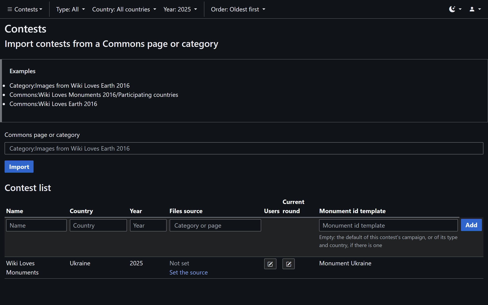

# The contest

## Contest settings

A contest has a name, a country, a year, the Commons category or page its files come from (**Files source**),
a **monument id template** for monuments contests, a greeting, and its rounds. Root creates and
changes the contests on the **Contests** page. Its **Type**, **Country** and **Year** menus at the
top pick which contests are listed (by default those of the latest contest year; **All years**
lists every year), and **Order** lists the oldest or the newest first, or **By country**: by the
country's name in the page's language, International last, each country's contests by year.
**Country** goes by the contest's campaign if the tool knows it, else by its country text. A known country is one entry
under its name, however it is written ("UA" or "Ukraine"). **International** has the contests of
an international campaign and those whose country is empty or "International". Any other text
("Ukraine, Animals", a misspelling) is an entry of its own. After **Add** the list shows
the new contest's year, and after **Import** the imported contests' year (all years if they are
of several). Admins of a contest set up its
people ([People](people.md#a-users)), its [greeting](invitations.md#a-greeting), its [files](contest-files.md#a-import-files) and its
[rounds](rounds.md#a-running).

## Series

A **series** ties one contest per year across the years: "Wiki Loves Monuments in Nepal" holds
the 2024, 2025 and 2026 contests of WLM in Nepal. Each year stays its own contest, with its own
people, files and rounds. The **previous year's contest** is the series' contest with the next
lower year. A series is not a Montage series, which covers a whole competition.

Today only root creates series and puts contests into them (see [What only root can
do](root.md#a-root)). Contests of a series show under its name in the contest menu. Contests in no
series work as before.

**Organizers:** the contest menu lists your contests under their series' names, as [The current
contest](accounts.md#a-current-contest) describes. Each year is still its own contest, with its
own role for you. A **series admin** looks after a whole series: an Admin of its contests from
their start year on, an Organizer in older ones; the contest's **Users** page names them (see
[Series admins](#a-series-admins)).

### Series admins

A **series admin** looks after a whole series, not one contest. Root makes someone a series admin
of a series; a series admin may add more series admins of their own series, but only root
removes them. Each grant has a **start year**:

- in the series' contests of the start year and later, a series admin is an **Admin**, whether the
  contest existed before the grant or not: rounds, settings, files, people, invitations and links,
  as a contest Admin can;
- in older contests of the series, a series admin is an **Organizer**: they see everything there
  but change nothing;
- where a series admin is a **Juror**, the series doesn't apply: they stay a Juror there;
- a series admin can't act on root accounts, other series admins, or people who also belong to a
  contest the series admin doesn't administer; only root changes a series admin's account, and in
  the series' contests only root makes them a Juror or removes or lowers their Admin role.

A series admin's contest menu has one entry per series, **Series: Wiki Loves Monuments in Nepal
(Series admin)**, leading to the **series page**: its contests by year, with your role in each and
an **Open** button that makes it your current contest, and its series admins with who added each,
when and their start year. A series admin with no contest role of their own lands there when
signing in.

**Add a series admin** on the series page: pick a member of the contests where you are an Admin as
series admin (root: of any of the series' contests), then check the
start year and the list of contests showing what the grant gives in each (**Show for this year**
shows it for another year). The start year is filled in from the person's own history: the
earliest year they were an Admin of a contest of the series, but at most last year; with none,
last year. A series admin may choose from their own start year up to next year; root may choose
any year. Only root changes a start year later. Root sees each addition on its **Series** page.

On a contest's **Users** page, **Series admins:** names the series admins of its series; only
root manages them. The contest's **Account changes** list each grant, revocation and start-year
change of its series. Creating a contest from the series page comes with a later update.

## Several admins

Make each person who runs the contest with you an **Admin** in the users page, and the team
members who only follow the voting **Organizers**. An admin of the contest can do all that this
guide says for it. It can't change contests it isn't an admin of, nor root accounts.
