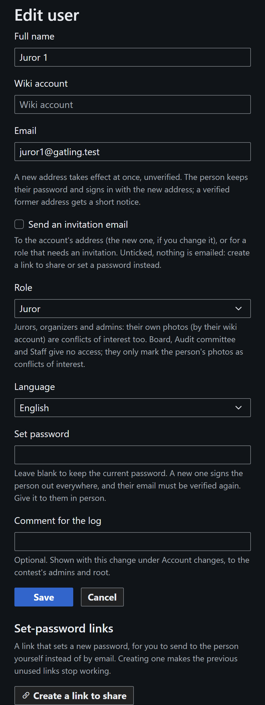

# Changing people's accounts

Changing a person's account, the log of account changes, and finding and joining two accounts of
one person.

## Changing a person

The pencil opens the page **Edit user**. An admin can change, for members of the current contest:

- the **Role** in this contest (the text under it says which roles make the person's own photos
  conflicts of interest);
- the **Full name** and the **Wiki account** (a valid wiki name that no other account has; it
  is marked unverified);
- the **Email**, at once, also of a person who has a password: they keep the password and sign
  in with the new address, which is unverified until they use an invitation or a password link
  sent to it. They are signed out everywhere. If the old address was verified, it gets a short
  email saying that you changed it (the new address partly hidden). The email can't be changed
  to another account's address, nor removed from an account that has a password;
- **Send an invitation email**, unticked by default: ticked, the person gets an invitation at the
  (new) address; unticked, nothing is mailed to it. An account that can sign in (with a password,
  or with Google or Wikimedia) and whose address an admin set gets an invitation (also **Send the
  invitation again**, or an add to another contest) only from someone who may set its password, as
  for a [link to share](invitations.md#a-share-link): not, for example, a fellow admin; ask root then. Once the
  person uses a link sent to the address, or root sets it, this no longer applies;
- if someone else changed the email after you opened the page, your save keeps their address
  when you left the field as it was, and refuses an edit of it: reload the page;
- the **Password**, with **Set password**, where you may: see [Passwords](signing-in.md#a-passwords). Set it
  and change the email in separate saves;
- a **Comment for the log**, optional: it is shown with this save's changes under
  [Account changes](#a-account-changes).

An account that also works in other contests can't be changed by an admin of one of them: the
admin may change the person's role in their own contest only, unless they administer all of its
contests.

### A wiki account another account has

If you type a wiki account that another account already has, nothing is saved, and the page shows
**Other accounts with the wiki account** … above the form: often the same person, who already has
an account from another contest or an earlier year. Some wiki accounts are on several old
accounts; up to 10 are shown, none chosen for you. Each shows what the search shows (see [Finding
an existing account](people.md#a-find-account)): its name, its email (in full only if it is in your
contests, otherwise masked), its wiki account, the contests of yours it is in with its role, and
its **votes, comments and rounds in your contests** (root: in all contests), so you can tell an
account in use from an empty one. Root accounts are not shown to admins; the panel says when some
accounts are not shown.

- **Add that account to this contest instead** adds the other account, with the role you pick (the
  form's role is chosen), exactly as **Add to this contest** in the search: an account whose owner
  proved the email joins at once, another gets an invitation. **Send an invitation email** and
  **Tell its owner by email** are unticked by default; nothing is mailed unless you tick one. Its
  owner sees a notice in the tool either way. An account already in this contest shows its role
  instead.
- **Retire the account being edited** (unticked; next to each **Add that account to this contest
  instead**) also retires the account you were editing, once the other account is added: for one
  person who ended up with two accounts. It is offered only for an **empty** account: no votes, no
  rounds, no comments, no linked Google or Wikimedia sign-in, no API token. Retiring removes it
  from its contests, revokes its invitations and links, frees its email address (so the person's
  other account can take it), ends its sessions, and nobody can sign in to it again; it can't be
  undone here, and no mail is sent. Admins may retire an account only if it is a member of (or invited to)
  this contest and they are an admin of every contest it is in; an account that is an admin is retired by root only; never your own
  account. While a round of its contests is getting its files or a new juror (a job on its
  page), wait until that is done; a round held in review doesn't stop it. If the account you were editing has another wiki account, the panel says that the
  conflict-of-interest filter will check the added account's wiki account instead. If the account
  can't be retired, the panel says why instead of offering the checkbox. The account change log
  shows **Account retired** on both accounts, each naming the other.
- **Keep them separate** puts the account's wiki account back as it was and hides the panel; your
  other changes in the form stay, and nothing is saved until you press **Save**. Nothing is
  recorded: the next time someone types that wiki account, the panel shows again.

Unless you tick **Retire the account being edited**, the account you were editing stays as it was.
Each time the panel is shown, the log records your account and the number of accounts shown, as for
a search.

Root sees more on this page, such as the checkbox **Root (every contest)**: see [What only root
can do](root.md#a-root).

A person's own email change, on their profile, still takes effect only once they follow the link
mailed to the new address.

## Account changes

Every change an admin or root makes to someone else's account is logged: the email (old and new),
a password set, a role change, the name and wiki account, accounts created, invitations and links
to share, and whether an email went out, with who made it, when, and the optional comment. The
button **Account changes** on the users page lists the contest's changes, the newest first; a
person's **Edit user** page lists theirs. Only the contest's admins and root see them: they show
email addresses. Root sees every change of an account on its edit page, also those made in other
contests.

## Possible duplicate accounts

The same person may have several accounts: one from an earlier year or another contest, created
under another email. **Possible duplicates**, on the users page, lists the groups of accounts that
look like one person's by one of two signs only:

- the **same wiki account**, written in any letter case, with or without `User:` and with
  underscores or spaces (`Anna K`, `anna_k`);
- the **same verified email**: one account's proven address is the address of another account's
  Google or Wikimedia sign-in. Root's report only, for now.

Nothing else pairs accounts: not the same name, and not working in the same round. A group is
listed in your contest's report if one of its accounts is a member of the contest or worked in it;
the report shows every account of the group, as the search shows it (see [Finding an existing
account](people.md#a-find-account)): the email in full only for accounts in your contests,
masked otherwise, only the contests of yours each is in with its role there, and a link to the
edit page of the contest's members. Root accounts are not shown. Root sees every group, across
the contests and outside them, from the **Users** page of all contests. The report changes no
account and mails no one.

**Keep separate** records that the accounts are different people, or that one person keeps
several accounts on purpose (a screening round may give one person several juror accounts, each
with its own share of the files): the pair is then never listed again, for you or anyone else, and
there is no undo in the tool. In a group of three or more, **Keep separate from the others** on an
account's row keeps that account apart from the rest of the group (a screening portion), and
**Keep all separate** keeps every pair apart; the others stay listed while any pair of them is not
kept apart. Two accounts kept apart can stay in a group while a third account links them; the
report then says so. Only root, or an admin of every contest the group's accounts are in or worked
in, can keep them separate: an account that is also in a contest you don't administer shows the
group without the buttons. If the group changed since you opened the page (someone kept a pair
apart meanwhile), nothing is recorded and the page says so. Each Keep separate is logged with
your account and the accounts' ids.

## Joining two accounts

When the accounts of a group are one person's, **Join…** on the group (in the report, next to
**Keep separate**) opens the join's page; **Join the two accounts…** in the Edit user panel (when
another account has the wiki account you typed) opens it for those two accounts. Only root, or an
admin of every contest each account is in or worked in, sees these links and the page; an account
in no contest is joined by root only.

1. **Choose the account to keep.** Nothing is chosen for you. If only some of the accounts have an
   email their owner proved (verified, not set by an admin), only those can be kept. Press **Show
   what joining would do**.
2. **Check the preview** of each other account joining into the one kept:
   - **Contests:** each account's role in each contest and the role after; where both have one, the
     role with more access is kept (admin, then organizer, then juror, then the roles without
     access; *no role* loses to any other).
   - **Rounds:** each round of the account retired, both accounts' files, votes and votes set aside
     there, and the round's juror after (active if either was; a row where one of the two was
     stopped is marked). Where both accounts have the same file unrated, it is one assignment: one
     stays (**Assignments merged**).
   - **Collisions:** a file both accounts voted on in the same round (or one's vote and the other's
     set aside). **Any collision stops the join**: a join never drops a vote. A file only one of
     them rated, the other having it unrated, is not a collision: the vote is kept. Fix them
     by hand first (it happens mostly where one person was given two shares on purpose; then keep
     the accounts separate).
   - **What else changes:** the conflict-of-interest filter (the account kept keeps its wiki
     account, or takes the other's if it has none; a name stays verified only if the account that
     proved it is the one it came from), comments moved, the account's Google or Wikimedia sign-ins
     unlinked (their holder links them again from the account kept, after signing in to it), both
     accounts' API tokens and unused links revoked and their sessions ended.
   - Why the join can't start, if it can't: a collision; an account in another join; a juror being
     added to a round of theirs, a round of theirs being distributed or held in review (finish or
     cancel the review first), or a round job in a contest of the account retired; the account
     retired being an admin (root only), your own, or not a member of this contest (start from the
     report of a contest it is in).
3. **Tell both owners by email** is unticked: no mail is sent unless you tick it (the addresses
   masked, no link). Press **Join #… into #…**. In a group of three or more, join one account at a
   time into the one kept.

The join runs in the background, round by round; its page shows the progress and, when done, what
moved. From its start the account retired can't sign in, and neither account can be added to a
round. Until its first round has moved, **Cancel** stops it with nothing moved; after that it can't
be cancelled: if it fails (a round getting its files or a new juror, say), fix the cause and press
**Retry** (if whoever started it is no longer an admin of every contest of both accounts, it
finishes for you, if you are). Root can **Abandon** a failed join instead: what moved stays with
the account kept, the other account is not retired, and both can be used again. While a join
runs, neither account can be added to a contest, accept an invitation, or have its role or
password changed. When it is done the other account is retired (as **Retire the account being edited**
does: its email freed, nobody signs in to it again), its votes outside every round's results stay
with it, and the account change log shows **Account joined** and **Account retired** on both
accounts. It can't be undone.
