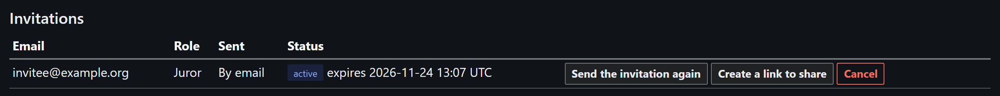
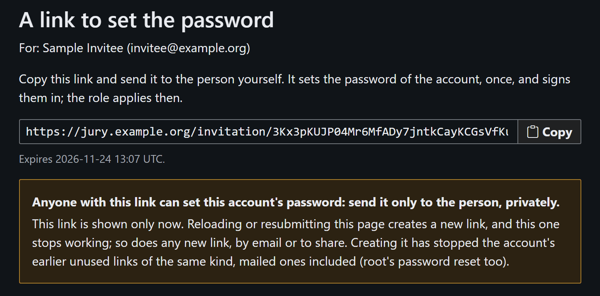

# Invitations

If the email doesn't arrive, create a [link to share](#a-share-link) and pass it on yourself.

## The invitation email

A new member gets an email, **Invitation to the … jury**, with a link that is valid for a few
days. When the contest uses its own **greeting message**, the email is **Welcome to … jury**
instead, with the greeting's text and the link, see [The greeting](#a-greeting). The person opens the link, chooses a password on the page **Set your
password**, and is signed in. The email address is their login. The role applies once the
invitation is accepted. See [Accepting your invitation](signing-in.md#j-invitation).

## The invitations list

Under the users table, **Invitations** lists each person's latest invitation into the contest,
if it is still live or is from the last 30 days: the **Email**, the **Role**, how it was **Sent**
(**By email** or **Link to share**) and its **Status** (**active**, **used**, **expired** or
**revoked**, with the time). So you can see whether the person got it. For a live one:

- **Send the invitation again** mails a new link;
- **Create a link to share** makes a link to pass on yourself, see [Sharing a
  link](#a-share-link), where you may;
- **Cancel** cancels it: the link stops working.

A person whose link expired asks you to send it again.

## Sharing a link instead of mailing it

When an email doesn't arrive, or you prefer to pass the link on yourself, you can create a link
to set a password and give it to the person directly, for example in a message.

**Where.** For an invitation not yet accepted, press **Create a link to share** on the users page
(in the list **Invitations**, or next to the person). For a reset of a password,
open the person's edit page and press **Create a link to share**.

**Who can create one.**

- **Root**, for any account.
- **A contest admin**, in their contest: for a member or a person invited into it, and for a
  reset only for an active member. The account must not be root or the admin themselves, must
  have only the roles **Juror** or **Organizer**, and every contest it belongs to, has worked in
  or is invited into must be a contest the admin administers.
- For a person who has no email, only if they have a wiki account of their own (one no other
  account has): it is then their login. Once Wikimedia sign-in is set up for the tool, not even
  then: such a person signs in with Wikimedia, with their wiki account, and the page says so.
  A link already shared with such a person then stops working too.
  A person with neither an email nor a wiki account of their own can't get a link.

**How it works.**

- The link is **single-use**: it works once, for the account it was made for. It expires like a
  mailed one, and the page shows **Expires**.
- It is **shown once**, on the page **A link to set the password**, with a **Copy** button.
  Reloading or resubmitting that page creates a new link and the one you copied stops working. If
  you lose a link, create another.
- Creating a link makes the account's earlier unused links of the same kind stop working, the
  mailed ones too. So an account has one active link at a time.
- The status of each link is shown as **active**, **used**, **expired** or **revoked**, with
  whether it was sent **By email** or is a **Link to share**: in the invitations list, and on
  the person's edit page.
- Mailing the invitation or the reset stays available.

**What using the link does.** The person chooses a password and is signed in. For a reset, it
signs out every other session of the account, and the old password works until the link is used.
A shared link doesn't prove that the person owns the email, because anyone who has it could use
it. So using it **marks the email and the wiki account unverified**: if another contest then adds
the person, they get an invitation by email first. Accepting a mailed link verifies the address
again.

Treat the link like a password: anyone who has it can set the account's password until it is
used. Pass it on to the person only, and not in a public place.

## The greeting

**Edit greeting message** on the users page opens the contest's greeting: the text a new member
receives. Tick **Send greeting to new users** to use it for new members, except that board,
audit committee and staff members don't get it. The page lists the variables you can put in the
text, and shows a preview for each member. Without a greeting the tool sends its standard
invitation.

The email never contains a password. Where your text has `{{Password}}`, the email says "the one
you choose with the link below"; the tool adds the link itself, after your text.
