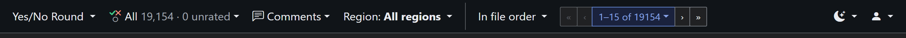
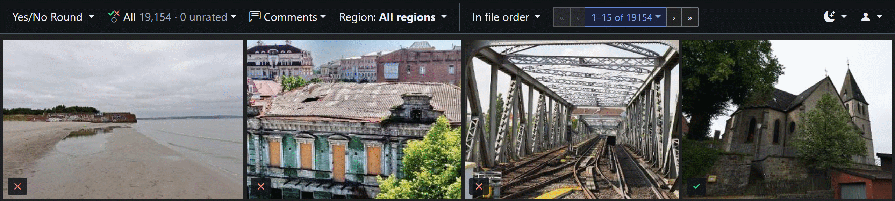
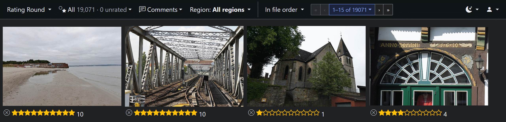

# The gallery

## The top bar

The bar at the top of the gallery has, from left to right:

- the **filters**, which choose the files you see: the round, the votes menu, the
  **Comments** menu, and the **Region** menu (or the chip of one monument, see below);
- after a thin line, the **order** of the files;
- the **pager**.

On a narrow window the groups move to a new line as a whole, the pager first.

## The votes menu

The first menu after the round chooses your files by your votes, each choice with its count at its right:

- in a yes/no round: **All**, **Unrated**, **Selected** and **Rejected**;
- in a rated round: **All**, **Unrated** and **Rated**.

The menu's button shows your choice's icon, the choice and its count, for example **Unrated 120**
with an empty circle; **Selected** has ✓, **Rejected** ✗, **Rated** a star, and **All** the icons of
all the choices squeezed into one: a small ✓ and ✗ above a small circle (a circle and a star in a
rated round). On **All** it
also shows how many of these files you haven't rated yet: **All 5712 · 120 unrated**. That is
the quickest way to see what is left to do: choose **Unrated** to see those files. On
**Selected** and **Rejected** the button is coloured as your votes are: green and red.

Each count is the number of files that choice shows, in the region and with the other filters
you have chosen. Choosing another one keeps them. A comments-only round has no votes menu.

## Files with comments

A file that has comments shows a speech bubble with their number in its lower-left corner, for
example 💬 3, in the gallery (right after your vote's mark) and in the large view's **Next
files**; in your list by rate it is under the thumbnail, on the line of the rank and the stars. It counts the comments that the file's large view shows: those written in any round of
the contest. It is a link: a screen reader reads it as "3 comments: open the comments", and a
click on it opens the file's large view at its comments. In the large view the same 💬 3 is under the buttons, after
your vote; click it to jump to the comments under the image.

The **Comments** menu, after the votes menu, has three choices:

- **All files**: your files with or without comments;
- **Only with comments N**: only your files that have comments. It works with the votes menu:
  on **Selected** it shows your selected files with comments, and N is how many of them have
  comments. The votes menu then counts your files with comments too. The large view's previous
  and next go through these files only, and your votes keep you in this list;
- **Recent comments list N**: the same files as a list of their comments (below).

The button shows **Comments N** while you see all your files, N being how many of them have
comments (just **Comments** when none has). While a choice is on, the button is highlighted and
says **With comments N** or **Comments list N**. A choice with no file is greyed out. On a
narrow screen the button shows the speech bubble and the number; point at it to see its name.

**Recent comments list** shows each of these files with its thumbnail, your vote, the 💬 with
the number of its comments (click it to open the file's large view at its comments) and every
comment its large view shows (from all rounds of the contest, with their authors and times), 20
files to a page, the file with the newest comment first. The votes menu works there too, and
counts the files of the list. The order menu in the top bar has **Latest comment first** and your
usual orders. Click a file to open its large view: previous, next and your votes then go through
these files in the same order. **Only with comments** in the **Comments** menu goes back to your
gallery with only the files with comments, in your usual order, and **All files** to all of them.
You see only your own files there, as in the gallery.

## Sorting your files

The order menu, after the line in the top bar, has **In file order**, **By my rating**, **Newest votes first**
and **Oldest votes first**. **In file order** keeps every file in its place when you vote.
**By my rating** puts your highest-rated files first. **Newest votes first** puts the files whose
vote you changed most recently first, and **Oldest votes first** the ones you voted on longest
ago; in both, files you haven't voted on yet come last, and votes from before these options were
added count as older than any other. Your browser remembers your choice; on another computer or
browser, choose it again.

In these two orders each file you voted on shows when you voted, in your own time zone, next to
your vote's mark in its lower-left corner (for example "✓ 12 Nov, 14:05"; in a rated round the
time alone, above the stars; in your list by rate under the thumbnail, after the stars). A yes/no
vote from before these options shows its mark alone, a rated one **Time not recorded**. On a
narrow tile the time is left out; the large view shows the
time of your vote on the file in every order.

On **Selected** and **Rejected** in a yes/no round the order menu has **In file order**,
**Newest votes first** and **Oldest votes first**. On **Unrated** the files are always in file
order.

A file you vote on stays where it is on the page until you reload it. In your list of a rated
round, a note above the files says so after your first vote on the page: **Changed rates are
re-sorted when the page is reloaded**.

## Regions

In a monuments contest, the bar has a **Region** menu: choose a region to see only its files,
or **All regions**. Each region shows how many files of your choice in the votes menu are in it.
The votes menu keeps the region you chose, and counts the files in it.

## One monument's files

Your gallery can show only your files of one monument. A chip in the top bar, where the
**Region** menu is, says so: **Monument: 07-101-0001**. The votes menu and the pager count only
that monument's files, and the **Region** menu is hidden: a monument is in one region. Click
**×** on the chip to see all your files again. **↗** on the chip opens the monument's page.

You open this list from a file's large view (**Gallery** in the monument's box, see [The monument's page](juror-large-view.md#j-monument-page)) or from
a monument's page. Votes work as usual. In the large view, **Next image** and **Previous image**
and voting by keys stay among the monument's files, and a small chip **Monument: 07-101-0001**
at the top of the left column reminds you; its **×** shows the same file in your whole list.

## The pager

When your files don't fit on one page, the pager in the top bar shows which files you see, for
example "46–60 of 5712". Use the arrows for the **First page**, **Previous page**, **Next page**
and **Last page**.

To jump to a page, click the numbers in the middle, type a page number in the box, and press
**Go**.

## Voting in a yes/no round's gallery

Point at a file's tile and its buttons appear: the magnifier above opens the file's large view
(as a click on the tile does), and below it ✓ selects the file and ✗ rejects it. They are the
large view's buttons, the same size and look. Pointed at, a button fills with its colour; the
button of the file's vote is pressed (filled, with a ring of the page's colour inside its border),
as in the large view. On a touch screen, the first tap on a tile shows its buttons and votes
nothing; then tap a button.
A selected file gets a green ✓ in its tile's lower-left corner, a rejected one a red ✗, with the
file's comments (💬 3) right after it. The picture below shows tiles at rest, with the marks of
earlier votes.

To undo a vote, press the same button again: the file is unrated again. The buttons also work from
the keyboard: move to one and press Enter or Space. A vote shows once it is stored, and further
clicks on that file are ignored until then. If a vote can't be stored, the file keeps its
earlier vote and a message says why.

Click the image itself to open it in the large view.

## Rating in a rated round's gallery

Under each file are its stars. Click a star to rate the file. In an older round that allows half
stars, click the left half of a star for a half star. The circled cross before the stars removes
your rating. The stars show your vote at once. If the vote can't be stored, the stars go back to
your earlier rate and a message says why. Further clicks on a file are ignored until its vote is
stored. In your list by rate, the number after the stars is your rate; it changes once the vote
is stored.

In a round with the worst mark, the button with an X icon after the stars (**Worst mark**) gives
the file the worst mark, and the stars are empty. The eraser before the stars removes your vote,
worst mark or stars; it shows only once the file has a vote. The worst-mark button is a toggle
that shows the file's worst mark: pressing it again doesn't clear it, the eraser does. In your
list by rate, a file with a worst mark shows the X icon as its rate.

Rounds with criteria show your result under each file, but you rate them in the large view.

## Deleted or missing files

Sometimes a file is deleted or renamed on Commons while the round is open. Its image then
can't be loaded: you see a grey box with a crossed circle, or your browser's mark for a missing
image.

Once the tool notices that a file was deleted, it leaves your list. If Commons restores the
file, it comes back with your vote.

A renamed file keeps its place in your list. At most, its image doesn't load until the tool
picks up its new name.

You don't need to do anything about these files.
