# WLX Jury: a guide for jurors

Other guides: the [organizer guide](organizer-guide.md), the [admin guide](admin-guide.md) and
[what's new in 2026](whats-new-26.11.md).

This guide is for jurors of a Wiki Loves Monuments, Wiki Loves Earth or similar photo contest
who judge its files in WLX Jury. It explains how to sign in, find your rounds, vote,
and what to do when something goes wrong.

Labels in **bold** are the ones the tool shows in English. If you use the tool in another
language, the same buttons and menus are in the same places.

Terms: a **contest** is one competition, a **file** is one photo or video, a **yes/no round** is
a round where you select or reject files, and a **juror** has the role **Juror**.

## Signing in to WLX Jury

### Accepting your invitation

You don't sign up yourself. An admin of your contest adds you, and you get an email,
**Invitation to the … jury**, with a link.

Open the link within the number of days the email says. A page, **Set your password**, asks
you to choose a password. Type it in **New password** and again in **Repeat your password**, then
press **Set password and sign in**. Your email address is your login from then on.

If the page says **This link cannot be used**, the link has expired or has been used
already. Ask your contest admin to send you a new one.

If you already have an account in the tool, for example from an earlier contest, the
contest admin may add you to the new contest directly. You then sign in as before and find the
new contest in the contest menu at the top of the page.

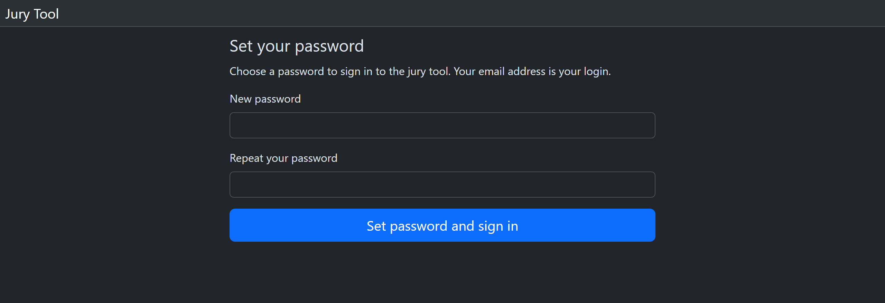

### Signing in with your password

On the sign-in page, type your email address (or your wiki user name, if your contest admin
set one for you) and your password, then press **Sign in**.

**Keep me signed in** is ticked by default. On a shared computer, untick it and choose
**Logout** before you leave (see [Signing out](#signing-out)): closing the browser may not sign
you out, because some browsers restore the session when they start again. Setting your password
from an invitation or a link also signs you in and keeps you signed in, as if the box were
ticked.

If the tool says **Invalid user or password**, check both and try again. If you have forgotten
your password, ask your contest admin for a link to set a new one.
A password set before version 26.11 stops working about three months after the update, so
this can happen even when you typed it right.

The link opens a page, **Set a new password**. Your old password works until you use the link.

If several jury accounts have the same wiki user name, signing in with that name doesn't work.
Sign in with your email address instead.

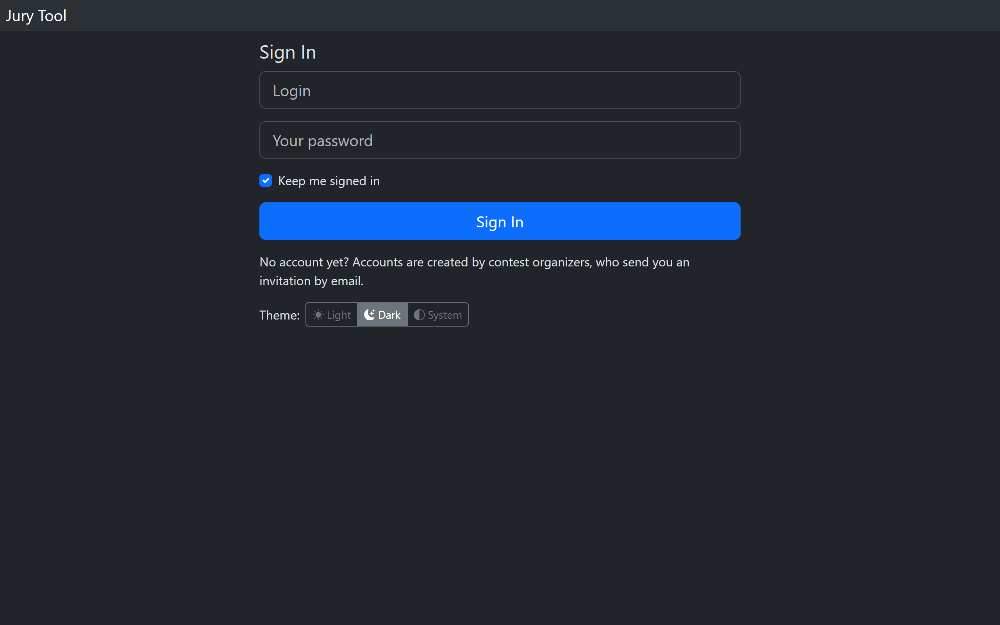

<!-- not offered yet (built, providers not set up): the sections "Signing in with Wikimedia or Google" and "When one wiki name has several jury accounts".

### Signing in with Wikimedia or Google

Some installations also show **Sign in with Wikimedia** and **Sign in with Google** above the
password form. If you don't see these buttons, only the password works there.

These buttons sign you in to the jury account you already have. They never create one. If the
tool says **No jury account matches this account**, ask your contest admin to invite you, or sign
in with your password and link the account on your profile, as the next paragraphs describe.
They keep you signed in, whether **Keep me signed in** is ticked or not: on a shared computer,
choose **Logout** before you leave.

Google sign-in finds your account by itself only for a Gmail or Google Workspace address. For
another address, accept the invitation first, then link Google on your profile. After that you
can sign in with it.

To link an account, open your **Profile** from the person icon at the top right. Under
**Linked accounts**, press **Link** next to Google or Wikimedia. **Unlink** removes the link
again and signs out your other sessions.

Setting a new password from a link (or accepting an invitation) unlinks your Google and
Wikimedia accounts. To use them again, sign in with the new password and link them again on
your profile.

When you link a Wikimedia account and your jury account has no wiki account yet, a page
**Set your wiki account** asks whether to use that Wikimedia user name. Press **Use it** to
confirm.

### When one wiki name has several jury accounts

Some people have more than one jury account with the same wiki user name, for example from
different years. When you sign in with Wikimedia, the tool then shows **Choose your jury
account**, with one box per account:

- An account you can choose at once shows **No email** and its contests, with your role in
  each. **This is my account** signs in to it.
- An account with a password or an email shows its email, partly hidden, and **No contests**:
  its contests are not listed there. Prove that it is yours in one of these two ways:
  - type its password under **Its password** and press **Choose with its password**;
  - or press **Mail me a link**, which sends a link to that account's email address. Open it in
    the same browser, within the minutes the email says, and press **Confirm**.

If the page then says **This account cannot be chosen here: ask your contest admin.**, that
account can't be used to sign in: ask your contest admin which account to use.

(screenshot to add: the "Choose your jury account" page with two accounts)
-->

### Signing out

Open the person icon at the top right and choose **Logout**.

To sign out on every computer and browser at once, open your **Profile** and press **Sign out
everywhere** under **Sessions**. Changing your password does this too, except in the browser
you changed it in.

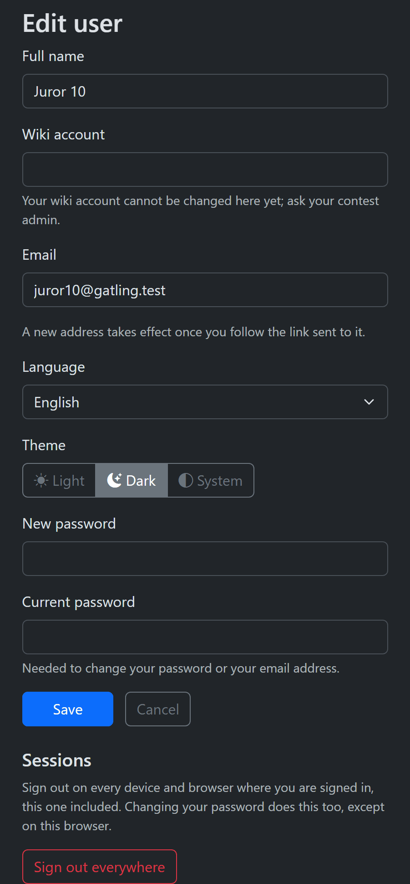

## Finding your rounds

### What you see after signing in

After you sign in, the tool opens your gallery in your first open round: all the files
assigned to you in it.

The bar at the top shows the round's name. If you are in more than one open round, the
round's name is a menu instead: choose another round there.

If no round is open for you in the current contest but one is in a newer contest of yours (for
example this year's, while you were still in last year's), the tool opens that one. Otherwise it
says **No round configured yet. Please wait until contest admin configures the tool.**, with a
**Logout** button and buttons for your other contests where you can go (for example last year's,
if its round is still open). Come back later, or ask your contest admin when the round opens.

### Rounds you don't see

You see only rounds that are open and that you are a juror of. A round disappears from your
view when:

- the contest admins are still preparing it: a new round stays hidden until all its files are
  assigned;
- the contest admins stop it, for example at its end, or for a while to fix something; it comes
  back when they start it again;
- the contest admins pause your voting in that round.

Your votes are kept in each case.

### Taking part in several contests

One account can be a juror in several contests. When you are in more than one, the top bar has
a contest menu (shuffle icon) showing the current contest's name. Open it and choose a contest:
each one is listed with your role there, for example "(Jury)". The tool opens your first round in
that contest. A contest where you are only a juror and no round is open for you (say, last
year's) is not listed, so with one such contest left there is no menu.

Opening a link to a page of another contest you belong to also takes you to that contest.

<!-- screenshot to add: the contest menu in the top bar -->

## Kinds of rounds

### Yes/no rounds (select or reject)

In a yes/no round you **select** the files that should go on and **reject** the others.
Files you haven't voted on are **unrated**.

### Rated rounds (stars)

In a rated round you give each file from one star up to the round's highest rate, for
example 1 to 5 stars. Older rounds may allow half stars; new rounds don't.

Some rated rounds also have the **worst mark**, shown as an X icon: for a file you would give
fewer than one star. A worst mark is a vote: the file is no longer unrated, and it counts in your
progress. In the results it counts as 0 in the file's score, and the organizers see how many
worst marks a file got. Giving a worst mark and removing your vote are two different things: a
file you clear is unrated again. Rounds rated by criteria have no worst mark.

### Rounds rated by criteria

Some rated rounds have criteria, such as **Aesthetics**, **Technical quality** or
**Usefulness for Wikipedia**. You rate each file on every criterion, with stars. A file counts as
rated once you have rated all its criteria. Its rate is the sum of them.

You rate criteria in the large view only. How is described below, with the large view.

### Comments-only rounds

A few rounds take no votes, only comments on the files.

## The gallery

### Tabs: all, unrated, selected, rejected

The bar at the top has tabs for your own files in the round, each with a count:

- in a yes/no round: **All**, **Unrated**, **Selected** and **Rejected**;
- in a rated round: **All**, **Unrated** and **Rated**.

**Unrated** is the quickest way to see what is left to do.

### Files with comments

A file that has comments shows a speech bubble with their number in its corner, for example
💬 3, in the gallery and in the large view's **Next files**. It counts the comments that the
file's large view shows: those written in any round of the contest. A screen reader reads it
as "3 comments".

Next to the tabs, **Only with comments (N)** shows only your files that have comments. It works
with the tabs: on **Selected** it shows your selected files with comments, and N is how many of
the tab's files have them. While it is on, the tabs count your files with comments too: each
tab's number is how many files it shows. The large view's previous and next then go through
these files only, and your votes keep you in this list. Press it again to see all your files. On
a narrow screen it is a speech bubble icon; point at it to see its name.

While **Only with comments** is on, **Recent comments** beside it opens the same files as a list
of their comments: each file with its thumbnail, your vote and every comment its large view
shows (from all rounds of the contest, with their authors and times), 20 files to a page, the
file with the newest comment first. The tabs work there too, and count the files of the list.
The order menu above the list has **Latest comment first** and your usual orders. Click a file
to open its large view: previous, next and your votes then go through these files in the same
order. **Show in the gallery** goes back to your gallery with only the files with comments, in
your usual order. You see only your own files there, as in the gallery.

### Sorting your files

The sort menu next to the tabs has **In file order**, **By my rating**, **Newest votes first**
and **Oldest votes first**. **In file order** keeps every file in its place when you vote.
**By my rating** puts your highest-rated files first. **Newest votes first** puts the files whose
vote you changed most recently first, and **Oldest votes first** the ones you voted on longest
ago; in both, files you haven't voted on yet come last, and votes from before these options were
added count as older than any other. Your browser remembers your choice; on another computer or
browser, choose it again.

In these two orders each file you voted on shows when you voted, in your own time zone (for
example "12 Nov, 14:05"); a vote from before these options says **Time not recorded**. The
large view shows the time of your vote on the file in every order.

On the **Selected** and **Rejected** tabs of a yes/no round the menu has **In file order**,
**Newest votes first** and **Oldest votes first**. On the **Unrated** tab the files are always
in file order.

A file you vote on stays where it is on the page until you reload it. In your list of a rated
round, a note above the files says so after your first vote on the page: **Changed rates are
re-sorted when the page is reloaded**.

### Regions

In a monuments contest, the bar has a **Region** menu: choose a region to see only its files,
or **All regions**. Each region shows how many files of the tab you are on are in it.

### One monument's files

Your gallery can show only your files of one monument. A chip under the top bar says so:
**Monument: 07-101-0001 (6)**, with the number of your files of it on the tab you are on. The
tabs count only that monument's files too, and the **Region** menu is hidden: a monument is in
one region. Click **×** on the chip to see all your files again. **The monument's page** beside
the chip opens the monument's page.

You open this list from a file's large view (**Gallery** in the monument's box, see below) or from
a monument's page. Votes work as usual. In the large view, **Next image** and **Previous image**
and voting by keys stay among the monument's files, and a small chip **Monument: 07-101-0001**
at the top of the left column reminds you; its **×** shows the same file in your whole list.

### The pager

When your files don't fit on one page, the pager in the top bar shows which files you see, for
example "46–60 of 5,712". Use the arrows for the **First page**, **Previous page**, **Next page**
and **Last page**.

To jump to a page, click the numbers in the middle, type a page number in the box, and press
**Go**.

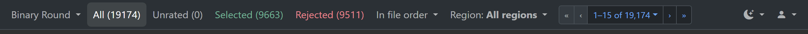

### Voting in a yes/no round's gallery

Point at a file's tile and its buttons appear: thumbs up to select it, thumbs down to reject it.
A selected file gets a green frame, a rejected one a red frame. The picture below shows tiles at
rest, with the frames of earlier votes.

To undo a vote, press the same thumb again: the file is unrated again. The thumbs also work from
the keyboard: move to one and press Enter or Space. A vote shows once it is stored, and further
clicks on that file are ignored until then. If a vote can't be stored, the file keeps its
earlier vote and a message says why.

Click the image itself to open it in the large view.

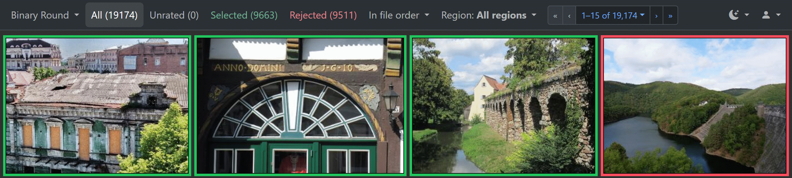

### Rating in a rated round's gallery

Under each file are its stars. Click a star to rate the file. In an older round that allows half
stars, click the left half of a star for a half star. The circled cross before the stars removes
your rating. The stars show your vote at once. If the vote can't be stored, the stars go back to
your earlier rate and a message says why. Further clicks on a file are ignored until its vote is
stored. In your list by rate, the number after the stars is your rate; it changes once the vote
is stored.

In a round with the worst mark, the button with an X icon after the stars (**Worst mark**) gives
the file the worst mark, and the stars are empty. The eraser before the stars removes your vote,
worst mark or stars; it shows only once the file has a vote. The worst-mark button is a toggle
that shows the file's worst mark: pressing it again doesn't clear it, the eraser does. In your
list by rate, a file with a worst mark shows the X icon as its rate.

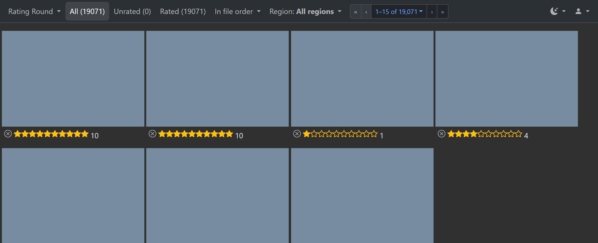

Rounds with criteria show your result under each file, but you rate them in the large view.

### Deleted or missing files

Sometimes a file is deleted or renamed on Commons while the round is open. Its image then
can't be loaded: you see a grey box with a crossed circle, or your browser's mark for a missing
image.

Once the tool notices that a file was deleted, it leaves your list. If Commons restores the
file, it comes back with your vote.

A renamed file keeps its place in your list. At most, its image doesn't load until the tool
picks up its new name.

You don't need to do anything about these files.

## The large view

### Opening a file in the large view

Click a file in the gallery to see it large. The large view shows one file, with the buttons
and stars on the left. First come three buttons: the grid of squares (**Back to gallery**), the
upward arrow (**Previous image**) and the downward arrow (**Next image**). Pointing at a button
shows its name. Then come the vote buttons or stars. Click the image to open the file's page on Commons in a new tab.

The left column also has **File details**: the full resolution with a link to the original
file, and for monuments the place and the monument. **Next files** shows the files after this
one. Click a heading to show or hide its section; the tool remembers which are open.

Videos play in the large view.

### The monument's page

In a monuments contest, the monument's box in **File details** ends with one line: the
monument's id, **Gallery (N)** and **Page →**, for example `46-233-0012 · Gallery (2) · Page →`.
**Page →** opens the monument's page:

- its name, place, year and type, as its Wikipedia list has them;
- links to its row in the list on Wikipedia, its category on Commons and its Wikidata item,
  where the list has them;
- **Files**: how many of your files in the round you came from show this monument (**yours**),
  linked to your gallery with only those files. Other jurors' files and votes are never counted
  for you.

**Gallery (N)** opens your gallery (the tab you are on) with only the monument's N files. It
isn't shown when your gallery already shows only this monument, or when this is its only file
of the monument; the line is then `46-233-0012 · Page →`. Files whose monument isn't in the
tool's monument lists (for example in Wiki Loves Earth) get a small box with the monument's id
and **Gallery (N)**, without a link to a monument's page; just the id when this is the only file
of the monument or your gallery already shows only this monument.

You see only the files of your rounds: the contest's other files aren't shown to jurors.

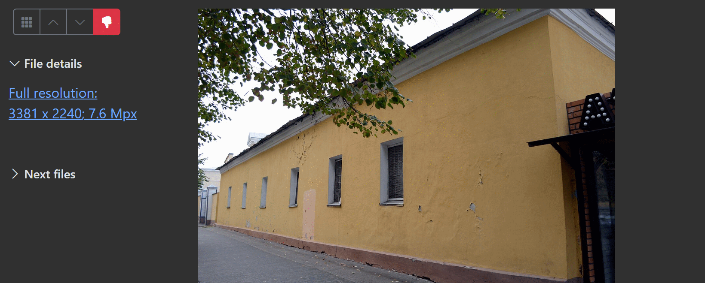

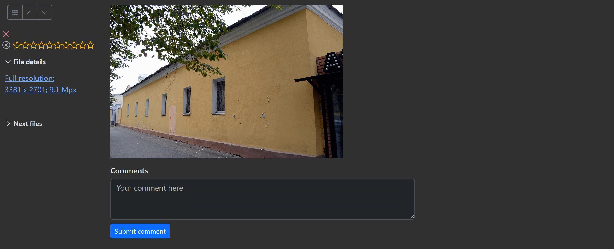

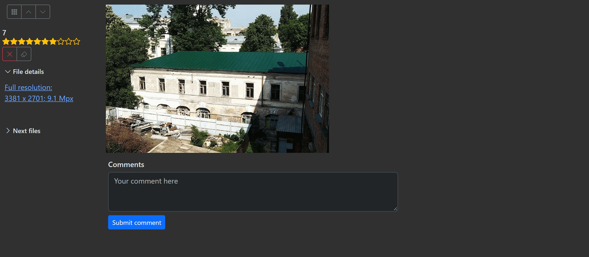

### Voting in the large view

In a yes/no round, use the green thumbs-up button (**Select image**) and the red thumbs-down
button (**Reject image**). Only the vote the file doesn't have yet is offered.

In a rated round, click the stars. The number above them shows the file's rate, or "–" if it
has none. While you point at a star, it shows the rate a click gives. The circled cross removes
your rating.

In a round with the worst mark, the stars have no circled cross. Under them are two buttons: the
button with the X icon (**Worst mark**) gives the file the worst mark, and the eraser (**Clear
the vote**), shown once the file has a vote, removes it. Above the stars, a file you gave the
worst mark shows the X icon instead of a number.

After you vote, the large view moves on to the next file, so you can go through your files one
after another. At the end of the list it goes to the file before instead.

If your vote moves the file in your list, or takes it out of the list you are in, a note says
so, for example **The image you rated (Rejected) is no longer in this list.** Click **View it**
to go back to that file.

### Rating by criteria

In a round with criteria, the large view lists the criteria, each with its own stars and
number. Click the stars of each criterion.

The view stays on the file while you rate its criteria. Go to the next file yourself with the
buttons or the Down key.

<!-- screenshot to add: the large view of a round with criteria -->

### Keyboard shortcuts in the large view

The large view works with the keyboard:

| Key | What it does |
|---|---|
| Down arrow | the next file |
| Up arrow | the previous file |
| Page Down / Page Up | two files on or back |
| Home / End | the first or last of the files around this one |
| Esc | back to the gallery, at this file's page |
| Space | select the file (yes/no round) |
| Delete | reject the file (yes/no round); give it the worst mark (rated round with the worst mark) |
| Backspace | remove your vote (rated round with the worst mark) |
| 0 up to the highest rate (at most 9) | rate the file (rated round) |

These keys move only among the few files around the one you see, never to the start or end of
your whole list.

The digit keys give the rate in points, from 0 up to the round's highest rate, and at most 9.
In a round of whole stars, 3 gives three stars. In an older half-star round each point is half
a star, so 7 gives three and a half stars. 0 removes your rating. A rate above 9 needs the
mouse.

On a Mac keyboard, reject with Fn and Delete together (the forward delete).

The vote keys work only in your own view of an open round. In a round with criteria, rate with
the mouse: the digit keys don't rate criteria.

Pointing at a button shows its key, for example **Next image <Down>**.

### Going back after a vote

Your browser's Back button takes you to the file you were on, showing the vote you just gave.
You can change it there.

### Comments on a file

Under the image in the large view is **Comments**. Type in **Your comment here** and press
**Submit comment**.

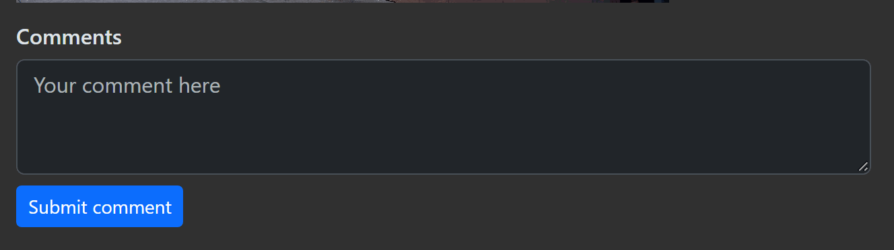

Each comment shows its author and when it was written, in your own time zone (older comments
may have no time). Comments from the contest's other rounds are shown too, without the round's
name.

Comments are not private. The contest's admins and organizers, and the other jurors who open
this file in the contest, see your comment, with your name. You can comment only while the round
is open.

## What you can and can't see

### Your own votes only

You see only your own votes and your own files in your rounds. Other jurors' votes, the files'
authors, the contest's other files and its statistics are for the organizers.

The tool doesn't show you who made a file, but judging isn't anonymous: the file's page on
Commons, which the large view links to, names its author.

### Conflicts of interest

A file is a conflict of interest when its author is a member of the contest, a juror for
example, or a tool administrator. The tool finds these files by the members' wiki accounts.

Contest admins can leave such files out of a round when they create it, so they never reach you.
They can also disqualify them in a stopped round: the files then leave every juror's list, and
their votes are kept aside. If a file is requalified later, it comes back with your vote.

Your round may disappear for a while when the contest admins stop it to do this.

If you upload photos to the contest yourself, make sure your profile shows your **Wiki
account**. Without it the tool can't recognise your files. If the field is empty, or to change a
wiki account that is already set, ask a contest admin.

### Disqualified files

A disqualified file simply leaves your list, and your tab counts change with it. You don't
need to do anything. If you had voted on it, your vote is kept and comes back if the file is
requalified.

## Your settings

### Light, dark or system theme

Open the theme icon in the top bar and choose **Light**, **Dark** or **System**. **System**
follows your computer's setting.

The tool remembers your choice for your account, also on other computers after you sign in.
The sign-in page has the same choice, under **Theme**.

### Interface language

Open your **Profile** from the person icon. Choose a **Language** (English, Français, Русский
or Українська) and press **Save**.

### Your profile

Your profile page is headed **Edit user**. It also has your **Full name**, your **Email** and a new password. To change
your password or email, type your **Current password** too.

A new email address takes effect once you follow the link sent to it.

## Supported browsers

WLX Jury supports the current and the previous version of these desktop browsers:

- Chrome
- Edge
- Opera
- Firefox
- Safari

Chrome 109 and Firefox 115, which some older computers can't upgrade from, are supported too
for signing in and voting. Pages may look different there.

Phones and tablets are not supported yet. The pages open there, but they aren't designed or
tested for small screens. Please judge on a computer.

## Common problems

### "This page has expired or you were signed out"

You see this when you send a form or a vote from a page opened long ago, or after you were
signed out in another tab.

Go back, reload the page, and try again. If you were signed out, sign in first.

In the gallery, a vote that can't be saved shows a message saying why, for example **This page
has expired. Reload it and vote again.** or **This round is closed for voting.**

### "Access denied" and its reference

The **Access denied** page says which account you are signed in as, what the page is for, and
your role in the current contest. It ends with a line like **Reference: …**, with a time.

If you think you should have access:

1. Check that you are signed in with the right account. If not, press **Sign out and sign in
   with another account**.
2. If you are in several contests, check the contest menu: you may be in another contest.
3. Otherwise, send your contest admin the reference and the time, the address of the page you
   tried to open, and the email you signed in with.

If the page offers **Open a gallery available to this account**, it takes you back to your own
files.

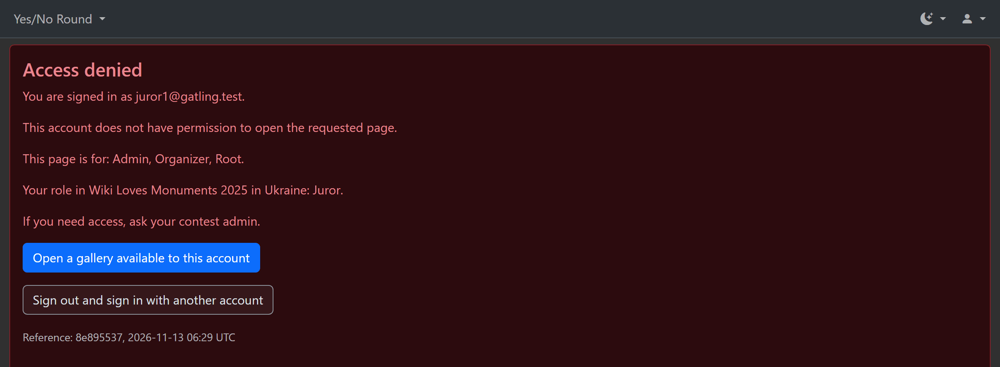

### When you are signed out

By default, you are signed out after 30 days without using the tool, and a year after you
signed in at most. Without **Keep me signed in**, closing the browser signs you out.

When you open a page while signed out, the tool asks you to sign in and then takes you back
to that page. A vote from the gallery says **You have been signed out. Sign in again and
reload the page.** and opens the sign-in page.

### Other errors

**Something went wrong on our side.** comes with a reference. If it happens again, send that
reference to your contest admin.

**This file is no longer assigned to you. Reload the page.** means the contest admins changed
the round's files. Reload the page to see your current list.

**Too many sign-ins at once.** means many people are signing in at the same moment. Wait a few
seconds and try again.
