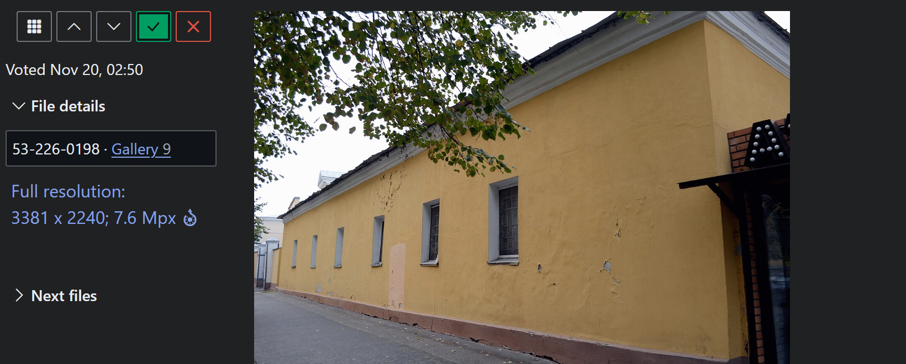
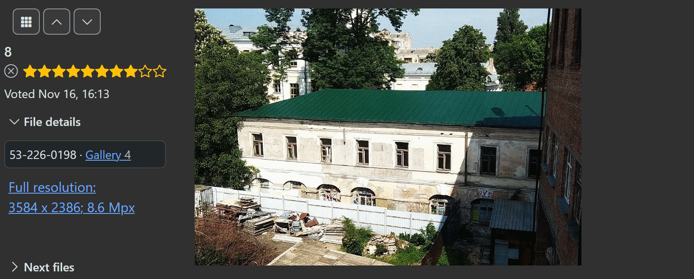
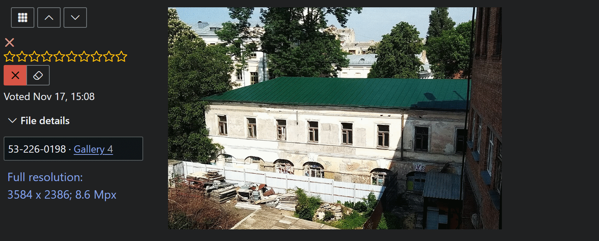
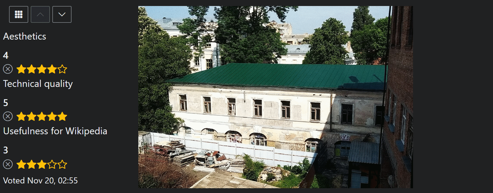
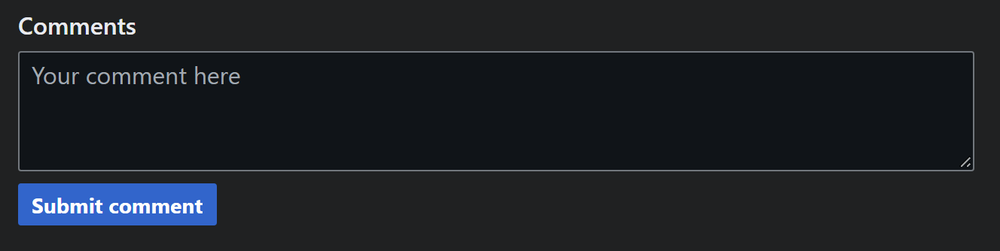

# The large view

## Opening a file in the large view

Click a file in the gallery to see it large. The large view shows one file, with the buttons
and stars on the left. First come three buttons: the grid of squares (**Back to gallery**), the
upward arrow (**Previous image**) and the downward arrow (**Next image**). Pointing at a button
shows its name. Then come the vote buttons or stars. Click the image to open the file's page on Commons in a new tab.

The left column also has **File details**: the full resolution with a link to the original
file (the Commons icon after **Full resolution** marks a link that opens Commons in a new tab),
and for monuments the place and the monument. **Next files** shows the files after this one. Click a heading to show or hide its section; the tool remembers which are open.

Videos play in the large view.

## The monument's page

In a monuments contest, the monument's box in **File details** ends with one line: the
monument's id, **Gallery N** and **Page →**, for example `46-233-0012 · Gallery 2 · Page →`.
**Page →** opens the monument's page:

- its name, place, year and type, as its Wikipedia list has them;
- links to its row in the list on Wikipedia, its category on Commons and its Wikidata item,
  where the list has them;
- **Files**: how many of your files in the round you came from show this monument (**yours**),
  linked to your gallery with only those files. Other jurors' files and votes are never counted
  for you.

**Gallery N** opens your gallery (your choice in the votes menu) with only the monument's N files. It
isn't shown when your gallery already shows only this monument, or when this is its only file
of the monument; the line is then `46-233-0012 · Page →`. Files whose monument isn't in the
tool's monument lists (for example in Wiki Loves Earth) get a small box with the monument's id
and **Gallery N**, without a link to a monument's page; just the id when this is the only file
of the monument or your gallery already shows only this monument.

You see only the files of your rounds: the contest's other files aren't shown to jurors.

## Voting in the large view

In a yes/no round, use the green ✓ button (**Select image**) and the red ✗ button
(**Reject image**). Both are always there, as on the gallery's tiles, and look the same: a
coloured border, filled with the colour while you point at it. The button of the file's vote is
pressed: filled, with a ring of the page's colour inside its border. Click the other button to
change the vote, or the pressed one to undo it (the file is unrated again, neither button
pressed when you come back to it). Either way the view then moves on to the next file, as after
any vote.

In a rated round, click the stars. The number above them shows the file's rate, or "–" if it
has none. While you point at a star, it shows the rate a click gives. The circled cross removes
your rating.

In a round with the worst mark, the stars have no circled cross. Under them are two buttons: the
button with the X icon (**Worst mark**) gives the file the worst mark, and the eraser (**Clear
the vote**), shown once the file has a vote, removes it. Above the stars, a file you gave the
worst mark shows the X icon instead of a number.

After you vote, the large view moves on to the next file, so you can go through your files one
after another, also after undoing a vote. At the end of the list it goes to the file before
instead.

If your vote moves the file in your list, or takes it out of the list you are in, a note says
so, for example **The image you rated (Rejected) is no longer in this list.** Click **View it**
to go back to that file.

## Rating by criteria

In a round with criteria, the large view lists the criteria, each with its own stars and
number. Click the stars of each criterion.

The view stays on the file while you rate its criteria. Go to the next file yourself with the
buttons or the Down key.

A round with **one criterion** is rated like any rated round: the gallery names the criterion
at its top ("Rate: …") and has stars under each file, the large view shows the criterion's name
above its stars, the digit keys rate it, and a vote moves on to the next file.

## Keyboard shortcuts in the large view

The large view works with the keyboard:

| Key | What it does |
|---|---|
| Down arrow | the next file |
| Up arrow | the previous file |
| Page Down / Page Up | two files on or back |
| Home / End | the first or last of the files around this one |
| Esc | back to the gallery, at this file's page |
| Space | select the file (yes/no round; it doesn't undo a selection) |
| Delete | reject the file (yes/no round; it doesn't undo a rejection); give it the worst mark (rated round with the worst mark) |
| Backspace | remove your vote (rated round with the worst mark) |
| 0 up to the highest rate (at most 9) | rate the file (rated round) |

Space and Delete only give their vote: to undo a vote, click the pressed button.

These keys move only among the few files around the one you see, never to the start or end of
your whole list.

The digit keys give the rate in points, from 0 up to the round's highest rate, and at most 9.
In a round of whole stars, 3 gives three stars. In an older half-star round each point is half
a star, so 7 gives three and a half stars. 0 removes your rating. A rate above 9 needs the
mouse.

On a Mac keyboard, reject with Fn and Delete together (the forward delete).

The vote keys work only in your own view of an open round. In a round with several criteria,
rate with the mouse: the digit keys don't rate criteria. In a round with one criterion, they
rate it.

Pointing at a button shows its key, for example **Next image <Down>**.

## Going back after a vote

Your browser's Back button takes you to the file you were on, showing the vote you just gave.
You can change it there.

## Comments on a file

Under the image in the large view is **Comments**. Type in **Your comment here** and press
**Submit comment**. When a file has comments, the 💬 with their number under the buttons takes you
there (also with the keyboard: Tab to it and press Enter; the vote keys still work).

Each comment shows its author and when it was written, in your own time zone (older comments
may have no time). Comments from the contest's other rounds are shown too, without the round's
name.

Comments are not private. The contest's admins and organizers, and the other jurors who open
this file in the contest, see your comment, with your name. You can comment only while the round
is open.
