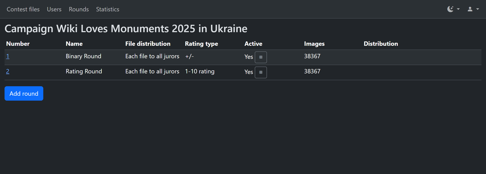
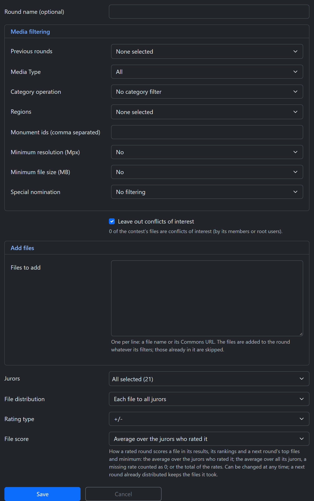
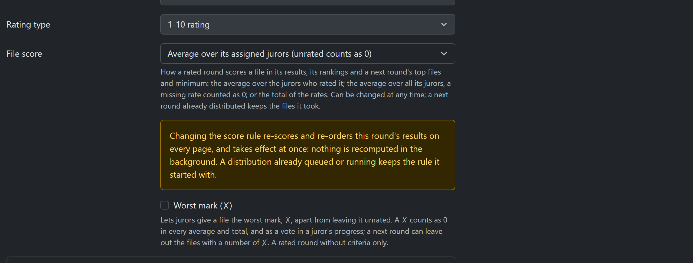
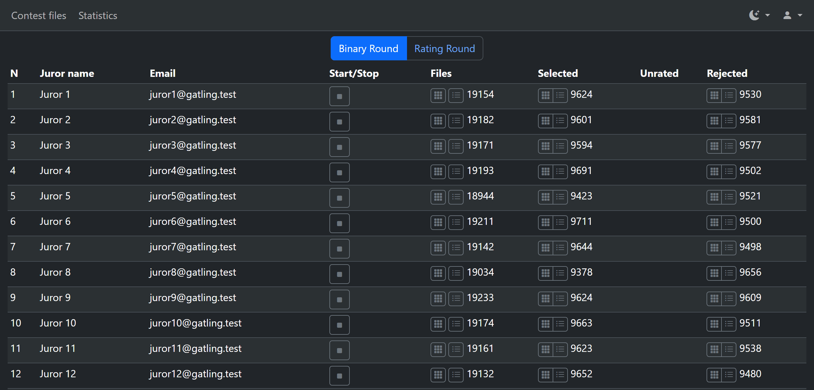
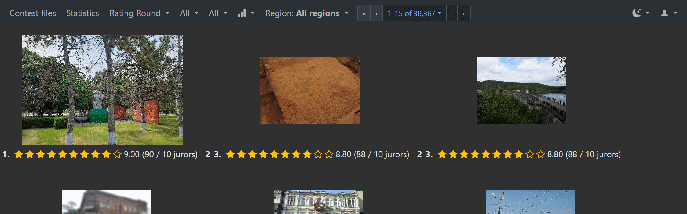
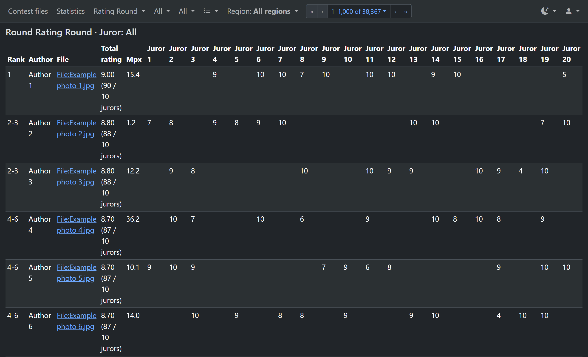
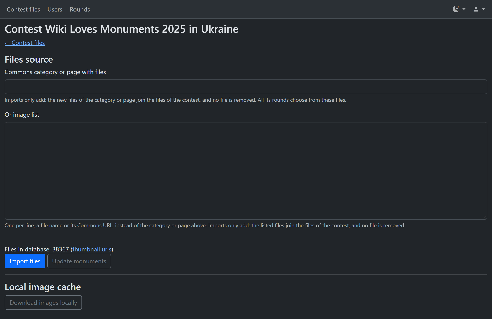
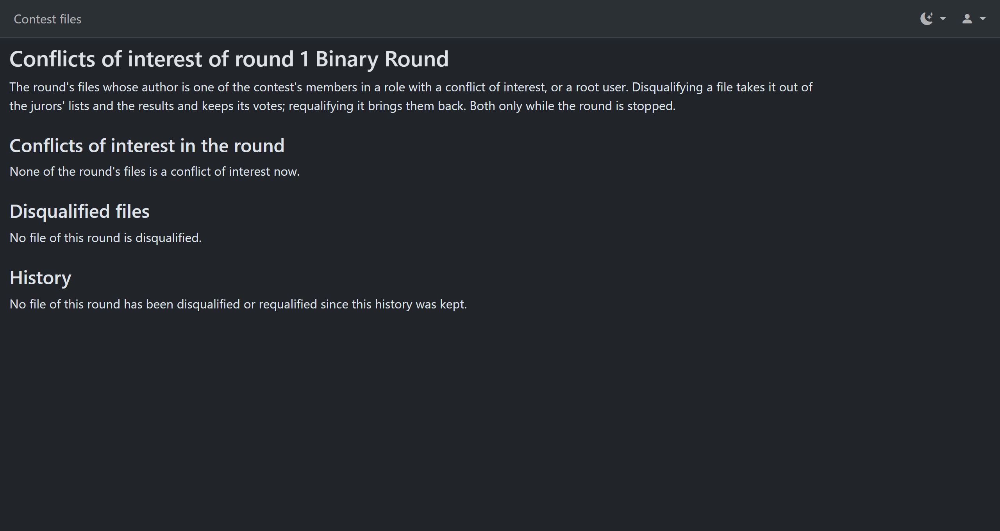

# WLX Jury Tool: a guide for organizers

This guide is for the people who run the jury of a Wiki Loves Monuments, Wiki Loves Earth or
similar photo contest in the WLX Jury Tool. It explains how to set up rounds, give files to
jurors, follow the voting, read the results and handle conflicts of interest.

Labels in **bold** are the ones the tool shows in English. Terms: a **contest** is one competition
(the tool's Campaigns page calls it a campaign), a **file** is one photo or video, a **yes/no
round** is a round with the rating type **+/-**, and the roles are **Jury** (a juror),
**Organizer** and **Admin**. Jurors have their own guide, the
[juror guide](juror-guide.md); read its sections on the gallery and the large view to know what
your jurors see. People and accounts are in the [admin guide](admin-guide.md).

## Who can do what

The tool has these roles in a contest: **Jury**, **Organizer** and **Admin**. A person can have
a different role in each contest. Roles are explained in the [admin guide](admin-guide.md#a-roles).

- An **Admin** of the contest does everything in this guide: creates and changes rounds, starts
  and stops them, gives files to jurors, imports the contest's files, and disqualifies files.
- An **Organizer** reads: the statistics of every round, the results of all jurors, the file
  list, the CSV, the contest's files and the conflicts page. An organizer changes nothing.
- **Root** (the tool's own administrators) can do all that in every contest.

Sections that only admins can use say so. If a button or page is missing for you, your role in
the current contest probably doesn't allow it. The contest menu at the top of the page shows
which contest you are in.

## The ideas in brief

### A contest and its rounds

A **contest** (the tool also calls it a campaign) has **files**, the images and videos taken
from Commons, and **rounds**. A round is one stage of judging: its own files, its own jurors and
its own votes. A typical contest has a first round that every file goes through, and later rounds
that take only the best files of the earlier ones.

### Kinds of rounds

The **Rating type** of a round is one of:

- **+/-**, a yes/no round: jurors select or reject each file.
- **1-N rating**, a rated round: jurors give each file from one star up to N stars, with N from
  3 to 20. A rated round can also use criteria and the worst mark, described below.
- **Comments only**: jurors take no votes, only write comments.

The rating type is chosen when the round is created and can't be changed afterwards.

A **rated round with criteria** (for example Aesthetics, Technical quality, Usefulness for
Wikipedia) asks for stars on each criterion; a file's rate is the sum. You choose 2 to 10
criteria for the round from the shared **Criteria catalogue**, which has a link on the round
form. After the round's first vote you can only replace a criterion by another in its place.

### The life of a round

1. You create the round on the round form. The tool then gives its files to its jurors in the
   background. While it does, the round is hidden from jurors.
2. When all files are given, the round starts: jurors see it and vote.
3. You follow the voting on the statistics page.
4. You stop the round when the voting ends. Votes are kept.
5. You read the results and, if there is a next round, create it from these results.

## Rounds

### The rounds list

Open **Rounds** in the top bar (admins only). The list shows, for each round: its **Number**
(a link to the round form), its **Name**, the **File distribution**, the **Rating type**, whether
it is **Active** (started), the number of **Images** and the state of its distribution.

**Add round** creates a new round.

### Creating a round

Press **Add round**. The page **Create round** has these parts, from the top:

- **Round name (optional)**: a name for the round next to its number.
- **Media filtering**: which files the round takes. [Choosing files](#o-choose-files) describes it.
- **Leave out conflicts of interest**: see [Conflicts of interest](#o-conflicts).
- **Add files**: a list of files to add, see [Adding files by name](#o-add-files).
- **Jurors**: the people who vote in this round. Choose them in the list, which shows the
  contest's jurors.
- **File distribution**: **Each file to all jurors**, or **Each file to N juror(s)**, for
  contests with so many files that each juror takes a part. The files are shared out so that
  each file goes to the number of jurors you chose.
- **Rating type**: see [Kinds of rounds](#o-round-kinds).
- **File score**: see [The file score](#o-score-rule).
- **Worst mark (✗)**: see [The worst mark](#o-worst-mark).
- **Criteria**: see [Kinds of rounds](#o-round-kinds).

Press **Save**. You go to the rounds list, where the round shows its distribution.
**Cancel** leaves the form without saving anything.

If you press Save twice, or send the form again from the browser's Back button, the tool makes
one round, not two, and tells you.

The jurors are chosen when the round is created, and the **Jurors** list can't be changed on an
existing round. To work with other jurors, create another round. Later you can pause and resume
a juror, see [Pausing a juror](#o-pause-juror).

### Choosing the round's files

The **Media filtering** section of the form decides which of the contest's files go into the
round. Leave a filter at its default to not use it. Filters add up: a file must pass all of them.
A round for all the files takes no filters at all.

**From earlier rounds**

- **Previous rounds**: take the files of one or more earlier rounds, which must all be of the
  same rating type (all yes/no or all rated). With none chosen, the files come from the whole
  contest, and the filters below that name earlier rounds don't apply.
- **Selected by at least X jurors**: for earlier yes/no rounds. A file is taken when at least X
  jurors selected it (X from 1 to 6). **No filter** takes all the files of the earlier round.
- **Average file rating is at least**: for earlier rated rounds. A file is taken when its score
  in the earlier round is at least this number. The score follows that round's
  [file score](#o-score-rule): with the total of the rates it is a total, and for a round with
  criteria it is the sum of the criteria's rates, averaged over the jurors. The hint under the
  field says which applies.
- **Number of top files from the previous rounds**: take only the best N files. After the
  other filters, the files are ordered by the earlier round's score, and N are taken. For an
  earlier yes/no round the field **Top files of a yes/no round by** chooses the order:
  **Approvals, then fewest rejections** or **Approvals minus rejections**.
- The **rejection filter**: take or drop files by how many jurors rejected them in the earlier
  rounds. See the next section.

**By the file itself**

- **Media Type**: **All**, **Video** or **Image**.
- **Category operation**, **Category A** and **Category B**: the Commons categories the file
  must be in. The operations are **No category filter**, **In category A**, **Not in category A**,
  **In both A and B**, **In A or B (or both)** and **In A but not B**. Typing in a category
  field suggests Commons categories.
- **Regions** and **Monument ids (comma separated)**: for monuments contests where the tool
  knows the regions (at present Ukraine's). Choose one or more regions, or list monument ids.
- **Minimum resolution (Mpx)** and **Minimum file size (MB)**: leave out small files.
- **Special nomination**: only the files of one special nomination, for contests that have them.

Most of these filters can only be set when the round is created. On an existing round the form
shows them, but they can't be changed.

### The rejection filter

The rejection filter uses how many jurors rejected each file in the earlier rounds, counting
every rejection in all of them. It works with earlier yes/no rounds, and with earlier rated
rounds without criteria, where a worst mark ✗ counts as a rejection. It shows once you choose
such a previous round.

It has two fields. **Rejected files** is the mode:

- **No filter (keep rejected files)**: rejections don't matter.
- **Exclude files rejected by at least X jurors**: a file is left out when X or more jurors
  rejected it. This drops the files that jurors agreed were bad, for example after a screening
  round where jurors rejected only the few worst files.
- **Only files rejected by at least X jurors**: a file is taken only when X or more jurors
  rejected it. This is for a round that looks again at the files that were doubted.

The second field, **X: rejected by at least X jurors**, is the number, from 1 to 6. The filter
combines with the other filters of the round.

The form refuses these choices: a mode with no X ("Choose X, the number of jurors…"), an X with
**No filter** ("Choose whether to exclude the rejected files or take only them, or clear X"), and
the filter with no previous round that has rejections ("The rejected files filter needs a previous
round with rejections: a yes/no round, or a rated round without criteria").

### Adding files by name

In **Add files**, type or paste file names or Commons addresses, one per line, in **Files to
add**. The tool adds these files to the round whatever its filters say. Files already in the
round are skipped. If a line doesn't name a file, nothing is added and the page lists the lines.
You can add files this way both when you create a round and later.

### The distribution of files

After you save a new round, the tool gives its files to its jurors as a **background job**. The
rounds list, and the top of the round form, show the job under **Distribution**: its state,
for example queued or running, and its progress as a number of files done out of the total.

While the job runs the round is hidden from jurors, and you can't start it: the tool says
that its images are still being distributed. The round starts by itself when the distribution
has finished. You can leave the page and come back.

- **Cancel** stops the job. It shows while the job runs and after it fails.
- **Retry** runs a failed job again, from where it stopped. It shows only for a failed job.

If a job fails, the state shows why. A message with a **reference** is for the contest's tool
administrators: send them the reference. If the tool stopped for a while while a job was running,
it takes the job up again by itself.

A round has one distribution job at a time. Starting a second one for the same round, for
example from another browser tab, tells you that its images are already being distributed.

### Distributing new files

When files are added to the contest after a round was created, or a file list is added to it,
the round can take them. Open the round form: the box **Distribute N new files** is there, and
**Count** shows how many files the round would take. Tick the box and press **Save** to start the
distribution of these files to the round's jurors, by the same filters as before.

The round keeps its own settings. For example, a next round whose files were taken from this
round by its score keeps the rule it started with.

### Changing a round

Open the round from the rounds list: its number is a link. On an existing round you can change:

- the round's name;
- the [file score](#o-score-rule) and the [worst mark](#o-worst-mark), at any time;
- the criteria, only by replacing one in its place once the round has votes;
- **Leave out conflicts of interest**, see [Conflicts of interest](#o-conflicts);
- **Add files** and **Distribute N new files**.

The rest of the form is shown but can't be changed: the files' filters, the rating type and the
file distribution. To start over, create another round. The panel **Jurors** shows each
juror's counts, as the statistics page does.

**Cancel** leaves without saving anything.

At the bottom of the form of an existing round there are also the button **Conflicts of
interest of this round**, and, where the tool's operators have set up a local image cache,
**Download images locally**, which fills it for this round's files.

### The file score

The **File score** option decides how a rated round gives a file its score. The score is shown
in the results and ranks the files, and a next round's top files and minimum score use it. The
three rules are:

- **Average over the jurors who rated it**, the default: the file's rates added up and divided
  by the number of jurors who rated it.
- **Average over its assigned jurors (unrated counts as 0)**: the rates divided by the number of
  jurors the file was given to, a juror who didn't rate it counting as 0.
- **Total of the rates (a file a juror skipped adds nothing)**: the rates added up, not
  divided.

The results show what the score is divided by, for example "14.50 (29 / 2 of 3 jurors)" or "29
(sum of 3 jurors)".

You can change the rule at any time. It changes the scores and the order of the round's results
on every page at once, and nothing is recomputed in the background. **The page warns you** when
the round has votes and you pick another rule. The warning says that:

- the results are re-scored and re-ordered everywhere, at once;
- a distribution that is already queued or running keeps the rule it started with;
- the later rounds that took their top files or minimum score from this round are named. Their
  files don't change, but a later **Distribute new files** there uses the new rule.

### The worst mark (✗)

The **Worst mark (✗)** option is for rated rounds without criteria. It is off by default. When
it is on, a juror can give a file ✗ for a file worth fewer than one star, which is different from
leaving it unrated:

- a ✗ counts as 0 in every average and total;
- a ✗ is a vote: the file counts as rated in the juror's progress and in the round's count of
  jurors who rated it;
- the results show "✗ n" beside the file's score, for a file with ✗ votes: the file list, the
  by-rate gallery, the large view of all jurors and the CSV;
- a next round can use the ✗ in the [rejection filter](#o-rejection-filter).

Jurors give ✗ with a button and clear a vote with another, see the [juror
guide](juror-guide.md#rated-rounds-stars). The form hides the option for a yes/no round, a
comments-only round and a round with criteria (and refuses it there if it is sent anyway). You can turn it on or off on an existing round.

## Following the voting

### Statistics

Open **Statistics** in the top bar for a round. A row for each juror shows the number of files
the juror has, and the juror's votes: for a yes/no round **Selected**, **Unrated** and
**Rejected**, for a rated round **Rated** and **Unrated**. The icons next to the counts open the
juror's gallery or file list, or only their selected, unrated or rejected files. The last row
sums up all the jurors, with links to the results of all jurors, see the next part. A
file with votes of two kinds is counted in each, so the columns of the totals can add up to more
than the files.

The statistics page is for admins, organizers and root. The round menu on the page switches
round.

### Pausing a juror

In the **Start/Stop** column of the statistics page, the button next to a juror's name pauses
their voting in that round (**Pause the juror's voting**), and the same button resumes it
(**Resume the juror's voting**). It's for admins. The round disappears from that juror's view
while they are paused; their votes are kept, and the juror's files stay assigned to them.

## Results

### Reading the results

The bar at the top of a round's pages, for you, has the menus that show other views of the same
round: the round, the juror (a single juror's votes, or **All**), a vote filter and four views:
the **Gallery**, **By rate**, **File list** and **CSV**. The views of **All** jurors are read
only.

You can see a juror's votes only for a juror of that round. Choosing another person's page
shows the tool's "not found" page.

### The by-rate gallery

**By rate** shows the files of the round as a gallery, best first, with each file's rank and
score. In a yes/no round the order depends on the menu next to the views: **Approvals, then
fewest rejections** or **Approvals minus rejections**. The vote filter shows only files with
**Selected**, **Unrated** or **Rejected** votes: for a yes/no round, files with at least one
such vote, or for a rated round **Rated** or **Unrated**. A rated round's score follows its
[file score](#o-score-rule), with the divisor shown. In a round with criteria, each file shows
its stars for each criterion. A file with ✗ votes shows "✗ n".

Clicking a file opens its [large view](#o-large-view).

### The file list

**File list** shows the files of the round in a table: the rank, the file, its score, and a
column for each juror with their vote. The table also shows the author of each file, for
organizers. In a round with criteria it has the average of each criterion. Use it to compare the
jurors, or to look for a file by name.

When there are many files, the pager at the top works as in the [juror
guide](juror-guide.md#the-pager).

### The large view for all jurors

Open a file from the by-rate gallery or the file list to see it large with the votes of **all**
jurors: the file's score and the comments on it. In a round with criteria, it shows the stars
of every criterion. The view doesn't take votes for the jurors. The keys that move between files
work as in the [juror guide](juror-guide.md#keyboard-shortcuts-in-the-large-view).

### The CSV

The **CSV** view downloads the round's results as a file for a spreadsheet. It has a row for
each file, in the order of the list you were on, and the columns **Rank**, **File**, **Overall**
(the score), for a round with criteria a column for each criterion, then a column for each
juror. The last row explains the values: for a yes/no round, 1 selected, -1 rejected, 0 not voted
yet, empty not assigned; for a rated round with the worst mark, -1 is the worst mark.

The file is named **WLXJury_Round_** with the round's name. Cells that start with a character
that a spreadsheet would read as a formula are changed so that they don't run as one.

### The contest's files

**Contest files** in the top bar (for admins and organizers) shows all the files of the contest
in a gallery, with regions and a large view, with the files that were deleted on Commons on
their own tab, **Deleted on Commons**.

### Importing the contest's files

Admins bring files into the contest from the **Images** link of the contest on the campaigns page
(or **Import and cache** on the contest files page). The page **Files source** takes a Commons category
or a page, or a pasted list of files in **Or image list**, and **Import files** adds them.
Imports only add: no file is removed, and all the contest's rounds choose from these files.

For monuments contests **Update monuments** refreshes the files' monument ids. Where the tool's
operators have set up a local image cache, **Download images locally** fills it. These run as
background jobs, with their progress.

## Conflicts of interest

### What a conflict of interest is

A file is a conflict of interest when its author is a member of the contest in a role that
gives a conflict of interest (Jury, Organizer, Admin, and the Board, Audit committee and Staff
roles), or a root user. The tool recognises the files by the members' **Wiki account**. A
member without one can't be checked, and the users page says so next to their name. An admin
can set the wiki account, see the [admin guide](admin-guide.md#a-users).

### Leaving them out of a round

Tick **Leave out conflicts of interest** on the round form. The form shows how many of the
contest's files, and of the round's files, are conflicts.

- On a new round, these files are left out when its files are given to jurors.
- On an existing round, saving the form with the box ticked disqualifies the round's conflicts,
  keeping their votes aside. It works only while the round is stopped. On an open round the
  tick makes only the later distributions leave them out; the tool then shows a link to the
  conflicts page.

### The conflicts page

Press **Conflicts of interest of this round** on the round form, to open the page **Conflicts of
interest of round …**. Admins and organizers can open it. It has:

- **Conflicts of interest in the round**: the files whose author is a conflicted member now,
  each with its author and reason.
- **Disqualified files**: the files taken out of the round.
- **History**: every disqualification and requalification, newest first: when, which file, the
  reason, the status before and after, and who did it.

A round without conflicts, as in the picture, says so in each part.

### Disqualifying and requalifying

Admins do these on the conflicts page, **only while the round is stopped**. On an open round the
page offers **Stop the round**, with a confirmation.

- Select files and press **Disqualify the selected files**. They leave every juror's list and
  the results. Their votes are kept aside. **Distribute new files** never adds them again.
- Select files in **Disqualified files**, choose **Why** (**A mistaken match** or **The conflict
  has ended**) and press **Requalify the selected files**. The files come back with their votes.
  A file that was deleted on Commons while the round was open stays out.

Jurors don't need to do anything. Their round may disappear for a while, as long as it is
stopped.

## Starting and stopping a round

### Starting and stopping

In the rounds list, the **Active** column shows **Yes** or **No**. The button in it, a play or a
stop icon, starts the round (**Start the round**) or stops it (**Stop the round**). It's for
admins. The conflicts page of a round has a **Stop the round** button too.

A round whose files are still being distributed can't be started; it starts by itself when the
distribution is done.

### What jurors see

A juror sees a round only when it is started, the juror is in it and not paused, and its
distribution is done. When a round is stopped it disappears from the jurors' view, and votes in
it are refused ("This round is closed for voting"). Votes are kept, and the round comes back
when you start it again. A juror with no round open sees **No round configured yet**.

Jurors see their own votes only. In the large view of a file they see comments of other jurors,
with names.

The REST API is for root only, with root's tokens, and is not covered here.
