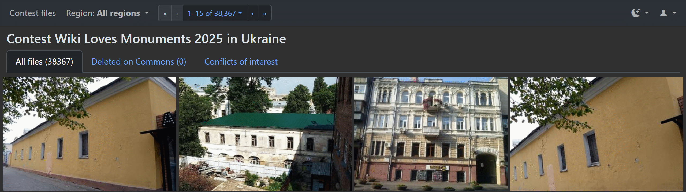
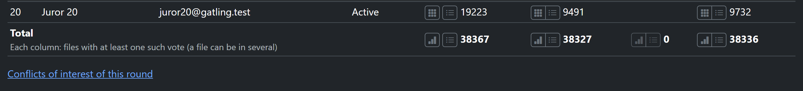

# WLX Jury: a guide for organizers

This guide is for the organizers of a Wiki Loves Monuments, Wiki Loves Earth or similar photo
contest in WLX Jury: the members of the contest's organizing team who help follow the voting. As
an organizer you read the statistics of every round, the results of all jurors, the file list, the
CSV, the contest's files and the conflicts page, and you may comment on the files of an open
round. You change nothing else: the contest's admins set it up and run the judging, as the [admin
guide](admin-guide.md) explains. Admins see everything in this guide too.

Labels in **bold** are the ones the tool shows in English. Terms: a **contest** is one competition,
a **file** is one photo or video, a **yes/no round** is a round with the rating type **Yes/No**, and
the roles are **Juror**, **Organizer** and **Admin**. Jurors have their own guide, the
[juror guide](juror-guide.md); read its sections on the gallery and the large view to know what
the jurors see.

## Who can do what

The tool has these roles in a contest: **Juror**, **Organizer** and **Admin**. A person can have
a different role in each contest. Roles are explained in the [admin guide](admin-guide.md#a-roles).

| | Juror | Organizer | Admin |
|---|---|---|---|
| Vote | on their own files | no | no |
| Read the statistics, the results of all jurors, the file list and the CSV | no | yes | yes |
| See the contest's files | no (their own files, in their rounds) | yes | yes |
| See the conflicts page | no | yes | yes |
| See the files' authors and the authors list | no | yes | yes |
| Comment on a file of an open round | their own files | any file of the round | any file of the round |
| Read the [comments report](#o-comments-report) | of their own files | yes | yes |
| Download the comments CSV, show one person's comments | no | yes | yes |
| Set up rounds and files, start and stop rounds, pause jurors, disqualify files, manage people | no | no | yes |

**Root**, the tool's own administrators, can do what an admin can, in every contest.

If a button or page is missing for you, your role in the current contest probably doesn't allow
it. The contest menu at the top of the page shows which contest you are in.

## Where to start

After you sign in, the tool opens the **Statistics** of a round of your contest: the latest
open round, or the latest round if none is open. A contest with no round yet shows **No round
configured yet**.

- The row of round names above the statistics table switches round.
- **Contest files** in the pages menu at the start of the top bar opens the contest's files.
- **Statistics** in the same menu, on every page of the contest, opens the statistics of the
  round you are looking at, or else of the latest open round (once the contest has a round).
- The contest menu at the top of the page switches contest, if you are in more than one.

There is no **Rounds** or **Users** menu for you: those are the admins'. The admins create the
rounds, give their files to the jurors, start them and stop them; a round being prepared is
hidden from the jurors until all its files are given.

## Kinds of rounds

The **Rating type** of a round, chosen by the admins, decides what the votes and the results
look like:

- **Yes/No** (a yes/no round): jurors select or reject each file.
- **1-N rating**, a rated round: each juror gives each file from one star up to N stars. Some
  rated rounds use **criteria** (for example Aesthetics, Technical quality, Usefulness for
  Wikipedia): stars on each criterion, and a file's rate is the sum. Some use the **worst mark**,
  shown as an X icon, for a file worth fewer than one star; it counts as 0 in the score.
- **Comments only**: jurors take no votes, only write comments.

The admin guide explains [the kinds of rounds](admin-guide.md#a-round-kinds) as the admins
choose them.

## Following the voting

### Statistics

**Statistics** shows a row for each juror of the round: **N**, **Juror name**, **Email**, the
juror's **Voting** state, the number of **Files** the juror has, and the juror's votes: for a
yes/no round **Selected**, **Unrated** and **Rejected**, for a rated round **Rated** and
**Unrated**. The icons next to the counts open the juror's gallery or file list, or only their
selected, unrated or rejected files.

The **Voting** column shows **Active**, or **Paused** when the admins have paused the juror's
voting in this round: the round is then hidden from that juror, and their votes are kept. Admins
see pause and resume buttons in this column instead, see [Pausing a
juror](admin-guide.md#a-pause-juror).

The last row, **Total**, sums up all the jurors, with links to the results of all jurors, see
the next part. In a yes/no round a file with votes of two kinds is counted in each, so the
columns of the totals can add up to more than the files.

Under the table:

- for a rated round, the round's **File score** rule, see [The score](#o-score);
- **Comments on the round's files (N)**, the [comments report](#o-comments-report): N is the
  number of comments written in this round on its files. When the round's files also have
  comments from other rounds of the contest, **all rounds (M)** follows with all of them, and
  opens the report with **All rounds of the contest**;
- the link **Conflicts of interest of this round**, see [The conflicts page](#o-conflicts-page),
  with the number of the round's files that are conflicts of interest now and of its
  disqualified files, for example "(3 files · 2 disqualified)". With neither it says "none",
  and while the round has a history of disqualified and requalified files, "none · history (N)"
  (500+ when it has more than the 500 latest events the page lists);
- the link **Authors of this round**, see [The authors list](#o-authors-list), with the number of
  authors the list shows and of the files without a stored author, for example "(148 · 12 files
  without an author)". "None stored" can mean that the files were imported without their
  authors; the link then still opens the list while some files have no author, for example
  "none stored · 12 files without an author";
- **Deleted on Commons**, when some of the round's files were deleted on Commons: the number
  links to these files.

A link whose number is 0 is plain text. The numbers of the conflicts and authors links appear
a moment after the page; until then, the links work without them.

## Results

### Reading the results

The bar at the top of a round's results has, from left to right, the pages menu (its button the
menu icon and the page you are on, for example **Gallery**; its items **Contest files**, for
admins **Users** and **Rounds**, and **Statistics**; for root also **Contests**), then the
filters: the round, the juror (a single juror's votes, or **All**), the votes menu, the
[**Comments**](#o-comments-filter) menu and the region menu; after a thin line the order and the
view menu (the **Gallery**, **By rate**, **File list** and **CSV**); then the pager. The views of
**All** jurors take no votes. Your own files in a round, if you have any, are under your name in
the juror menu, with the same bar.

The votes menu is the jurors' own: **All**, **Unrated**, **Selected** and **Rejected** (in a rated
round **All**, **Unrated** and **Rated**), keeping the region and the other filters. In a single
juror's view each choice has its count, and on **All** the button adds how many of the juror's
files in the list are unrated (**All (900) · 40 unrated**); the view of **All** jurors has no
counts. In a window narrower than about 1700 pixels, the pages menu shows only its icon, the
votes menu its choice and count without the unrated, the **Comments** menu a speech bubble and its count, a single juror's order
menu a sort icon, and the region menu only the chosen place, without the word "Region" (or
"Country"); point at an icon to see its name. A long juror name or region is cut short (point at
it to see it whole). The bar and its pager stay on one line from 1280 pixels.

You can see a juror's votes only for a juror of that round. Choosing another person's page
shows the tool's "not found" page.

**Files with comments:** the **Comments** menu, after the votes menu, has **All files**, **Only
with comments (N)** and **Recent comments list (N)**. **Only with comments** shows only the files
with comments in the view you are on: a single juror's files, or all of them for **All**. It
works with the votes menu (for example the selected files with comments), the region, the order
and every view, the CSV included, and N is how many files of the current view have comments. The
large view then moves through those files only. **Recent comments list** opens the
[comments report](#o-comments-report) of the same files (the juror, votes choice, region and
monument kept), with all rounds' comments, by the latest comment. The menu's button says
**Comments (N)**, or, highlighted, **With comments (N)** or **Comments list (N)**; in the view of
**All** jurors without the number. A choice with no file is greyed
out. In the gallery, the by-rate gallery and the large view's **Next files**, a file with
comments shows a speech bubble with their number. Both count the comments the file's large view
shows: from any round of the contest, by anyone.

**Comments report:** **Recent comments list** in the **Comments** menu (also **Comments on the
round's files** in the round's statistics) lists the files with comments, 20 to a page. Each
file has its thumbnail and name, which open its large view, its result in the round (the votes of
**All** jurors, or the chosen juror's vote, a rated round's stars), and then its comments, each
with its author, its time and, for a comment from another round, that round's name. Above the
list:

- **This round** or **All rounds of the contest**: which comments the report shows. A file is
  listed when it has at least one comment of that choice; **All rounds of the contest** shows
  every comment its large view shows. The **Comments** menu opens the report with **All rounds of
  the contest**, the same files as its **Only with comments**; the round's statistics open it with
  **This round**.
- **Comments CSV**: a spreadsheet with one row per comment of the report, in its order: the file,
  its page id and Commons link, the author, the time (UTC), the round and the text.

The order menu, in the bar's order place: **Latest comment first** (the default), by the newest
comment of the choice above, or the view's own (for **All** jurors the yes/no orders or by
rating, and file order; for one juror that juror's orders). The report opens in it from the
**Comments** menu and the round's statistics; the order chosen in the report is kept by its
pages, the CSV and the large view's previous and next. Leaving the report for another view keeps
that order, except **Latest comment first**, which goes back to by rating.

**Only with comments** in the **Comments** menu goes back to the gallery with only the files with
comments (the juror, votes choice, region and monument kept), in the gallery's default order, and
**All files** to all of them. With **This round** the gallery can have more files (it counts
comments from any round), so the menu shows no numbers there.

A juror opens the report of their own files only, from **Recent comments list** in their
**Comments** menu: every comment their large view shows (all rounds of the contest), without
the round names, the scope buttons, the CSV or the icons below. Another juror's report, all
jurors' together and the CSV are refused to them.

**One person's comments:** after each comment's author are small icons. The funnel
(its tooltip: **Only the comments by Name**) shows the report with only the files that
person commented on, by their comments of the choice above (**This round** or **All rounds of the
contest**). A chip **Comments by Name ×** above the list says so; **×** shows everyone's comments
again. Each file then shows that person's comments, with the file's other comments folded under
them (**N other comments on this file**, click to open). **Latest comment first** is then by that
person's latest comment; the counts, the pages, the **Comments CSV** (only their comments) and the
large view's previous and next follow it, together with the juror, votes choice, region and order.
The pictures icon (**Gallery of juror Name in round …**) opens that person's gallery of the round
the comment was written in, with their votes; it is shown only for a juror of that round (a
pre-screener's comment in an earlier round links their gallery there). Old comments without
an account have no icons. Hover over an icon to see what it does; screen readers read the same
text.

The juror, votes, Comments and region menus and the pager work as in the other views, the CSV
included. Only admins and organizers of the contest (and root) can open all the jurors' report
and its CSV; jurors open only their own report, without the CSV. Comment authors' names and texts leave the tool in the
CSV: share it only with the contest's team.

In a single juror's **Gallery** each file shows that juror's vote, read-only: in a yes/no round a
green or red frame with a thumb, in a rated round the juror's stars (or ✗). In the **Gallery** of
**All** jurors' votes on a yes/no round each file shows its tally, approvals (✓) and rejections
(✗), in the order chosen in the menu next to the views.

A single juror's **Gallery** and **By rate** views have an order menu, by that juror's votes:
**In file order**, **By rating**, **Newest votes first** and **Oldest votes first** (when the
juror last changed each vote; votes from before these options count as the oldest, unrated
files come last). With a yes/no round's **Selected** or **Rejected** filter it has **In file
order** and the two vote-time orders; with **Unrated**, the files are in file order. In the
vote-time orders each file shows when the juror voted (in your time zone; **Time not recorded**
for votes from before), and the large view of a single juror's vote shows it in every order. The
views of **All** jurors keep their own order and show no vote times.

### The score

In a rated round each file has a score, which ranks the files. The admins choose how the round
computes it: the average over the jurors who rated the file (the default), the average over the
jurors it was given to, a juror who didn't rate it counting as 0, or the total of the rates. The
results show what the score is divided by, for example "14.50 (29 / 2 of 3 jurors)" or "29 (sum
of 3 jurors)". The rules are in [The file score](admin-guide.md#a-score-rule).

### The by-rate gallery

**By rate** shows the files of the round as a gallery, best first, with each file's rank and
score. In a yes/no round the order depends on the menu next to the views: **Approvals, then
fewest rejections** or **Approvals minus rejections**. The votes menu shows only files with
**Selected**, **Unrated** or **Rejected** votes: for a yes/no round, files with at least one
such vote, or for a rated round **Rated** or **Unrated**. A rated round's score follows its
[file score](#o-score), with the divisor shown. In a round with criteria, each file shows
its stars for each criterion. A file with worst marks shows how many ("n worst marks").

Clicking a file opens its [large view](#o-large-view).

### The file list

**File list** shows the files of the round in a table: the rank, the file, its score, and a
column for each juror with their vote. The table also shows the author of each file, for
organizers and admins. In a round with criteria it has the average of each criterion. Use it to
compare the jurors, or to look for a file by name.

When there are many files, the pager at the top works as in the [juror
guide](juror-guide.md#the-pager).

### The large view for all jurors

Open a file from the by-rate gallery or the file list to see it large with the votes of **all**
jurors: the file's score and the comments on it. In a round with criteria, it shows the stars
of every criterion. The view takes no votes. The keys that move between files work as in the
[juror guide](juror-guide.md#keyboard-shortcuts-in-the-large-view).

**Comments:** while the round is open, the view has a comment box under the file, as the
jurors' large view has: type your comment and press **Submit comment**. Each comment shows its
author and time (in your time zone; some older comments have none), and the round's name if it
was written in another round of the contest. Only admins, organizers and root see that round
name; jurors see the comment without it. Comments are not
private: whoever opens the file's large view in the contest sees them, with your name: its
admins and organizers, and the jurors who have the file. When the round is stopped, the file's
comments are still shown, but no new ones can be added: the tool refuses a comment on a stopped
round's file, also one sent from a page opened before the round was stopped.

### The CSV

The **CSV** view downloads the round's results as a file for a spreadsheet. It has a row for
each file, in the order of the list you were on, and the columns **Rank**, **File**, **Overall**
(the score; in a round with criteria **Overall (sum of the criteria)**), for a round with criteria
a column for each criterion's average, then a column for each juror. The last row explains the
values: for a yes/no round, 1 selected, -1 rejected, 0 not voted yet, empty not assigned; for a
rated round with the worst mark, -1 is the worst mark.

The file is named **WLXJury_Round_** with the round's name. Cells that start with a character
that a spreadsheet would read as a formula are changed so that they don't run as one.

### The contest's files

**Contest files** in the pages menu at the start of the top bar shows all the files of the contest in a gallery, with the region
menu of a monuments contest, and a large view of each file. It has three tabs:

- **All files**;
- **Deleted on Commons**: the files that were deleted on Commons;
- **Conflicts of interest**: the contest's files that are conflicts of interest, each with
  whose it is, see [What a conflict of interest is](#o-conflicts).

The **Import and cache** button next to the contest's name is only for admins, who bring the
files in with it, see [Importing the contest's files](admin-guide.md#a-import-files).

Jurors don't open this page: it is for the contest's admins and organizers. A juror who follows
an old link to it gets the "no access" page, which suggests their round's gallery. Jurors reach
a monument's files in their own round instead (see below).

### Monuments

In a monuments contest, the monument's box in a file's large view (in a round and on the contest
files page) ends with one line, for example `46-233-0012 · Gallery (2) · Page →`: the
monument's id, **Gallery (N)** in a round (see below), and **Page →**, which opens the monument's
page. The page shows the monument as its Wikipedia list has it, links to its list row on
Wikipedia, its Commons category and its Wikidata item where the list has them, and under
**Files**:

- **In the contest: N →**: the contest's files of this monument. The link opens the contest files
  page with only them, under a chip **Monument: … (N)**; the **×** on the chip shows all the files
  again. The filter takes the monument's id exactly and keeps to the pages, the region and
  country menus, the author filter and the large view.
- **In round …: N →**: the round's files of this monument, those any juror has (for a juror: only
  their own, and the contest's count isn't shown to them). The link opens the round's gallery
  with only them: all the jurors' votes for you, a juror's own gallery for them.

A round's lists (the gallery, by rate, the file list and the comments report) take the monument
filter too, with a compact chip **Monument: …** in the bar's filters, where the region menu is:
**↗** opens the monument's page and **×** removes the filter. The votes menu and the pager count
only the monument's files, the region menu is hidden while the filter is on (a monument is in one
region), and the filter keeps to the pages, the votes choices, orders, views, the round and juror
menus and the large view, whose next and previous files and votes by keys stay among the
monument's files. In the large view, the monument's line has **Gallery (N)**, which opens the list
you are in (the same juror, votes choice and order) with only the
monument's N files; it is left out while the list already has only them and when the file is the
list's only one of the monument. For a file whose monument isn't in the tool's monument lists
the box shows the id and **Gallery (N)**, or just the id when the file is the list's only one of
the monument or the list already has only the monument's files.

The page counts files only in a contest you are a member of, and a round you may see; opened
from elsewhere it shows the monument alone. **Monuments** (`/monuments`) opens a monument's page
by its id.

### Authors

Jurors never see who took a file. You, the admins and root see the author, as their Commons
account, in these places:

- the large view of a file, in a round and on the contest files page (**Author:**);
- the **Author** column of a round's file list (of all the jurors' votes, and of one juror's in a
  rated round);
- the **Conflicts of interest** tab of the contest files page, which lists the people whose files
  they are.

Each author's name links to their files. Where it leads depends on where you are:

- **In a round** (the round's large view and file list, and a round's authors list): the round's
  list with only that author's files. From the large view and the file list it is the list you
  are in (the same juror, or all the jurors' votes, and the same tab and order); from a round's
  authors list it is the round's gallery of all the jurors' votes. In the large view and the
  authors list a small images icon beside the name opens the contest files page with the author
  instead.
- **In the contest** (the contest's authors list, the contest files page's large view and its
  conflicts of interest): the contest files page with only that author's files.

The contest files page shows a chip **Author: … (N)** above the files, N being the number of
files in the current tab; a round's lists show a compact chip **Author: …** in the bar's filters,
after the monument's, a long name cut short (point at it to see it whole). The **×** on the chip
shows the files of all authors again. On the contest files page the pages, the region and country
menus and the large view keep the author; the tabs show all the contest's files again. In a
round's lists (the gallery, by rate, the file list, the comments report and its CSV) the filter
keeps to the pages, the votes choices, orders, views, the region, round and juror menus and the
large view, whose next and previous files stay among the author's files (a compact chip there
says so). The votes menu and the pager count only the author's files, and the filter combines
with the monument filter and **Only with comments**. The small link **Commons ↗** beside a name
on the contest files page, or **↗** on a round's chip, opens the author's user page on Wikimedia
Commons in a new tab.

The filter takes the author exactly as stored: "Ivan", "ivan" and "Iván" are three different
authors. It is yours, the admins' and root's only: a juror who opens a link with an author gets
their own list without it, and never sees the author.

### The authors list

The **Authors** button next to the contest's name on the contest files page, and the link
**Authors of this round** under a round's **Statistics**, open the authors list. It has each
author of the contest's files, with the number of their files, linked as above. A line above
the table says how many authors and files there are, and how many files the author with the
most has, with their share, for example "Round 2: 87 authors, 482 files; most by one author: 41
(8.5%)". Files without a stored author are counted below that line.

The buttons above the list choose the whole contest or one of its rounds. A round's list counts
only the files in that round. Once the round has votes, it also counts them per author, over
all its jurors:

- a yes/no round: each file counts once, so the three columns add up to the author's files,
  each with its share of them:
  - **Approved**: at least one juror said yes;
  - **Rejected by all**: votes were cast, none of them yes;
  - **Not voted yet**: no vote cast, whether its jurors haven't voted yet or nobody is assigned
    the file.

  **Approval rate** is the share of yes among all the yes and no votes cast on the author's
  files: a file with 1 yes and 2 no counts as approved, and gives an approval rate of 33%. It
  compares authors whatever the number of jurors per file; it is "—" for an author without a
  cast vote. Sorted from the lowest, it shows first the authors the jurors reject the most
  ("—" stays last);
- a rated round: **Rated** (files with at least one rating), **✗ (worst mark)** (files with at
  least one worst mark, in a round that takes the worst mark or has one) and **Average**, the average score of the
  author's rated files in stars, as the round scores a file (see the admin guide's [The file
  score](admin-guide.md#a-score-rule)). In a round with criteria, the average is per criterion.

Click a column's heading to sort by it, and again to sort the other way. The vote columns sort
by the share of the author's files, so 12 of 14 rejected comes before 30 of 100.

## Conflicts of interest

### What a conflict of interest is

A file is a conflict of interest when its author is a member of the contest in a role that
gives a conflict of interest (Juror, Organizer, Admin, and the Board, Audit committee and Staff
roles), or a root user. The tool recognises the files by the members' **Wiki account**. A
member without one can't be checked. An admin can set the wiki account, see the [admin
guide](admin-guide.md#a-users).

The admins can leave these files out of a round, and disqualify them from a stopped round,
keeping their votes aside, see [Leaving conflicts of interest out of a
round](admin-guide.md#a-leave-out-conflicts).

### The conflicts page

The link **Conflicts of interest of this round**, under the table on the round's
**Statistics** page, opens the page **Conflicts of interest of round …**. (Admins also find a
button on the round form.)

The page has:

- **Conflicts of interest in the round**: the files whose author is a conflicted member now,
  each with its author and reason.
- **Disqualified files**: the files taken out of the round.
- **History**: every disqualification and requalification, newest first: when, which file, the
  reason, the status before and after, and who did it.

A round without conflicts, as in the picture, says so in each part. Admins also have the
controls to disqualify and requalify files there, see [Disqualifying and
requalifying](admin-guide.md#a-disqualify); for you the page is read only.

