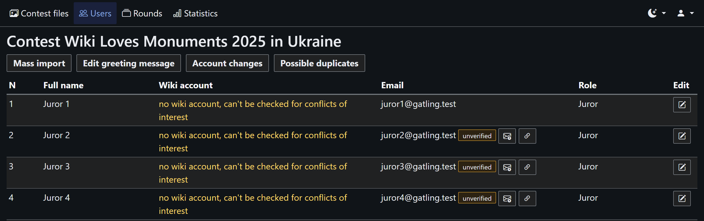
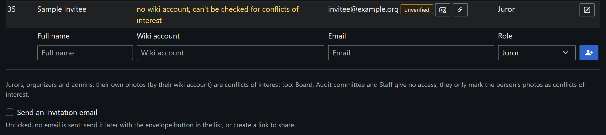

<a id="a-users"></a>
# People

<a id="a-users-page"></a>
## The users page

Open **Users** at the start of the top bar (in a gallery, on the Rounds and Statistics pages, or in a window narrower than 1280 pixels, in the pages menu there). The page lists the members of the current contest: **Full name**,
**Wiki account**, **Email**, **Role**, and a pencil to edit. Next to a wiki account there may be
two buttons that write to the person on Commons, a message on their talk page and an email.

A badge **unverified** after a wiki account says that nobody has proved that the account
belongs to this person: anyone could have typed it. A badge **unverified** after an email says
that the person hasn't accepted an invitation yet. A badge **password expired** says that the
person's password was set before version 26.11 and has stopped working: they need a link to set a
new one. The envelope button next to the badge sends it again.

A member without a wiki account whose files could be conflicts of interest shows **no wiki
account, can't be checked for conflicts of interest**. Add their wiki account in their edit
page.



<a id="a-add-person"></a>
## Adding a person

At the bottom of the table, fill in the row: **Full name**, **Wiki account**, **Email**, the
**Role**, and press the button with the plus. A person needs an email or a wiki account. The text
under the table recalls which roles make the person's own photos conflicts of interest, and that
**Board**, **Audit committee** and **Staff** give no access (see [Roles](accounts.md#a-roles)).



- **Send an invitation email**, under the table, is unticked by default: nothing is mailed. The
  person then gets in with a [link to share](invitations.md#a-share-link) that you pass on, or a password you
  [set for them](signing-in.md#a-passwords); the envelope button next to them sends the invitation later. Tick
  it to mail the invitation (and, to someone who already has an account, the contest's greeting).
- A **new** email gets a new account, and an invitation by email if you ticked the box, see
  [Invitations](invitations.md#a-invitations).
- An email whose account **exists** and whose owner has proved it (they accepted an invitation
  or a mailed link) joins your contest with the role at once. Nothing is changed in the account
  itself.
- An account that hasn't proved its email, for example one made unverified by a shared link,
  gets an invitation instead, and the role applies when they accept it. Unticked, the invitation
  waits in the invitations list as **Not sent**, for you to send or share.
- A **wiki account** (with no email) that an account already has, but that nobody has verified,
  adds nothing at first: the page asks you to pick the account you mean and confirm it, see
  [A wiki account nobody verified](#a-wiki-confirm). A role without access (**Board**, **Audit
  committee**, **Staff**, **No role**) is added at once, as before.
- A person added with a wiki account only has no email. They can't sign in with a password
  until you share a link or set one for them (only while Wikimedia sign-in is not set up, see
  [Sharing a link](invitations.md#a-share-link) and [Passwords](signing-in.md#a-passwords)), or add the person by email to
  invite them.

The page tells you how many accounts were created, how many people joined and how many were
members already, how many invitations were not emailed because the box was unticked, and any that
could not be sent.

<a id="a-wiki-confirm"></a>
## A wiki account nobody verified

A wiki account stored in the tool says who holds the account only once its owner has signed in
with it through Wikimedia: until then anyone could have typed it into their own account, or an
admin of another contest could have mistyped it. So when you type, in the add row, a wiki account
(and no email) that such accounts have, nothing is added yet. The page **Confirm the account with
the wiki account** … lists those accounts **by name only**, none of them chosen; old contests
sometimes left several accounts with one wiki account, and one person may have several on purpose.

- Pick the account of the person you mean. The page shows the name you typed in the add row
  beside them, to compare. To see more about one first (its email, masked, and
  the contests of yours it is in), search for it under [Find an existing
  account](#a-find-account) on the users page.
- Tick **This is the person I mean** and press **Add to this contest**. Without a pick or the tick,
  nothing is added and the page says so.
- **Send an invitation email** and **Tell its owner by email** are both unticked, whatever you
  chose in the add row: tick them here for the account you picked. **Cancel** goes back to the
  users page.

The account is then added as if you had found it with the search (see [Finding an existing
account](#a-find-account)): an account whose owner proved its email joins at once; an account
with no password and no email joins at once too (see below); one with an email but no password
joins at once and needs an invitation to set its password; another gets an invitation, and the role
applies when they accept it. An invitation is mailed only if you ticked **Send an invitation
email**; unticked, the one that gives the role waits in the invitations list as **Not sent**, for
you to send or share, and none is made for the account that only needs a password: send it with
the envelope button, or create a link to share, from the users page. The message after the add names the account you confirmed with its email,
masked there if the account wasn't in your contests before; once it is in your contest (or
invited), the users page and the search show its email in full, as for anyone you add. Its owner
sees a notice in the tool when they next sign in.

**Be sure before you confirm:** the role goes to whoever signs in to that account, with its
password or its email, and that may not be the person you mean. If you are not sure, add the
person by email instead. Each confirmation is recorded in the account changes as **wiki account
unverified, confirmed by the admin**, and logged with your account.

An account with no password and no email (made with a wiki account only) is confirmed the same
way. Nobody can sign in to it until someone shares a link to set its password: if you can't (the
account is also in a contest you don't administer), the page says that the person signs in with a
link from root.

<a id="a-find-account"></a>
## Finding an existing account

Someone may already have an account from another contest, or from an earlier year, under an
email you don't know. **Find an existing account**, under the add row, searches every account in
the tool:

- by **any part of a name or wiki account**, at least 3 characters, in any letter case;
- by a **whole email address**. A part of an address finds only accounts that are in your
  contests (members, or invited and not yet accepted).

At most 20 accounts are shown; if more match, type more to narrow the search. Each shows its
**Full name** (a link to its edit page if it is a member of this contest), its **Email**, its
**Wiki account** (with **verified** if its owner proved it), the contests of yours it is in with
its role there, and whether it is in this contest already. The email is shown in full only for
accounts in your contests; for others it is masked, as `a***@example.org`, or **no email** (an
address typed into a name or wiki account is masked too, and such a name finds the account only by
its whole email). You never see an account's other contests. Root accounts are not shown.

Several accounts with the same name, or one person with several juror accounts, are normal (a
screening round may give one person several shares on purpose): the search shows them side by
side and doesn't suggest joining them.

To add one, pick its **Role** and press **Add to this contest**. It is added as if you had typed
its email in the add row (see [Adding a person](#a-add-person)): an account whose owner proved the
email joins at once; another gets an invitation, and the role applies when they accept it. An
account with a password but no email can't be invited and isn't added: ask root.
**Send an invitation email**, next to the button, is unticked by default; ticked, the mail goes
from the tool's own address, not yours. Whether you can then [share a link](invitations.md#a-share-link) or
[set a password](signing-in.md#a-passwords) for the account follows the usual rule: not for an account that
is also in a contest you don't administer.

The account's owner always sees a notice in the tool when they next sign in: that you added them
to your contest, with the role. **Tell its owner by email**, also unticked by default, mails them
the same from the tool's own address; nothing is mailed unless you tick one of the two boxes. The
page says what happened: that the owner will see the notice, and whether the email went out (or
couldn't, for an account without an email). Once the account is in your contest (or invited to
it), you see its full email address on the users page and in the search, as for anyone you add by
email.

A person you added this way sees **An admin added you to a contest** under the top bar after
signing in; **See the details** opens their profile, which lists each add (the contest, who added
them, the role and what it lets them do), with **Dismiss**.

Each search is logged with your account and the number of results, never the text you typed.

<a id="a-mass-import"></a>
## Adding many people

**Mass import** takes a list: entries separated by commas or new lines, each a Wikimedia
account, an email, or a name with an email in angle brackets:

```
Wiki Account 1, Wiki Account 2
mail1@example.org, mail2@example.org
Name1 Surname1 <mail1@example.org>
```

Choose the role for all of them; the text under it says the same about the roles as the users
page. **Send an invitation email** works as on the users page (unticked: nothing is mailed). They
are added as in [Adding a person](#a-add-person), except that an import never asks you to confirm
an account: a wiki account nobody verified is counted as **Not added yet**, with a link to the
users page, where you type each such wiki account in the add row and
[confirm the account](#a-wiki-confirm).

To bring the people of another contest you administer, last year's jurors say, you don't need to
copy their emails into an import: see [Adding people from another of your
contests](#a-add-from-contest).

<a id="a-add-from-contest"></a>
## Adding people from another of your contests

**Add people from another of your contests**, on the users page, adds people who are members of
another contest of yours, for example last year's jurors. The button is there when you are an
admin of another contest (root sees it always). Pick the contest under **Contest to add people
from**: the contests where you are an admin, the newest first (root: every contest), and press
**Show its people**.

The list shows that contest's members: **Full name**, **Role there**, **Wiki account** (with
**verified** if its owner proved it), **Email** (in full: they are in a contest of yours) and
**Role in this contest**, which starts as their role there; a row whose role here is **Admin** is
bold. Root accounts are not listed for admins, nor retired accounts. **All**, **Jurors**, **Organizers** and
**Admins** show only the people with that role there.

- Nobody is ticked. Tick the people to add, or **Tick all shown**, and change a role where you
  need another.
- A person already in this contest can't be ticked: the row says **Already in this contest**, with
  their role here. Nor can a person already invited into it (**Invited already**): adding them
  again would cancel that invitation and make a new one.
- A person known only by a wiki account nobody verified (no email) can be ticked too: you pick the
  account itself, a member of your other contest, so there is nothing to
  [confirm](#a-wiki-confirm) as in the add row.
- **Send an invitation email** is unticked: nothing is mailed. Tick it to mail the invitations, as
  on the users page; ticked, the people who join at once also get the contest's
  [greeting](invitations.md#a-greeting) by email.
- At most 200 people are added at a time.

Press **Add the ticked people**. Each person is added as **Add to this contest** in the search
adds an account (see [Finding an existing account](#a-find-account)): one whose owner proved the
email joins at once; so does one with an email but no password, which only needs the invitation
to set a password; another gets an invitation, and the role applies when they accept it
(unticked, it waits in the invitations list as **Not sent**). A person with neither an email nor
a password joins at once, and no invitation can reach them: the result says so, and they sign in
once you [share a link](invitations.md#a-share-link) with them (or with a link from root, where you may not
create one). A person with a password but no email can't be invited and is skipped: ask root.
The role counts for [conflicts of
interest](conflicts.md#o-conflicts) as any role does. Each person added sees a notice in
the tool when they next sign in, which names the contest they were added from. Each add is listed
under [Account changes](editing-people.md#a-account-changes) with that contest, as "from Wiki Loves Earth 2020 in
Nepal (#20)", a link to its users page: this contest's admins see where the people came from
(the link opens only for that contest's admins and root). The users page then says how many
joined, how many were invited, how many were given the Admin role, and how many were skipped and
why.
