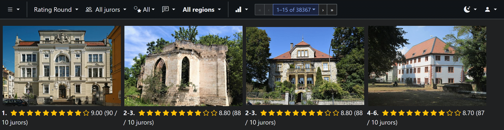
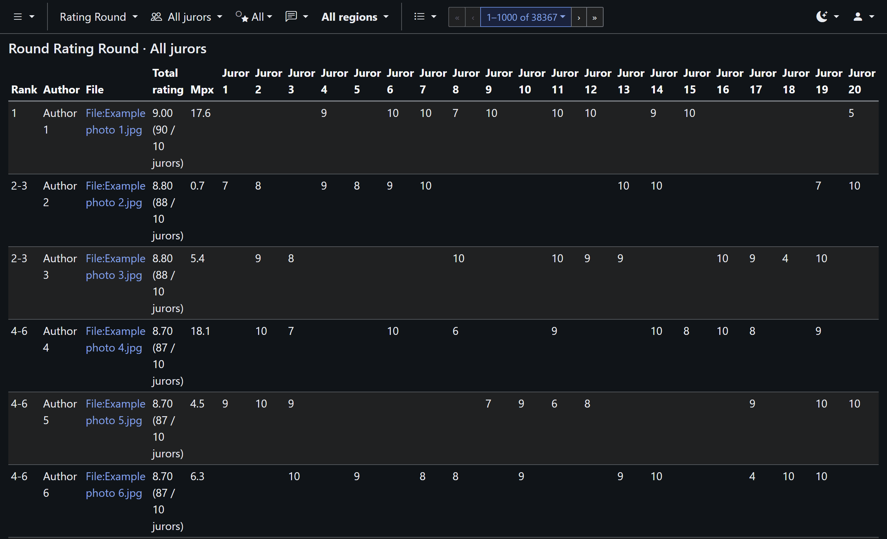

# Results

## Reading the results

The bar at the top of a round's results has, from left to right, the pages menu (its button the
menu icon and the page you are on, for example **Gallery**; its items **Contest files**, for
admins **Users** and **Rounds**, and **Statistics**; for root also **Contests**), then the
filters: the round, the juror menu (its people icon, then a single juror's name, or **All jurors**), the votes menu, the
[**Comments**](comments.md#o-comments-filter) menu and the region menu; after a thin line the order and the
view menu (the **Gallery**, **By rate**, **File list** and **CSV**); then the pager. The views of
**All jurors** take no votes. Your own files in a round, if you have any, are under your name in
the juror menu, with the same bar.

The votes menu (its button with the icon of its choice: ✓ selected, ✗ rejected, an empty circle unrated, a star rated, all of them small in one icon for **All**) is the jurors' own: **All**, **Unrated**, **Selected** and **Rejected** (in a rated
round **All**, **Unrated** and **Rated**), keeping the region and the other filters. In a single
juror's view each choice has its count, and on **All** the button adds how many of the juror's
files in the list are unrated (**All 900 · 40 unrated**); the view of **All jurors** has no
counts. In a window narrower than 1800 pixels (2100 in the comments list), the pages menu shows only its icon, the
votes menu its choice and count without the unrated, the **Comments** menu a speech bubble and its
count (or the person the comments list is filtered by), the order menu a sort icon, and the region
menu only the chosen place, without the word "Region" (or "Country"); in the comments list the
votes menu shows only its icon and the names are cut shorter. Point at an icon to see its name. A long juror name or region is cut short (point at
it to see it whole). The bar and its pager stay on one line from 1280 pixels.

You can see a juror's votes only for a juror of that round. Choosing another person's page
shows the tool's "not found" page. If you are a juror of the round yourself, then while it is open
you see only your own votes in it: not another juror's, not all the jurors' together, and on its
**Statistics** each juror's progress but not their selections (the conflict-of-interest rule).
Once the round is closed you see its results as usual.

In a single juror's **Gallery** each file shows that juror's vote, read-only: in a yes/no round a
green ✓ or a red ✗ in the tile's lower-left corner, in a rated round the juror's stars (or ✗). In
the **Gallery** of **All jurors**' votes on a yes/no round each file shows its tally in the same
corner, approvals (✓) and rejections (✗), in the order chosen in the menu next to the views. The
file's comments (💬 3) follow the vote or the tally there.

A single juror's **Gallery** and **By rate** views have an order menu, by that juror's votes:
**In file order**, **By rating**, **Newest votes first** and **Oldest votes first** (when the
juror last changed each vote; votes from before these options count as the oldest, unrated
files come last). With a yes/no round's **Selected** or **Rejected** filter it has **In file
order** and the two vote-time orders; with **Unrated**, the files are in file order. In the
vote-time orders each file shows when the juror voted, next to the vote's mark (in your time
zone, "✓ 12 Nov, 14:05"; a yes/no vote from before shows its mark alone, a rated one **Time not
recorded**; a narrow tile leaves the time out), and the large view of a single juror's vote shows
it in every order. The
views of **All jurors** keep their own order and show no vote times.

## The by-rate gallery

**By rate** shows the files of the round as a gallery, best first, with each file's rank and
score. In a yes/no round the order depends on the menu next to the views: **Approvals, then
fewest rejections** or **Approvals minus rejections**. The votes menu shows only files with
**Selected**, **Unrated** or **Rejected** votes: for a yes/no round, files with at least one
such vote, or for a rated round **Rated** or **Unrated**. Under each thumbnail, on one line
where they fit, come the file's rank, a rated round's stars and score, then its chips: a yes/no
round's tally (✓ approvals, ✗ rejections) or a single juror's ✓ or ✗ (with the vote's time in
the vote-time orders), then its comments (💬 3), as on the gallery's tiles. A rated round's score follows its
[file score](scoring.md#o-score), with the divisor shown. In a round with criteria, each file shows
its stars for each criterion. A file with worst marks shows how many ("n worst marks").

Clicking a file opens its [large view](#o-large-view).

## The file list

**File list** shows the files of the round in a table: the rank, the file, its score, and a
column for each juror with their vote. The table also shows the author of each file, for
organizers and admins. In a round with criteria it has the average of each criterion. Use it to
compare the jurors, or to look for a file by name.

When there are many files, the pager at the top works as in the [jurors'
gallery](juror-gallery.md#j-pager).

## The large view for all jurors

Open a file from the by-rate gallery or the file list to see it large with the votes of **all**
jurors: the file's score and the comments on it. In a yes/no round its approvals and rejections
(**✓ 12 ✗ 3**) are under the buttons, as on the file's tile in the gallery of all jurors, and
after them its comments (**💬 3**), a link to the comments under the file. In a
round with criteria, it shows the stars of every criterion. The view takes no votes. The keys that move between files work as in the
[jurors' large view](juror-large-view.md#j-keyboard).

**Comments:** while the round is open, the view has a comment box under the file, as the
jurors' large view has: type your comment and press **Submit comment**. Each comment shows its
author and time (in your time zone; some older comments have none), and the round's name if it
was written in another round of the contest. Only admins, organizers and root see that round
name; jurors see the comment without it. Comments are not
private: whoever opens the file's large view in the contest sees them, with your name: its
admins and organizers, and the jurors who have the file. When the round is stopped, the file's
comments are still shown, but no new ones can be added: the tool refuses a comment on a stopped
round's file, also one sent from a page opened before the round was stopped.

## The CSV

The **CSV** view downloads the round's results as a file for a spreadsheet. It has a row for
each file, in the order of the list you were on, and the columns **Rank**, **File**, **Overall**
(the score; in a round with criteria **Overall (sum of the criteria)**), for a round with criteria
a column for each criterion's average, then a column for each juror. The last row explains the
values: for a yes/no round, 1 selected, -1 rejected, 0 not voted yet, empty not assigned; for a
rated round with the worst mark, -1 is the worst mark.

The file is named **WLXJury_Round_** with the round's name. Cells that start with a character
that a spreadsheet would read as a formula are changed so that they don't run as one.
