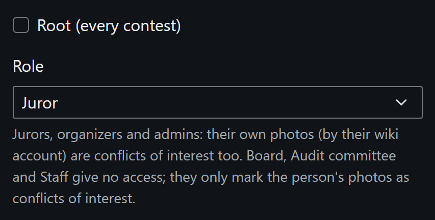

# What only root can do

- Create contests, and import them from a Commons list, on **Contests**, and change a contest's
  settings there. A contest added there records who added it and when (the **Created** column).
  Adding a contest with the name, year and country of an existing one is allowed, with a warning.
- Manage **series admins** ([Series admins](contest.md#a-series-admins)): on a series' page under **Series**,
  its series admins as a tree of who added whom, each with **Revoke** (tick **Also revoke the grants
  this admin added** to remove the whole branch) and its **start year** (change it; the default as
  it would be computed now is shown under it, useful after joining accounts); add a series admin on
  the series page (**Add series admins on the series page**). **Series** lists, per series, the
  series admins added in the last 24 hours, and on top those that series admins added in the last
  30 days. A grant root revoked can be given again by root only. When root un-retires a series,
  its series admins come back marked **to confirm**: they have no access until root presses
  **Confirm** beside each (one added by a series admin who is still to confirm waits for them).
- Manage **series** on **Series** (the **Manage series** link beside the **Series** menu on **Contests**):
  - **create** a series with its name, type (`wlm`, `wle`, or the word after "Wiki Loves" in
    lower case, such as `folklore`; empty for any type), country and campaign; **rename** it
    (two live series can't share a name); **retire** it
    (its contests stay live and show under **Other contests**; nothing new goes into it) and
    un-retire it;
  - **assign contests in bulk:** **Assignment proposals** groups the live contests in no series
    by type and country across years, and offers an existing series of that type and country
    first; a type the tool doesn't know otherwise ("Wiki Loves Folklore") groups by the word after
    "Wiki Loves". Tick the proposals to assign and untick contests to leave out; one confirmation
    is one **batch**, all or nothing: if the proposals changed since the page was shown (a contest
    assigned, retired or flagged meanwhile), nothing is assigned and the page says to look again.
    **Undo batch** on the Series page takes the batch's contests out of their series again, except
    those changed since (they are listed); a series the batch created stays, empty (retire it if
    it isn't wanted). The proposals leave out, with why: a name of no contest type, an unusual
    country, two live contests of one type, country and year, a year the series already has, and a
    contest the **reuse check** flags (with the kinds of signs it found). The page reads every
    unassigned contest's rounds and files, so it takes a few seconds;
  - **one contest at a time:** the contest's **Series and status** page (the **Series** column on
    **Contests**) assigns it, moves it to another series or takes it out. A series holds one live
    contest per year, and a contest the tool reads as of another type or country than the series is
    refused. A contest whose type or country it can't read ("USA", a name in another language) may
    be assigned, and its change log says so. The page shows the reuse check and the change log;
  - the **reuse check** looks for signs that a contest was reused for another year or country: an
    import source or files source naming another contest, a round filtered by another contest's
    category, a round with at least 5 files, and at least 2 % of its files, in another contest's or
    country's categories, and rounds of several countries in a national contest. Rounds created
    far apart are shown beside these, never a sign alone. Such a contest is never proposed for a
    series. On **Contests** the **Reused** badge reads the sources and rounds only, not the rounds'
    files: the contest's **Series and status** page shows every sign.
- **Retire a contest**, and un-retire it, on its **Series and status** page: its members can't
  open it any more and menus and lists leave it out (**Status** on **Contests** shows the retired
  ones); its data stays; root still opens and can change it. A contest with a round open or
  paused can't be retired (stop the round first), nor one with a round being created or reviewed,
  or whose creation failed (finish or cancel it on the Rounds page). Its admins no longer reach
  accounts through it, and it is no source for adding people from another contest. A retired contest doesn't count as its series' contest of that year, and
  can't be un-retired while another live contest of the series has that year.
- On **Contests**, the **Series** menu lists the contests of one series or of none, and **Status**
  the live (the default), retired or all contests.
- See **Users** across all contests, every account by default. The **Type**, **Country**, **Year**
  and **Role** menus in the top bar narrow the list to the accounts that are an **Admin**, an
  **Organizer** or a **Juror** (or any of these, with **All**) of a contest of that type, country
  and year: the role must be in that same contest, so an admin of a 2024 contest who is a juror in
  2025 isn't listed for Admin in 2025. A membership with **No role**, or with Board, Audit committee
  or Staff, doesn't count for these menus. Each item shows how many accounts it lists,
  given the other menus' choices; the menus are links, so a filtered list can be bookmarked or
  shared with another root. With every menu on **All** the page also lists the accounts in no
  contest. Root accounts are listed only under **All**, unless they are also a member of a
  contest with a role there: root is not a role of a contest.
- Make an account root: tick **Root (every contest)** on its **Edit user** page. An account that
  has a password but no verified email can't be made root; an invitee who hasn't set a password
  yet can. A new account can't be made root when it is added: add the person, and tick it once
  they have accepted the invitation. Root can't change their own root, and the last root can't
  be taken away. Root and the email can't be changed in one save: save one, then the other.
  Changing the person's role in a contest leaves root as it is.

  

- Edit an account that is in contests the admin doesn't administer, its email included (at
  once, as an admin does, see [Changing a person](editing-people.md#a-edit-person)).
- Send **Reset password** links and use **End sessions** on any account, and see and revoke
  any account's API tokens.
- See the [possible duplicate accounts](editing-people.md#a-duplicates) of every contest and outside them, keep
  any of them separate, and [join](editing-people.md#a-join) any two accounts (also an admin account, or one in no
  contest).
- Run **Check every round's images**, on the rounds list: it checks that every round's list of
  files matches its votes, and repairs any drift.
- Run **Normalize stored authors**, on the rounds list, see [below](#a-normalize-authors).
- **Release** a round that the rounds list flags as held inactive with no job holding it: a job
  that paused it (a distribution, or a juror being added) ended without its cleanup. Release
  makes it active again if it was before. **Check every round's images** lists such rounds too.
- Work in any contest without being a member of it.

The first root account is made when the tool is first set up; that is in the [deployment
guide](../deployment.md).

## Normalizing stored authors

Files imported by older versions of the tool may keep their author as wiki markup, such as
`[[User:Example_Photographer|Example]]` or a photographer's credit template like
`{{ExamplePhotographerPhotos}}`. Files imported now keep the author's Commons account. The tool
shows these old authors as their account. But conflicts of interest are found by the stored account, so such files aren't found
as conflicts until their authors are normalized. A file deleted on Commons can't be imported
again, so only this button can fix its author.

**Normalize stored authors**, on the rounds list (root only), does it for the files of every
contest, as a background job:

- A link to a user page gives that account: `[[User:Example_Photographer|Example]]` becomes
  `Example Photographer`.
- A credit template gives the account its page links to. A template that links to nobody gives
  the file's original uploader, as an import does. A file deleted on Commons, or uploaded by a
  bot, then has no author.
- An unknown author (`{{Unknown|author}}`) becomes no author.
- An account that an old import stored as question marks (`[[User:???????? ????????|…]]`, its
  letters lost) is read again from the file's page on Commons. If Commons names no author for it
  (a file deleted there), it is left as it is.

The job shows its progress under the buttons, with **Cancel**, and **Retry** if it fails. When
it is done, the line shows how many authors it changed, how many got the uploader, how many were
left without an author, how many question-mark accounts it restored from Commons or left, and
how many were skipped because an import changed them meanwhile. It can be run again: a second
run changes nothing, apart from reading again any question-mark accounts Commons could not
restore (it reports them as left again).

After it, files whose author is a contest member are found as conflicts of interest on the
round form and the conflicts pages. Rounds already distributed keep their files: to leave the
new conflicts out of a round, stop it and disqualify them on its [conflicts
page](conflicts.md#o-conflicts-page).
