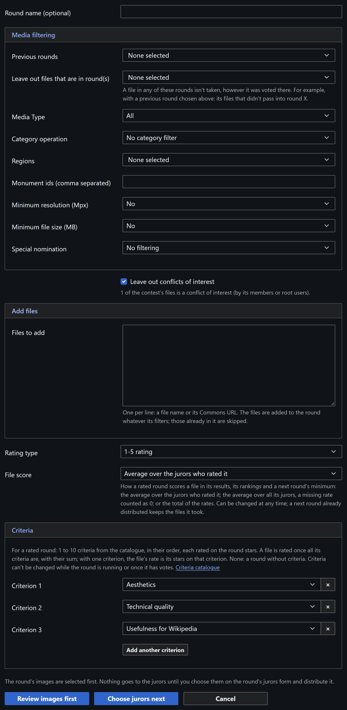

# Creating and changing a round

The round form, the background job that gives a new round's files to its jurors, and what can
change on an existing round. Which files a round takes is in [Choosing a round's
files](round-files.md), its jurors in [A round's jurors](round-jurors.md).

## Creating a round

Press **Add round**. The page **Create round** has these parts, from the top:

- **Round name (optional)**: a name for the round next to its number.
- **Track label (optional)**: usually left empty; see [Tracks](tracks.md#a-tracks).
- **Media filtering**: which files the round takes. [Choosing files](round-files.md#a-choose-files) describes it.
- **Leave out conflicts of interest**: see [Leaving them out of a round](conflicts.md#a-leave-out-conflicts).
- **Add files**: a list of files to add, see [Adding files by name](round-files.md#a-add-files).
- **Rating type**: see [Kinds of rounds](rounds.md#a-round-kinds).
- **File score**: see [The file score](scoring.md#a-score-rule).
- **Worst mark**: see [The worst mark](scoring.md#a-worst-mark).
- **Criteria**: see [Kinds of rounds](rounds.md#a-round-kinds).

A new round is set up in numbered steps, shown in a step bar at the top of each page:
**1 Which files** (this form), **2 Check the matching files** (the round's review page),
**3 Jurors** (its jurors form), then **Open to jurors**. The form has no jurors: nothing goes to
the jurors until you choose them on the round's **jurors form** and distribute it
([Choosing the jurors](round-jurors.md#a-round-jurors)). The form ends with one button, **Save and find matching
files**: the tool picks the contest's files that match the settings, for you to check, which can
take a few minutes. You land on the round's review page (step 2), which says "Round N is saved.
Step 2 of 3: its matching files are being found." The round waits there, hidden from the jurors:
see [Reviewing a round's images](round-review.md#a-review).

Reference links such as **Criteria catalogue** open in a new tab, keeping your draft in the
form tab. **Cancel** discards the draft and returns to the rounds list.

If you press Save twice, or send the form again from the browser's Back button, the tool makes
one round, not two, and tells you.

The jurors are chosen on the jurors form when the round is distributed, and can't be changed on
the form of a distributed round. To work with other jurors, create another round. Later you can pause and resume
a juror, see [Pausing a juror](round-jurors.md#a-pause-juror).

Here the contest's latest round has criteria, so the form starts with them and its 1–5 rating;
with criteria the form has no worst mark.

## The distribution of files

After you save a new round, the tool gives its files to its jurors as a **background job**. The
rounds list, and the top of the round form, show the job under **Distribution**: its state,
for example queued or running, and its progress as a number of files done out of the total.

While the job runs the round is hidden from jurors, and you can't start it: the tool says
that its images are still being distributed. The round starts by itself when the distribution
has finished. You can leave the page and come back.

- **Cancel** stops the job. It shows while the job runs and after it fails.
- **Retry** runs a failed job again, from where it stopped. It shows only for a failed job.

If a job fails, the state shows why. A message with a **reference** is for the contest's tool
administrators: send them the reference. If the tool stopped for a while while a job was running,
it takes the job up again by itself.

A round has one distribution job at a time. Starting a second one for the same round, for
example from another browser tab, tells you that its images are already being distributed.

## Changing a round

Open the round from the rounds list: its number is a link. On an existing round you can change:

- the round's name;
- the track label, at any time, see [Tracks](tracks.md#a-tracks);
- the [file score](scoring.md#a-score-rule) and, in a rated round, the [worst mark](scoring.md#a-worst-mark), at any time;
- in a rated round, the criteria, only before the round is started (not running and no vote
  yet; a yes/no or comments-only round's form has neither);
- **Leave out conflicts of interest**, see [Leaving them out of a round](conflicts.md#a-leave-out-conflicts);
- **Add files** and **Distribute N new files**.

The rest of the form is shown but can't be changed: the files' filters, the rating type and the
file distribution. To start over, create another round. The panel **Jurors** shows each
juror's counts, as the [statistics page](statistics.md#o-statistics) does.

**Cancel** leaves without saving anything.

At the bottom of the form of an existing round there are also **Download images locally**, which
fills the [local image cache](contest-files.md#a-image-cache) with this round's files, the button
**Conflicts of interest of this round**, and **Check round images**, see [Checking a round's
images](#a-image-check).

## Checking a round's images

For each round the tool keeps a list of its files, with each file's state in the round (given to
jurors, deleted on Commons, disqualified), next to the jurors' votes on them. The two should
always agree. They can drift apart after an upgrade of the tool that changes how the list is kept,
or after the tool ran an older version for a while; the tool's administrators then say when a check
is needed. You can also run it when a round's counts look wrong, for example a file that has votes
but isn't counted in the round.

**Check round images**, at the bottom of an existing round's form, checks that round. It runs in the
background as a job: the page says "Image check queued (job N)", and shows the job's state under the
button, with a link to the job, until it is done. While a check of the round is queued or running,
pressing the button again only says so ("An image check is already queued or running").

The check compares every file of the round with its votes, and **repairs** what it can:

- a file that has votes in the round but is missing from its list is added;
- a file whose state doesn't match its votes gets the right state;
- a file whose monument id in the round differs from the file's own monument id gets the file's.

It only **reports**, without changing anything, what it can't safely repair: a file shown in the
round as deleted on Commons that isn't marked deleted (its votes would have to move), and a
disqualified file with votes (it stays disqualified; [requalify](conflicts.md#a-disqualify) it to
take it back). A file with no votes yet is never removed from the list: it is a file given to the
round and not voted on yet.

When the check is done, its result stays under the button in one line, for example "Image check
(job 29, 2026-11-12): no mismatches", or the numbers of what it fixed and reported, such as "2 rows
added, 1 status fixed, 1 row with a mismatch not repaired (reported)". Votes are never changed or
lost.

A round whose files are being distributed at that moment (its distribution queued or running) is
**skipped**, because the distribution writes the same list: the result says "1 round skipped
(distribution running)". Check it again once the distribution has finished.

**Root:** **Check every round's images**, on the rounds page, checks every round of every contest,
one after another, and then also archives criteria rates that belong to no vote ("orphaned criteria
rates archived"). Its result counts the rounds checked ("1,823 rounds checked, no mismatches"), and
shows on the rounds page for root.

