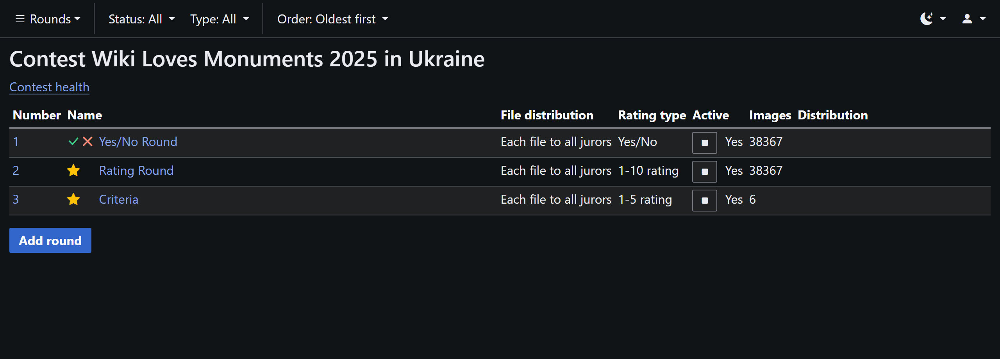

# Running the judging

This page and the round pages after it are for the admins: the rounds, their files and jurors,
starting and stopping them, and conflicts of interest. Following the voting and reading the
results, which admins and organizers both do, have pages of their own: the
[statistics](statistics.md#o-statistics), the [results](results.md#o-results), the
[CSV](results.md#o-csv), the [contest's files](contest-files.md#o-contest-files) and
the [conflicts page](conflicts.md#o-conflicts-page).

## A contest and its rounds

A **contest** has **files**, the images and videos taken from Commons, and **rounds**. A round is
one stage of judging: its own files, its own jurors and its own votes. A typical contest has a
first round that every file goes through, and later rounds that take only the best files of the
earlier ones.

## Kinds of rounds

The **Rating type** of a round is one of:

- **Yes/No** (a yes/no round): jurors select or reject each file.
- **1-N rating**, a rated round: jurors give each file from one star up to N stars, with N from
  3 to 20. A rated round can also use criteria, described below, and the [worst
  mark](scoring.md#a-worst-mark).
- **Comments only**: jurors take no votes, only write comments.

The rating type is chosen when the round is created and can't be changed afterwards.

A **rated round with criteria** (for example Aesthetics, Technical quality, Usefulness for
Wikipedia) asks for stars on each criterion; a file's rate is the sum. You choose 1 to 10
criteria for the round from the shared **Criteria catalogue**, which has a link on the round
form: **Add criteria** shows a criterion's list, **Add another criterion** one more, and × beside
a criterion removes it. With one criterion the round is rated as usual (the file's rate is that
criterion's stars, and the digit keys rate it), and the large view shows the criterion's name.
If the contest's latest round has criteria, a new round starts with them and with that round's
rating type; otherwise it starts as Yes/No without criteria. Choose another rating type, or remove
the criteria with ×, to drop them. Once a round is started (running, or with a vote), its criteria can't be
changed: the form lists them, and a round started without criteria can't get any. A round
stopped before its first vote keeps the full form.

**Organizers:** the admins choose each round's rating type, and it decides what the votes and the
results look like. A worst mark counts as 0 in the score, see [The worst
mark](scoring.md#a-worst-mark).

## The life of a round

1. You create the round on the round form. The tool then gives its files to its jurors in the
   background. While it does, the round is hidden from jurors.
2. When all files are given, the round starts: jurors see it and vote.
3. You follow the voting on the [statistics page](statistics.md#o-statistics), as the
   contest's organizers do.
4. You stop the round when the voting ends. Votes are kept.
5. You read the results and, if there is a next round, create it from these results.

## The rounds list

Open **Rounds** at the start of the top bar (or in the pages menu there). The list shows, for each round: its **Number** (a link to the
round form), its **Name** (a link to the round's statistics), the **File distribution**, the **Rating type**, whether it is
**Active** (started), the number of **Images** and the state of its distribution. The
**Contest health** link under the contest's name opens the contest's health report (see
[Importing the contest's files](contest-files.md#a-import-files)).

Before each name, an icon shows the round's type: a tick and a cross for **Yes/No**, a star for
**Rated** (a criteria round is rated too; a comments-only round has no icon). The icons are in
colour for a started round and in grey for a stopped one; pointing at them shows the type and the
state. The **Type** menu shows the same icons as a legend. A stopped round's row is in grey; its
links still work.

With many rounds, the menus in the top bar narrow and order the list:

- **Status:** **All**, **Active** or **Not active** rounds.
- **Type:** **All**, **Yes/No** or **Rated** rounds (a comments-only round shows under **All** only).
- **Order:** **Oldest first** (the order in which the rounds were created), **Newest first**, or
  **Active first** (the started rounds, then the others, each group oldest first).
- **Track:** **All tracks** or the rounds of one track, when the rounds listed are on two tracks
  or more besides the tracks of a round alone, named after it (those have no chip and no item).
  A coloured chip after a round's name names its track. See [Tracks](tracks.md#a-tracks).

Each item shows in grey how many rounds it would list. The choices stay in the page's address, so
a reload or a link keeps them, and the round's statistics (the round's name, **Statistics** in the
pages menu) open with the same choices, which narrow the row of rounds there; **Rounds** from there
comes back to the same list. Starting or stopping a round, and the round form's **Save** and
**Cancel**, come back to it too. With no choice made the list is all rounds, oldest first.

**Add round** creates a new round.

## Starting and stopping a round

In the rounds list, the **Active** column shows **Yes** or **No**. The button in it, a play or a
stop icon, starts the round (**Start the round**) or stops it (**Stop the round**). The
conflicts page of a round has a **Stop the round** button too.

A round whose files are still being distributed can't be started; it starts by itself when the
distribution is done.

## What jurors see

A juror sees a round only when it is started, the juror is in it and not paused, and its
distribution is done. When a round is stopped it disappears from the jurors' view, and votes in
it are refused ("This round is closed for voting"). Votes are kept, and the round comes back
when you start it again. A juror with no round open sees **No round configured yet**.

While a round is **open** (active, paused, or being created or reviewed), a **juror of it** sees
only their own votes in it, whatever their role in the contest: an Admin, an Organizer, a series
admin or root who is also a juror of the round can't open another juror's votes there, nor all the
jurors' votes together (by rate, the file list, the CSV, the large view's votes of every juror, the
round's authors with votes); on the round's **Statistics** they see each juror's progress (files,
unrated, rated) but not the others' selections or rejections nor the totals by vote, and the round
menu opens the round on their own votes. Once the round is **closed** (stopped or finished) they
see its results like any admin. In rounds they don't judge nothing changes.

If an admin who is a juror of a round **stops** it, **starts it again**, or closes it by
**creating the next round** from it, the round's **Statistics** page lists it under "Changed by a
juror of this round", with who did it and when (in UTC), newest first. Everyone who sees the page's
full view sees the list; a juror of the round doesn't while it is open. The same done by an admin
who doesn't judge the round isn't listed.

Jurors see their own votes only, and never the files' authors: the author's name and links, the
contest files page's author filter and the authors list are for admins, organizers and root
(see [Authors](monuments-authors.md#o-authors)). In the large view of a file
they see comments of other jurors, with names. Their **Comments** menu and the comment counts on their tiles cover
their own files only; [Comments](comments.md#o-comments-filter) explains both.
A stopped round takes no comments, also from admins and organizers. Admins and organizers also
have the round's [comments report](comments.md#o-comments-report), with its CSV: every
file with comments of the round (or of the whole contest) and its comments on one page. Jurors
open it for their own files only (**Recent comments list** in their **Comments** menu, with the comments their large view shows),
without the CSV, the round names or the filter by person.
