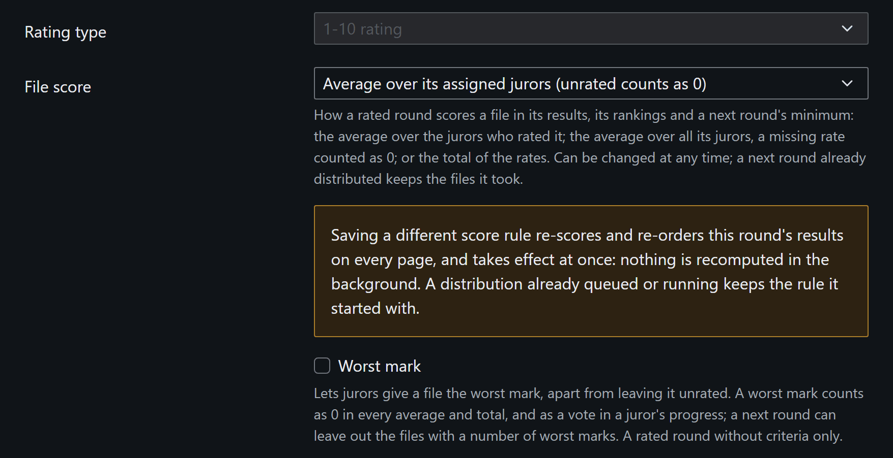

# Scores and the worst mark

How a rated round scores its files, and the worst mark. The admins set both on the round form,
and the results show the scores and the worst marks.

## The file score

The **File score** option decides how a rated round gives a file its score. The score is shown
in the results and ranks the files, and a next round's minimum score uses it. The three rules
are:

- **Average over the jurors who rated it**, the default: the file's rates added up and divided
  by the number of jurors who rated it.
- **Average over its assigned jurors (unrated counts as 0)**: the rates divided by the number of
  jurors the file was given to, a juror who didn't rate it counting as 0.
- **Total of the rates (a file a juror skipped adds nothing)**: the rates added up, not
  divided.

The results show what the score is divided by, for example "14.50 (29 / 2 of 3 jurors)" or "29
(sum of 3 jurors)".

You can change the rule at any time. It changes the scores and the order of the round's results
on every page at once, and nothing is recomputed in the background. **The page warns you** when
the round has votes and you pick another rule. The warning says that:

- the results are re-scored and re-ordered everywhere, at once;
- a distribution that is already queued or running keeps the rule it started with;
- the later rounds that took their minimum score from this round are named. Their
  files don't change, but a later **Distribute new files** there uses the new rule.

**Organizers:** the admins choose each rated round's rule. The results rank the files by the score
and show what it is divided by.

## The worst mark

The **Worst mark** option is for rated rounds without criteria. It is off by default. When it is
on, a juror can give a file the worst mark, shown as an X icon, for a file worth fewer than one
star, which is different from leaving it unrated:

- a worst mark counts as 0 in every average and total;
- a worst mark is a vote: the file counts as rated in the juror's progress and in the round's
  count of jurors who rated it;
- the results show the number of worst marks ("n worst marks") beside the file's score, for a
  file that has them: the file list, the by-rate gallery, the large view of all jurors and the
  CSV;
- a next round can use the worst marks in the [rejection filter](round-files.md#a-rejection-filter).

Jurors give a worst mark with a button and clear a vote with another, see [Rated rounds
(stars)](juror-rounds.md#j-rated) in the jurors' pages. The form hides the option for a yes/no round, a
comments-only round and a round with criteria (and refuses it there if it is sent anyway). You can turn it on or off on an existing round.
