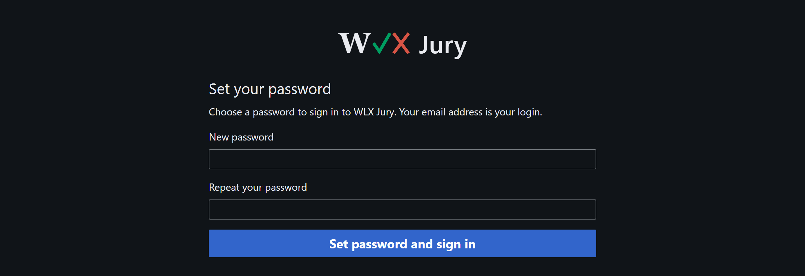
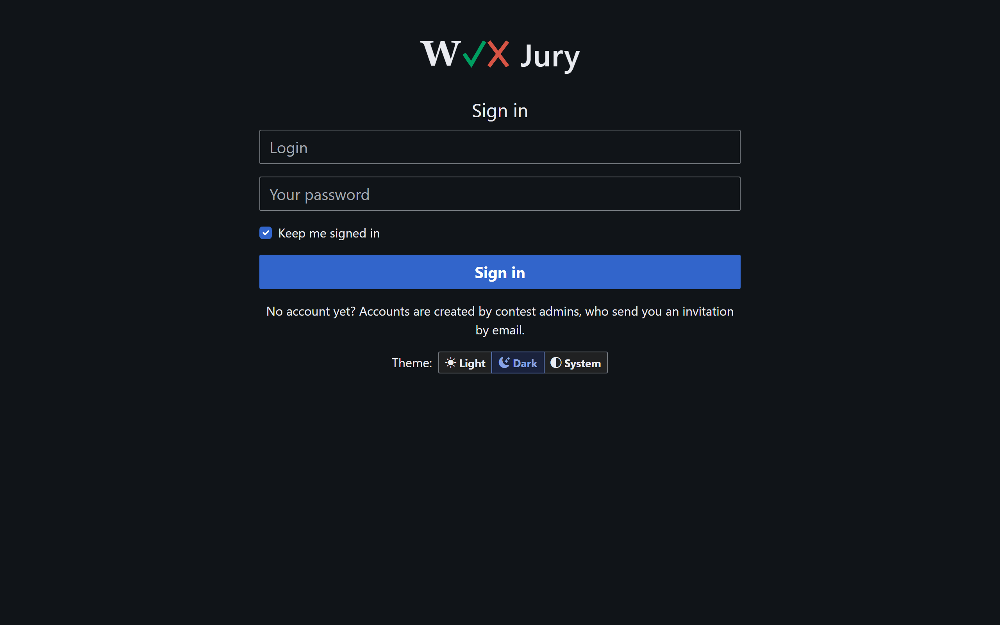
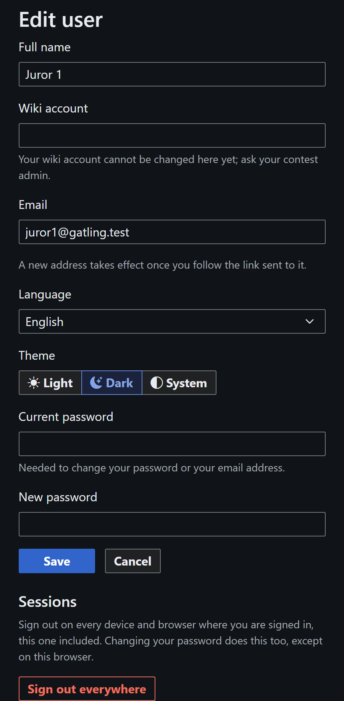

# Signing in

How everyone signs in to WLX Jury, signs out, and how long a session lasts. The parts only admins
or root use are marked.

## Accepting your invitation

You don't sign up yourself. An admin of your contest adds you, and you get an email,
**Invitation to the … jury**, with a link.

Open the link within the number of days the email says. A page, **Set your password**, asks
you to choose a password. Type it in **New password** and again in **Repeat your password**, then
press **Set password and sign in**. Your email address is your login from then on.

If the page says **This link cannot be used**, the link has expired or has been used
already. Ask your contest admin to send you a new one.

If you already have an account in the tool, for example from an earlier contest, the
contest admin may add you to the new contest directly. You then sign in as before and find the
new contest in the contest menu at the top of the page.

## Signing in with your password

On the sign-in page, type your email address (or your wiki user name, if your contest admin
set one for you) and your password, then press **Sign in**.

**Keep me signed in** is ticked by default. On a shared computer, untick it and choose
**Logout** before you leave (see [Signing out](#j-sign-out)): closing the browser may not sign
you out, because some browsers restore the session when they start again. Setting your password
from an invitation or a link also signs you in and keeps you signed in, as if the box were
ticked.

If the tool says **Invalid user or password**, check both and try again. If you have forgotten
your password, ask your contest admin for a link to set a new one.
A password set before version 26.11 stops working about three months after the update, so
this can happen even when you typed it right.

The link opens a page, **Set a new password**. Your old password works until you use the link.

If several jury accounts have the same wiki user name, signing in with that name doesn't work.
Sign in with your email address instead.

**Admins:** a person signs in with the wiki user name only if you set one for them. When a password
set before version 26.11 has stopped working, send the person a link to set a new one from the
users page.

<!-- not offered yet (built, providers not set up): the sections "Signing in with Wikimedia or Google" and "When one wiki name has several jury accounts".

## Signing in with Wikimedia or Google

Some installations also show **Sign in with Wikimedia** and **Sign in with Google** above the
password form. If you don't see these buttons, only the password works there.

These buttons sign you in to the jury account you already have. They never create one. If the
tool says **No jury account matches this account**, ask your contest admin to invite you, or sign
in with your password and link the account on your profile, as the next paragraphs describe.
They keep you signed in, whether **Keep me signed in** is ticked or not: on a shared computer,
choose **Logout** before you leave.

Google sign-in finds your account by itself only for a Gmail or Google Workspace address. For
another address, accept the invitation first, then link Google on your profile. After that you
can sign in with it.

To link an account, open your **Profile** from the person icon at the top right. Under
**Linked accounts**, press **Link** next to Google or Wikimedia. **Unlink** removes the link
again and signs out your other sessions.

Setting a new password from a link (or accepting an invitation) unlinks your Google and
Wikimedia accounts. To use them again, sign in with the new password and link them again on
your profile.

When you link a Wikimedia account and your jury account has no wiki account yet, a page
**Set your wiki account** asks whether to use that Wikimedia user name. Press **Use it** to
confirm.

## When one wiki name has several jury accounts

Some people have more than one jury account with the same wiki user name, for example from
different years. When you sign in with Wikimedia, the tool then shows **Choose your jury
account**, with one box per account:

- An account you can choose at once shows **No email** and its contests, with your role in
  each. **This is my account** signs in to it.
- An account with a password or an email shows its email, partly hidden, and **No contests**:
  its contests are not listed there. Prove that it is yours in one of these two ways:
  - type its password under **Its password** and press **Choose with its password**;
  - or press **Mail me a link**, which sends a link to that account's email address. Open it in
    the same browser, within the minutes the email says, and press **Confirm**.

If the page then says **This account cannot be chosen here: ask your contest admin.**, that
account can't be used to sign in: ask your contest admin which account to use.

(screenshot to add: the "Choose your jury account" page with two accounts)
-->

## Signing out

Open the person icon at the top right and choose **Logout**.

On a shared computer, sign out before someone else signs in. If someone signs in from an old
sign-in page while you are still signed in, the tool signs nobody in and switches neither the
account nor the contest: it says **You are already signed in as** your name, with **Continue**
and **Logout**. To sign in with another account, sign out first. Your other open tabs then need
a reload before your next vote, as after any expired page.

To sign out on every computer and browser at once, open your **Profile** and press **Sign out
everywhere** under **Sessions**. Changing your password does this too, except in the browser
you changed it in.

## Sessions

A signed-in session ends after a period without use, and at the latest a fixed time after
sign-in; the operators set both (30 days idle and 365 days at most, unless changed). A person can
end all their sessions on their profile: **Sign out everywhere** under **Sessions**. Changing a
password does the same, except in the browser it was changed in. Root can end the sessions of any
account with **End sessions** on its edit page.

## Passwords: setting another person's

> **For admins and root.**

Nobody can see a password. There are three ways to give a person a new one:

- **Set password** on the person's edit page: you type the password and give it to the person
  yourself, in person if you can.
- A link to share: you pass it on and the person chooses the password
  ([Sharing a link](invitations.md#a-share-link)).
- A mailed link: root mails one from the person's edit page (**Reset password**), and an admin
  invites an unverified member again, which does the same.

**Who can set a password.** The field **Set password** is shown, and accepted, only where you
may create a link to share for a reset, under the conditions in [Sharing a link](invitations.md#a-share-link):
root for any account; a contest admin only for an active **Juror** or **Organizer** of their
contest whose every contest is one they administer, never root, another admin or themselves.
Anyone else's attempt is refused. Nobody, root included, can set a password for a person who has no
email where Wikimedia sign-in is set up (they sign in with their wiki account, and the page says
so), or who has no email and no wiki account of their own to sign in with (none, or one that
several accounts share). Your own password is changed on your
profile, with your current password.

**What setting it does.** It is the same as the person using a link to share:

- the new password works at once, and the old one stops working;
- the person is **signed out everywhere**, and their API tokens stop working;
- their **email and wiki account are marked unverified**: if another contest then adds the
  person, they get an invitation by email first, and accepting a mailed link verifies the
  address again;
- their linked Google and Wikimedia accounts are unlinked;
- their unused links (invitations, password and email-change links) stop working. An invitation
  that was waiting to give a role in a contest you administer gives it.

Leave the field blank to keep the current password. A password can be at most 72 bytes. Change the
email or the role and set the password in separate saves. The password is set after the rest of
the form is saved: if the person's account changed meanwhile so that you may no longer set it, the
page says that your other changes were saved and the password was not. Each password set is recorded in the security log, with the accounts' ids. The
person can then change the password on their own profile.

<!-- not offered yet (built, providers not set up): the section "Wikimedia and Google".

## Wikimedia and Google

If the tool's operators set them up, the sign-in page has **Sign in with Wikimedia** and **Sign
in with Google**. They sign a person in to the account they already have, and never create one.
The tool finds the account by the email address the provider confirms: for Wikimedia, the
person's confirmed email there; for Google, only a Gmail or Google Workspace address. The
account's email must be verified (an accepted invitation or link), or the account has no
password and a live invitation or password link to that address, which the sign-in then
accepts. Wikimedia also finds an account by its wiki account, but only one with no email and no
password that no Wikimedia account was ever linked to. A person can also **Link** the provider on
their own profile under **Linked accounts**, and **Unlink** it, which signs out the account's
other sessions.

When the same wiki account is on several jury accounts, the person chooses their account on the
page **Choose your jury account**, with its password or a link mailed to it. See [When one wiki name has several
jury accounts](#when-one-wiki-name-has-several-jury-accounts).

Some changes unlink accounts, as the account may be changing hands:

- changing a person's wiki account unlinks their Wikimedia account (the name may now be
  someone else's), but not Google;
- changing the email of an invitee who has not set a password yet unlinks both, and sends a new
  invitation;
- **Reset password** (root), setting a person's password, and the person accepting an
  invitation or a password link unlink both.

Changing the email of a person who has a password unlinks nothing: the new address takes effect
when they follow the link sent to it.

Operators set the providers up in the [OAuth reference](../oauth.md).
-->

## API tokens

> **For root.**

Only root sees the API tokens section on their profile, for command-line tools: almost nothing
can be done through the API yet, and only by root, so nobody else can create a token for now. A
token acts with its owner's roles, so it must be kept secret. Ending sessions doesn't revoke
tokens: the owner revokes them on the profile, and root on any account's tokens page.

A token's **Access** is chosen when it is created: **Full** (the default) reads and writes from
anywhere; **Read-only, from the server only** is for the diagnostics tool run on the server over
ssh (`wlxjury-diag`): it only reads, and is refused on anything sent through the website. Both
token lists show each token's access. The contest's health report (**Contest health**) can also
be read through the API, by root and the contest's admins, as the page.
