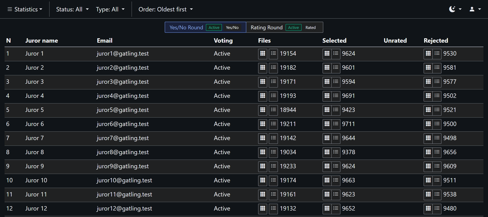

# Following the voting

## Where to start

After you sign in, the tool opens the **Statistics** of a round of your contest: the latest
open round, or the latest round if none is open. A contest with no round yet shows **No round
configured yet**.

- The row of round names above the statistics table switches round. An icon before each name shows
  its type: a tick and a cross for **Yes/No**, a star for **Rated** (none for a comments-only
  round), in colour for a started round and in grey for a stopped one, whose name is grey too;
  point at the icon for its type and state. With many rounds, the **Status** (**All**, **Active**, **Not active**), **Type**
  (**All**, **Yes/No**, **Rated**) and **Order** (**Oldest first**, **Newest first**, **Active
  first**) menus in the top bar narrow and order this row; each item shows in grey how many rounds
  it would list. A choice that leaves out the round you are looking at opens the first round it
  lists, in the chosen order (the oldest, the newest or the first active), so a choice that lists
  only one round opens it; a choice that keeps the round stays on it. If no round matches, the
  page stays on the round and says so, with a link to all rounds. **Statistics** in the pages menu,
  with choices made on the **Rounds** page, opens the round it would open otherwise if the
  choices keep it, else the first round they list, else the round itself, which says none match.
  A round opened from a saved or shared link whose choices leave it out still shows in the row,
  selected, with a dashed outline: point at it for **Not in the chosen filter**. The choices stay
  in the page's address and when you switch round. The round menu of the galleries shows the same icons and grey names, without these menus, and groups the rounds by track as the row does, each track's name as a heading.
- When the contest's rounds are on two tracks or more, each round belongs to a **track**, the line
  of rounds it is on: for example Quality, Quantity, **Main** (the main competition; in a contest
  without one, the track of the first round when it is named after that round, such as "Round 1"),
  a region or a special nomination. The row groups the rounds by track, each track's name once
  before its rounds (point at a round to see its track); **Group by track** at the end of the
  **Order** menu turns that off and on. The **Track** menu next to **Status** and **Type** narrows
  the row to one track's rounds. A round alone on a track named after it gets no group label and no
  item in the menu, as it would only repeat its name; the groups and the menu show only when two
  tracks or more remain besides those, so a contest whose rounds were each created on their own has
  neither. The tool finds each round's track and only admins can change it; see
  [Tracks](tracks.md#a-tracks).
- The pages menu at the start of the top bar (its button the menu icon and the page you are on,
  **Statistics** here) opens the other pages: **Contest files** opens the contest's files, and
  **Statistics**, on every page of the contest, the statistics of the round you are looking at,
  or else of the latest open round (once the contest has a round).
- On a page whose bar has no filters, order or pages (a round's conflicts page) these pages
  are links in the top bar instead, the page you are on highlighted, from a window 1280 pixels
  wide. The statistics, the galleries and the contest files have filters, so their pages are in
  the pages menu.
- The contest menu at the top of the page switches contest, if you are in more than one.

There is no **Rounds** or **Users** menu for you: those are the admins'. The admins create the
rounds, give their files to the jurors, start them and stop them; a round being prepared is
hidden from the jurors until all its files are given.

## Statistics

**Statistics** shows a row for each juror of the round: **N**, **Juror name**, **Email**, the
juror's **Voting** state, the number of **Files** the juror has, and the juror's votes: for a
yes/no round **Selected**, **Unrated** and **Rejected**, for a rated round **Rated** and
**Unrated**. The icons next to the counts open the juror's gallery or file list, or only their
selected, unrated or rejected files.

The **Voting** column shows **Active**, or **Paused** when the admins have paused the juror's
voting in this round: the round is then hidden from that juror, and their votes are kept. Admins
see pause and resume buttons in this column instead, see [Pausing a
juror](round-jurors.md#a-pause-juror), can [add a juror](round-jurors.md#a-add-juror) to a
running or a stopped round, and can [reassign a juror's unrated files](round-jurors.md#a-reassign-juror) to the
other jurors. While a juror is being added or their files reassigned the round pauses for its
jurors for a few seconds; you still see its files.

The last row, **Total**, sums up all the jurors, with links to the results of all jurors, see
[Results](results.md). In a yes/no round a file with votes of two kinds is counted in each, so the
columns of the totals can add up to more than the files.

Under the table:

- in a round where each file goes to a set number of jurors, **N files are waiting for a juror**
  when some files have fewer jurors than that (after an admin reassigned a juror's files and no
  other ticked juror could take some of them), shown while the round is running; an admin gives
  them out with the round form's **Also give out the N files waiting for a juror**, and adding a
  juror gives them to the new juror first;
- for a rated round, the round's **File score** rule, see [The score](scoring.md#o-score);
- **Comments on the round's files N**, the [comments report](comments.md#o-comments-report): N is the
  number of comments written in this round on its files. When the round's files also have
  comments from other rounds of the contest, **all rounds M** follows with all of them, and
  opens the report with **All rounds of the contest**;
- for a round whose images wait for review before distribution, the link **Review images**: the
  round's files as they will go to the jurors, by status (in the round, deleted on Commons,
  disqualified), read only; an admin distributes them,
- the link **Conflicts of interest of this round**, see [The conflicts page](conflicts.md#o-conflicts-page),
  with the number of the round's files that are conflicts of interest now and of its
  disqualified files, for example "3 files · 2 disqualified". With neither it says "none",
  and while the round has a history of disqualified and requalified files, "none · history N"
  (500+ when it has more than the 500 latest events the page lists);
- the link **Authors of this round**, see [The authors list](monuments-authors.md#o-authors-list), with the number of
  authors the list shows and of the files without a stored author, for example "148 · 12 files
  without an author". "None stored" can mean that the files were imported without their
  authors; the link then still opens the list while some files have no author, for example
  "none stored · 12 files without an author";
- **Deleted on Commons**, when some of the round's files were deleted on Commons: the number
  links to these files.

A link whose number is 0 is plain text. The numbers of the conflicts and authors links appear
a moment after the page; until then, the links work without them.

## Changes to a round

At the bottom of a round's statistics, two lists say who changed the round and when, newest
first, each with the time in UTC. A list shows only when it has entries, and each shows the latest
20.

**Changes to this round's settings:** every save of the round's settings, with who saved it:

- **Round 3 created by** a name: the settings the round was created with, those not left at their
  defaults (the rating type always);
- **Round 3 changed by** a name: a save of the round form, a start or stop on the rounds list, or
  the jurors per file on the round's jurors form;
- **Round 3: filters re-applied by** a name: **Re-apply filters** on a round held for
  [review](round-review.md#a-review);
- **Round 3: track label changed by** a name, see [Tracks](tracks.md#a-tracks).

Each entry lists the settings that changed, as "setting: old → new", for example "File score:
Average over the jurors who rated it → Total of the rates". The settings followed are the name, the
rating type, half stars, the criteria, the file score, the worst mark, the previous rounds and
their filters (selected by at least, rejected by at least and its mode, the top files, the order of
a yes/no round's top files and the minimum score), the categories and their combination, the
regions, the monument ids, the minimum size and resolution, the media type, the special
nomination, the rounds to leave out, leaving out conflicts of interest, the jurors per file,
whether the round is open to jurors, its state, and the track label. A save that changes nothing
adds no entry. The top files say how the cut was chosen, for example "(chosen from the candidate
cuts: scores drop 8.2 → 7.1)" or "(chosen from the list)", see [The top
files](round-files.md#a-top-files). A long value is shortened, ending in "…": point at it to read it
whole. Lists of files are never shown.

**Changed by a juror of this round:** the round stopped, started again, or closed by creating the
next round, by an account that is also one of this round's jurors (for example an admin who judges
it too), with that account's name. These are listed apart, so that a juror's own change to the
round they judge is easy to see.

Who sees the lists: the contest's organizers and admins, and root, as for the rest of the
statistics page; not someone who is a juror of the round while it is open, who sees only their own
votes there. A juror never sees them. Root also sees the contest's round changes in the change log
of the contest's **Series and status** page.

