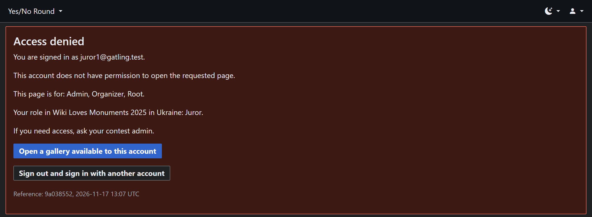

# Common problems

## "This page has expired or you were signed out"

You see this when you send a form or a vote from a page opened long ago, or after you were
signed out in another tab.

Go back, reload the page, and try again. If you were signed out, sign in first.

In the gallery, a vote that can't be saved shows a message saying why, for example **This page
has expired. Reload it and vote again.** or **This round is closed for voting.**

## "Access denied" and its reference

The **Access denied** page says which account you are signed in as, what the page is for, and
your role in the current contest. It ends with a line like **Reference: …**, with a time.

If you think you should have access:

1. Check that you are signed in with the right account. If not, press **Sign out and sign in
   with another account**.
2. If you are in several contests, check the contest menu: you may be in another contest.
3. Otherwise, send your contest admin the reference and the time, the address of the page you
   tried to open, and the email you signed in with.

If the page offers **Open a gallery available to this account**, it takes you back to your own
files.

## When you are signed out

By default, you are signed out after 30 days without using the tool, and a year after you
signed in at most. Without **Keep me signed in**, closing the browser signs you out.

When you open a page while signed out, the tool asks you to sign in and then takes you back
to that page. A vote from the gallery says **You have been signed out. Sign in again and
reload the page.** and opens the sign-in page.

## Other errors

**Something went wrong on our side.** comes with a reference. If it happens again, send that
reference to your contest admin.

**This file is no longer assigned to you. Reload the page.** means the contest admins changed
the round's files. Reload the page to see your current list.

**Too many sign-ins at once.** means many people are signing in at the same moment. Wait a few
seconds and try again.
